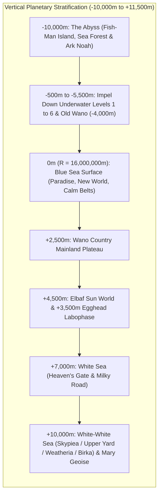

# Grand Line, Calm Belts, Sky Seas & Abyss: Complete One Piece Wiki Atlas

> [!IMPORTANT]
> **Sector Ownership:** `"THE MIDDLE JUMBO MESS"` — Grand Line (**Paradise** + **New World**), North & South **Calm Belts**, **Red Line Intersection Node B** (*Mary Geoise*, *Red Port*, *Sabaody*), **Sky Seas** (`+7,000m` *White Sea* & `+10,000m` *White-White Sea*), and **The Abyss** (`-10,000m` *Fish-Man Island* & *Impel Down* Sub-Levels).
> **Engine & Scale:** Godot 4.3+ (`precision=double`), `1 unit = 1.0 meter`, Player Height = `2.0m`, Planet Sea-Level Radius $R = 16,000,000.0\text{ m}$ (Circumference $\approx 100,531\text{ km}$).
> **Data Module:** [grand_line_data.gd](file:///Users/lin/Downloads/OnePieceBluePlanet/regions/grand_line_data.gd)

---

## 1. Planetary Geodesy, Vertical Layering & Economy

### 1.1. Great Circle Spatial Architecture
On the $R = 16,000,000.0\text{ m}$ sphere, the **Grand Line** forms a $600\text{ km}$-wide Great Circle ocean band tilted $-45^\circ$ relative to the planetary equator, bisected perpendicularly by the **Red Line** ($+45^\circ$ tilt, $250\text{ km}$ width, $+10,000\text{ m}$ elevation):
* **Paradise (`Lon 0°` to `180°`):** Extends from **Twin Cape** at the base of Reverse Mountain (`Lon 0°`, managed by `reverse_mountain_controller.gd`) to the **Sabaody Archipelago** (`Lon 178.5°`).
* **Red Line Intersection Node B (`Lat 0°, Lon 180°`):**
  * **`+10,000 m` Crest:** **Mary Geoise** (Capital of the World Government & Pangaea Castle).
  * **`0 m` Sea Level:** **Red Port** (Bondola bubble-cable elevators on both Paradise and New World faces) and **Sabaody Archipelago**.
  * **`-10,000 m` Abyssal Cavern:** **Fish-Man Island** (Ryugu Kingdom), housed inside a double-layered Yarukiman resin bubble illuminated by the roots of **Sunlight Tree Eve**.
* **New World (`Lon 180°` to `360°`):** Extends from the Fish-Man Island ascent (`Raijin` / `Risky Red` / `Mystoria` / `Punk Hazard`) across Emperor territories (`Dressrosa`, `Zou`, `Totto Land`, `Wano Country`, `Egghead`, `Elbaf`, `Hachinosu`) to **Lodestar Island** (`Lon 342°`) and **Laugh Tale** (`Lon 356°`).
* **The Calm Belts (`150 km` North & South Flanking Bands):** Wind velocity is locked to $0.0\text{ m/s}$. Entering without **Seastone Keel Plating** or **Kuja Yuda Snake** propulsion triggers colossal $500\text{ m}\text{–}2,000\text{ m}$ Sea Kings rising from $-2,000\text{ m}$ nesting grounds.

### 1.2. Multi-Currency Conversion Matrix
| Currency | Symbol | Exchange Rate to Beli | Canonical Region & Usage |
| :--- | :--- | :--- | :--- |
| **Beli (Berry)** | `฿` | $1\text{ Beli} = 1.0\text{ Beli}$ | Global World Government standard across Paradise, New World, and Fish-Man Island. |
| **Extol** | `E` | $10,000\text{ Extol} = 1.0\text{ Beli}$ | **Skypiea / White-White Sea** (e.g., Heaven's Gate entry toll is $1,000,000,000\text{ Extol} = 100,000\text{ Beli}$). |
| **Gor** | `G` | $1\text{ Gor} = 100.0\text{ Beli}$ | **Amazon Lily** tribal currency used by the Kuja warrior tribe inside the Calm Belt. |
| **Silver Ryo (Gin)** | `AgRyo` | $1\text{ Silver Ryo} = 500.0\text{ Beli}$ | **Wano Country** everyday street and food stall coinage. |
| **Gold Ryo (Kin)** | `AuRyo` | $1\text{ Gold Ryo} = 10,000.0\text{ Beli}$ | **Wano Country** high-value merchant and swordsmith bullion. |
| **Platinum Ryo (Hakkin)** | `PtRyo` | $1\text{ Platinum Ryo} = 500,000.0\text{ Beli}$ | **Wano Country** supreme coin tier (one coin can purchase an entire house). |

---

## 2. Paradise Atlas (`Lon 0°` to `180°`)

### 2.1. Whisky Peak (*Cactus Island*) — `Lat -2.4°, Lon 14.5°`
* **Log Pose Lock Time:** `< 1 Day` (~8 hours; resets overnight).
* **Geography & Lore:** An arid island dominated by colossal cactus-like rock formations. What appear to be cactus spines from afar are actually thousands of pirate tombstones erected by **Baroque Works** frontier bounty hunters (**Millions** and **Billions**) who lure newly arrived crews into drunken banquets before stripping their ships.
* **Marketplaces & Taverns:**
  * **Cactus Saloon & Banquet Hall:** Run by **Igaram (Mr. 8)** disguised as the hospitable mayor of Whisky Peak. Sells *Whisky Peak Cactus Tequila* (`800฿`), *Peak Barrel Aged Rum* (`500฿`), and *Baroque Works Bounty Ledgers* (`5,000฿`).
* **Canonical NPCs:**
  * **Igaram (Mr. 8):** Captain of the Alabasta Royal Guard infiltrating Baroque Works; saxophone-shotgun user who begs the player to escort Princess Vivi to Alabasta.
  * **Nefertari Vivi (Miss Wednesday) & Karoo:** Undercover Princess of Alabasta and her loyal Super Spot-Billed Duck mount.
  * **Miss Monday & Mr. 9:** Frontier Agents who sacrifice themselves to buy Vivi time to escape **Mr. 5** (Bomu Bomu no Mi) and **Miss Valentine** (Kilo Kilo no Mi).

### 2.2. Little Garden — `Lat -5.8°, Lon 28.0°`
* **Log Pose Lock Time:** **`1 Full Year` (365 Days / `31,536,000` seconds)** — forces players to acquire an **Eternal Pose to Alabasta** from **Mr. 3's Candle House** or **the Unluckies (Mr. 13 & Miss Friday)** to depart early.
* **Geography & Lore:** A prehistoric jungle island frozen in the age of dinosaurs where **Dorry the Blue Ogre** and **Brogy the Red Ogre** (co-captains of the Giant Warrior Pirates from Elbaf) have fought over `73,467` duels across 100 years whenever the central volcano erupts.
* **Establishments & Safehouses:**
  * **Mr. 3's Secret Candle House:** Hidden deep in the jungle; run by **Galdino (Mr. 3)** and **Marianne (Miss Goldenweek)**. Stocks *Dorudoru Candle Wax Armor Polish* (`4,500฿`), *Earl Grey Calming Paint Tea* (`1,200฿`), and the *Eternal Pose: Alabasta*.
* **Canonical NPCs & Hazards:**
  * **Dorry & Brogy:** Teach the joint Elbaf spear shockwave **Hakoku Sovereignty** needed to pierce the **Island Eater** (colossal sea-goldfish whose droppings were mistaken for islands) upon departure.
  * **Prehistoric Fauna:** Triceratops, Brontosaurs, Tyrannosaurs, and the venomous **Kestia** forest tick (whose bite inflicts the fatal 5-Day Prehistoric Fever, driving the emergency detour to **Drum Island**).

### 2.3. Drum Island (*Sakura Kingdom*) — `Lat 4.2°, Lon 41.0°`
* **Log Pose Lock Time:** `24 Hours`.
* **Settlements & Geography:** A sub-zero winter island ringed by the sheer $5,000\text{ m}$ cylindrical peaks of the **Drum Rockies**:
  1. **Bighorn:** Coastal port village defended by **Dalton** and the citizen militia.
  2. **Cocoa Weed:** Lakeside town housing the lower station of the **Ropeway** sky-cable up to Drum Castle.
  3. **Gyasta:** Cross-country skiing resort town.
  4. **Robelle:** Southern village where **Dr. Hiriluk** practiced and where **Portgas D. Ace** left a message for Luffy.
  5. **Drum Castle (`+5,000m` Peak):** Former royal castle of **Wapol**, now home to 141-year-old **Dr. Kureha**, **Tony Tony Chopper**, and the reunited **Isshi-100** medical corps.
* **Marketplaces & Clinics:**
  * **Dr. Kureha's Drum Castle Apothecary:** Sells the *Kestia 5-Day Antibiotic Cure* (`50,000฿`), *Rumble Ball Formula Notes* (`120,000฿`), *Hiriluk's Sakura Blossom Gunpowder* (`25,000฿`), and *Plum Wine Flasks* (`1,500฿`).
  * **Dalton's Bighorn Winter Outfitter:** Sells *Lapahn Fur Arctic Parkas* (`6,500฿`), *Ropeway Cable Passes* (`1,000฿`), and *Snow-Sled Ship Runners* (`35,000฿`).
* **Canonical NPCs & Fauna:** **Dr. Kureha** (first character in canon to mention `"Gol D. Roger"` and the **Will of D.**), **Dalton** (Ushi Ushi no Mi, Model: Bison), **Tony Tony Chopper**, **Negikuma Maria**, **Tamachibi**, **Lapahn** (carnivorous snow-rabbits that trigger avalanches), and the **Hiking Bear** (players must bow politely when passing).

### 2.4. Alabasta Kingdom (*Sandy Island*) — `Lat -8.5°, Lon 56.0°`
* **Log Pose Lock Time:** `3 Days`.
* **Towns & Cities:**
  1. **Nanohana:** Southeastern port famous for Nanohana Perfume, carpet bazaars, and the **Spice Bean Restaurant** (where Ace and Smoker clashed).
  2. **Erumalu (*The Green City*):** Desert ghost town ruined by Baroque Works' **Dance Powder** scheme.
  3. **Yuba:** Western oasis town where **Toto** digs relentlessly for water despite Crocodile's sandstorms.
  4. **Katorea:** Southern oasis town and relocated headquarters of **Koza's Rebel Army**.
  5. **Rainbase:** Casino city hosting **Sir Crocodile's** giant golden pyramid casino, **Rain Dinners** (guarded by giant **Bananawani** crocodiles and a Seastone VIP cage).
  6. **Alubarna:** Stepped-mesa capital city containing the Royal Palace, the Clock Tower, and the **Hidden Royal Tomb of the Kings** (`Historical Poneglyph` detailing the location of the Ancient Weapon **Pluton** in Wano).
  7. **Tamarisk:** Eastern port city where the Super Spot-Billed Duck Squadron rallies.
* **Marketplaces & Bars:**
  * **Spice Bean Restaurant (Nanohana):** Sells *Alabasta Spice Bean Curry* (`900฿`), *10L Desert Canteens* (`1,200฿`), and *Desert Sun-Robes* (`2,500฿`).
  * **Nanohana Perfume & Carpet Grand Bazaar:** Sells *Royal Nanohana Perfume Casks* (`8,500฿` — high-margin trade good), *Alubarna Silk Carpets* (`15,000฿`), and *Spot-Billed Duck Saddles* (`18,000฿`).
  * **Spiders Cafe (Desert Junction):** Run by **Zala (Paula / Miss Doublefinger)** as a bartender; serves *Prickly Pear Cocktails* (`1,100฿`) and Baroque Works rendezvous briefings.
  * **Rain Dinners Casino (Rainbase):** High-stakes gambling tables, VIP Seastone trap room, and Bananawani pit.
* **Canonical NPCs:** **King Nefertari Cobra**, **Princess Vivi**, **Igaram**, **Pell** (Falcon Zoan), **Chaka** (Jackal Zoan), **Koza**, **Toto**, **Terracotta** (Igaram's wife & palace head chef), **Kappa** (shoeshine boy who witnessed Mr. 2's impersonation of Cobra), **Eyelash** (chivalrous camel), **Hasami** (giant Moving Crab), and the **Kung-Fu Dugongs**.

### 2.5. Jaya (*Mock Town & Cricket's Cape*) — `Lat -3.1°, Lon 74.0°`
* **Log Pose Lock Time:** **`4 Days`** (or instant vertical lock upward toward **Skypiea** at `+10,000m`).
* **Settlements & Marketplaces:**
  * **Mock Town:** Lawless pirate town on western Jaya.
    * **Pub and Pies:** Run by bartender **Terry**; serves the iconic *Mock Town Cherry Pie* (`300฿`) and *Jaya Spiced Grog* (`450฿`) where **Marshall D. Teach (Blackbeard)** and Luffy famously disagreed on the pie and drink before Blackbeard declared *"People's dreams... never end!"*
    * **Tropical Hotel:** Managed by **Spector**; headquarters of **Bellamy the Hyena** and **Sarquiss**.
  * **Cricket's Cape (Eastern Headland):** Half-skull bay where the upper half of Jaya (**Upper Yard**) was blasted into the sky 400 years ago by the **Knock Up Stream**. Home to **Mont Blanc Cricket**, **Masira**, and **Shoujou** (*Saruyama Alliance*), who reinforce the player's ship with a cloud-riding bowsprit and keel.

### 2.6. Long Ring Long Land — `Lat 1.8°, Lon 92.0°`
* **Log Pose Lock Time:** `1 Day`.
* **Geography & Lore:** Ten ring-arranged steppe islands that appear separate all year until the annual 3-hour extreme low tide (caused by the **Aqua Laguna** drawdown toward Water 7) exposes the circular land bridge connecting them.
* **Establishments & NPCs:** **Tonjit's Nomadic Yurt** (*10-Year Aged Stilt-Cheese* `400฿`, *Bamboo Stilts* `1,200฿`), **Shelly** (elongated horse), **Foxy the Silver Fox**, **Porche**, and **Hamburg** (*Davy Back Fight* 3-coin crew wager mechanics), and wandering **Admiral Aokiji (Kuzan)** on his bicycle **Ao Chari**.

### 2.7. Water 7 & The Puffing Tom Sea Train Network — `Lat -4.6°, Lon 115.0°`
* **Log Pose Lock Time:** `7 Days` (`604,800` seconds).
* **Districts & Infrastructure:**
  1. **Blue Station & Shift Station:** Sea Train passenger terminal and outer lighthouse switch-yard run by **Kokoro**, her granddaughter **Chimney**, and her cat-rabbit **Gonbe**, guarded by the sumo-wrestling frog **Yokozuna**.
  2. **Back Street & Shopping Canals:** Home to **Blueno's Bar**, **Yagara Bull Rental**, and the **Gold-to-Beli Appraiser** (exchanges Skypiea gold relics for `300,000,000฿`).
  3. **Galley-La Company Shipyards (Docks 1–7):** Seven radial drydocks presided over by Mayor/President **Iceburg** (and his pet mouse **Tyrannosaurus**) and Dock 1 foremen **Paulie**, **Peepley Lulu**, and **Tilestone** (plus undercover CP9 agents **Rob Lucci**, **Kaku**, and **Kalifa**).
  4. **Scrap Island & Franky House:** Ship-dismantling yard run by **Franky (Cutty Flam)**, **Zambai**, and the **Square Sisters (Kiwi & Mozu)**.
* **The Puffing Tom & Rocketman Sea Train Route:**

| Station Order | Station / Island Name | Coordinates | Key Role, NPCs & Trade Goods |
| :--- | :--- | :--- | :--- |
| **Stop 1** | **Blue Station** (*Water 7*) | `Lat -4.6°, Lon 115.0°` | Central passenger & cargo terminal inside lower Water 7. |
| **Stop 2** | **Shift Station** (*Water 7 Reef*) | `Lat -4.8°, Lon 115.4°` | Track-switching lighthouse manned by **Kokoro**, **Chimney**, **Gonbe**, and **Yokozuna**; secret hangar of the brake-less prototype **Rocketman**. |
| **Stop 3** | **St. Poplar** (*Spring Queen Town*) | `Lat -5.2°, Lon 117.5°` | Bustling market town 1 hour from Water 7; exports timber and spring produce. |
| **Stop 4** | **San Faldo** (*Carnival Town*) | `Lat -5.8°, Lon 119.5°` | Festive island city that trades forged iron and carnival masks to Water 7. |
| **Stop 5** | **Pucci** (*Gourmet City*) | `Lat -6.4°, Lon 121.5°` | Wealthy culinary capital governed by **Mayor Bimine**; trades luxury ingredients. |
| **Stop 6** | **Dry Station** (*Enies Lobby*) | `Lat -7.2°, Lon 124.0°` | Judicial island terminal outside the Main Gate of **Enies Lobby** (`Never-Night Island`), leading to **Baskerville's Courthouse**, the **Tower of Justice**, the **Bridge of Hesitation**, and the **Gates of Justice** over the bottomless waterfall abyss. |

### 2.8. Florian Triangle & Thriller Bark — `Lat -2.0°, Lon 146.0°`
* **Geography & Mechanics:** A pitch-black fog belt where over 100 ships vanish annually. Drifting inside is **Thriller Bark**, an entire island from the West Blue converted into the world's largest pirate ship by **Gecko Moria**, **Dr. Hogback**, **Absalom**, and **Perona**.
* **Camps & NPCs:**
  * **Lola's Victim Association Camp:** Led by **Charlotte Lola** (captain of the Rolling Pirates), the **Risky Brothers**, and old **Spoil**. Sells *Purified Sea Salt Pouches* (`500฿` to exorcise zombies) and rewards players who defeat Moria before dawn with **Big Mom's Signed Vivre Card**.
  * **Brook & Shimotsuki Ryuma:** Players duel Zombie #470 (**Ryuma**, legendary Sword God of Wano) atop Hogback's roof to return Brook's shadow and earn the 21 O Wazamono Black Blade **Shusui**, then record *"Binks' Sake"* on a **Tone Dial** for **Laboon**.

### 2.9. Additional Canonical Paradise Islands
* **Banaro Island (`Lat 3.4°, Lon 104.0°`):** Western frontier town beneath giant Balancing Banana Rocks where **Portgas D. Ace** and **Blackbeard** fought the duel that triggered the Summit War.
* **Karakuri Island / Future Country Baldimore (`Lat 7.8°, Lon 135.0°`):** Sub-zero cyborg winter island and birthplace of **Dr. Vegapunk**. Home to **Kitton**, his grandfather, and the cyborg bulldog **Taroimo**; houses Vegapunk's 1st and 2nd laboratories containing **Wapometal**, **Gaon Cannon**, and **Radical Beam** blueprints.
* **Kuraigana Island (`Lat -6.5°, Lon 152.0°`):** Foggy Gothic ruins of the **Shikkearu Kingdom**, home to **Dracule Mihawk**, **Perona**, and sword-mimicking **Humandrills**.
* **Momoiro Island / Kamabakka Queendom (`Lat 5.5°, Lon 158.0°`):** Pink heart-shaped island ruled by **Queen Emporio Ivankov**, **Inazuma**, and **Caroline**; teaches **Sky Walk (Geppo)** and the **99 Vital Recipes of Attack Cuisine**.
* **Boin Archipelago (`Lat -5.0°, Lon 162.0°`):** Carnivorous floating flower-island (**Stomach Baron**) containing the **Forest of Gluttony**, where **Heracles'n** teaches **Pop Green** botanical artillery.

### 2.10. Sabaody Archipelago (Groves 1–79) — `Lat 0.0°, Lon 178.5°`
Sabaody is not a magnetic island (it has no Log Pose signature of its own) but a cluster of **79 giant Yarukiman Mangrove trees** growing from the ocean floor beside the Red Line.

| Grove Range | District Classification | Key Canonical Groves, Establishments & NPCs |
| :--- | :--- | :--- |
| **Groves 1–29** | **Lawless Zone** (*Unpoliced Pirate & Bounty Hunter Sector*) | • **Grove 1:** Former **Human Auctioning House** (run by **Disco**, shattered by **Silvers Rayleigh**, **Luffy**, **Law**, and **Kid**). • **Grove 12:** Restaurant street where **Jewelry Bonney** and **Capone Bege** dined. • **Grove 13:** **Shakky's Rip-Off Bar** (100 steps from the base), run by former Kuja Empress **Shakuyaku (Shakky)** and **Silvers Rayleigh**. • **Grove 17:** Hidden anchorage and 2-year reunion rally point. • **Grove 21 & 24:** Supernova battlegrounds against **Admiral Kizaru**, **Sentomaru**, and **Pacifistas**. • **Grove 27:** Tavern where **Demaro Black** (Fake Luffy) recruited. |
| **Groves 30–39** | **Sabaody Park** (*Amusement Park & Concert Dome*) | • **Grove 32:** Bubble Ferris Wheel & Rollercoaster (where **Hatchan**, **Camie**, and **Pappag** take the crew). • **Grove 33:** **Sabaody Dome** (venue of **Soul King Brook's** final world-tour concert). |
| **Groves 40–49** | **Tourist & Souvenir Area** (*Shopping & Bon Chari Rentals*) | • **Grove 41:** Main souvenir boulevard selling *Floating Bubble Bags* (`200฿`) and *Bon Chari Bubble Bikes* (`500฿` rental / `10,000฿` purchase). • **Grove 42:** Coastal departure pier where the coated **Thousand Sunny** dives for Fish-Man Island. • **Grove 44:** Nearest pier to **Duval's Rosy Life Riders** flying-fish base (`4 km` offshore). • **Grove 46:** Fake Straw Hat rally grove crushed by Sentomaru's Pacifista squad. |
| **Groves 50–59** | **Shipyard & Coating District** | • **Grove 53:** Master Coating Drydocks where **Silvers Rayleigh** coats ships in **Yarukiman Mangrove Resin** (`3 days` completion time) to withstand $-10,000\text{ m}$ water pressure. |
| **Groves 60–69** | **Marine Base Garrison** | • **Grove 66:** Sabaody Marine Headquarters Annex monitoring Red Line approaches. |
| **Groves 70–79** | **Hotel Town** | • **Grove 74:** Peaceful resort hotels and inns where Weatheria scholars and merchants stay. |

---

## 3. The Sky Seas (`+7,000m` White Sea & `+10,000m` White-White Sea)

### 3.1. Skypiea (*Heaven's Gate, Angel Island & Upper Yard*) — `Lat -3.1°, Lon 74.2°, Alt +10,000m`
* **Entry & Currency:** Accessed via the **Knock Up Stream** (to `+7,000m` **Heaven's Gate**, guarded by **Amazon**, who charges $1,000,000,000\text{ Extol}$ per person to ride the **Speedy Shrimp Express** up the **Milky Road** to `+10,000m`) or the **High West** summit route.
* **Settlements & Marketplaces:**
  1. **Angel Beach & Lovely Street (Angel Island):** Island Cloud city patrolled by **McKinley's White Berets**.
     * **Lovely Street Dial Bazaar:** Sells *Impact Dials* (`50,000,000 E`), *Breath Dials* (`15,000,000 E`), *Flame Dials* (`20,000,000 E`), *Milky Dials* (`30,000,000 E`), *Tone Dials* (`10,000,000 E`), extinct *Jet Dials* (`500,000,000 E`), and forbidden *Reject Dials* (`1,000,000,000 E`).
     * **Conis & Pagaya's Pumpkin Cafe:** Serves *Sky Pumpkin Juice* (`2,000,000 E`), *Grilled Sky-Shark* (`4,500,000 E`), and *Octopus Balloons* (`80,000,000 E` for safe Blue Sea descent).
  2. **Shandia Village:** Cloud settlement of the exiled Shandians led by **Wyper**, **Laki**, **Kamakiri**, **Braham**, **Genbo**, and Mantra prodigy **Aisa**.
  3. **Upper Yard & Shandora Ruins:** Sacred soil (**Vearth**) blasted from Jaya 400 years ago, pierced by the giant beanstalk **Giant Jack** (`+11,500m`). Houses the **Shandorian Golden Bell Belfry** and the **Poseidon Historical Poneglyph** (with **Gol D. Roger's** message carved alongside it in Ancient Script by Kozuki Oden), guarded by **Gan Fall**, his Pegasus-bird **Pierre**, and the 400-year-old giant python **Nola**.

### 3.2. Weatheria & Birka / Ballon Terminal (`Alt +10,000m`)
* **Weatheria (`Lat 6.0°, Lon 148.0°`):** Drifting meteorological sky island where **Haredas** and the wizard-elders craft **Three-Knot Wind Ropes** (`15,000฿`), **Weather Balls** (`45,000฿`), and **Sorcery Clima-Tact** upgrades.
* **Birka Remnants & Ballon Terminal (`Lat -4.5°, Lon 168.0°`):** Ruined sky archipelago where lost Blue Sea helium balloons gather; home to **Urouge ('Mad Monk')** and site of Kaido's $10,000\text{ m}$ sky jump.

---

## 4. The Calm Belts, Red Line Node B & The Abyss (`-10,000m`)

### 4.1. Amazon Lily & Rusukaina (*South Calm Belt*)
* **Amazon Lily (`Lat -12.5°, Lon 156.0°`):** Jungle ring surrounding the **Nine Snakes Castle**, ruled by **Pirate Empress Boa Hancock** and her sisters **Boa Sandersonia** and **Boa Marigold**, advised by **Elder Nyon (Gloriosa)**. Uses **Gor** coinage; the **Kuja Snake-Bow Foundry** (*Marguerite*, *Sweet Pea*, *Aphelandra*, *Belladonna*, *Kikyo*) crafts *Busoshoku Haki Arrows* (`250 Gor`) and *Yuda Fierce-Snake Paddlewheel Harnesses* (`5,000 Gor`).
* **Rusukaina (`Lat -11.8°, Lon 154.5°`):** Uninhabited Calm Belt island with **48 distinct seasons per year** (shifting weekly) and 500+ apex monsters surrounding a single **Safe Zone Rock**, where **Silvers Rayleigh** trains the player in all three forms of Haki.

### 4.2. Impel Down (*The Underwater Great Prison*) — `Lat -9.5°, Lon 164.0°, Alt 0m to -5,500m`
Built of Seastone directly on the floor of the Calm Belt and linked to Marineford and Enies Lobby via the **Tarai Current** whirlpool:
* **Level 1 (`-500m`): Crimson Hell** — Forest of razor-sharp blade trees (*Kenshinju*) and needle grass (*Haribarisou*).
* **Level 2 (`-1,500m`): Wild Beast Hell** — Patrolled by the **Basilisk**, **Manticores**, **Puzzle Scorpions**, and the giant human-faced lion **Sphinx**.
* **Level 3 (`-2,500m`): Starvation Hell** — Scorching desert floor heated by the cauldron below (`50,000,000฿+` bounties).
* **Level 4 (`-3,500m`): Blazing Hell** — Boiling blood pool and **Warden Magellan's** office, guarded by **Hannyabal**, **Sadie**, **Saldeath**, **Domino**, and the four Awakened Zoan **Jailer Beasts** (*Minotaurus*, *Minorhinoceros*, *Minokoala*, *Minozebra*).
* **Level 5 (`-4,500m`): Freezing Hell** — Sub-zero blizzard forest patrolled by **Army Wolves** (`100,000,000฿+` bounties).
* **Level 5.5 (`-4,750m`): Newkama Land** — Secret paradise carved inside the rock wall between Levels 5 and 6 by a former user of the *Mori Mori / Oshi Oshi no Mi*; presided over by **Emporio Ivankov** and later **Bentham (Mr. 2 Bon Clay)** (*Healing & Tension Hormones*).
* **Level 6 (`-5,500m`): Eternal Hell** — Abyssal Seastone vault for erased legends (**Portgas D. Ace**, **Jinbe**, **Sir Crocodile**, **Shiryu of the Rain**).

### 4.3. Mary Geoise & Red Port (`Lat 0.0°, Lon 180.0°, Alt +10,000m`)
* **Red Port (`0m` Sea Level):** Twin fortified harbors at the base of the Red Line operating giant bubble-powered **Bondola** cable elevators up to $+10,000\text{ m}$. Legal travellers must abandon their ship at Red Port and buy a new vessel on the opposite side.
* **Mary Geoise (`+10,000m`):** Features the **Travelator** moving walkways, the **Domain of the Gods**, and **Pangaea Castle** (*Socializing Plaza*, *Room of Authority*, *Room of Flowers*, the **Empty Throne**, and the frozen subterrane vault housing a giant Straw Hat).

### 4.4. Fish-Man Island (*Ryugu Kingdom*) — `Lat 0.0°, Lon 180.0°, Alt -10,000m`
Located $10,000\text{ m}$ directly beneath Mary Geoise inside a submarine cavern through the Red Line, illuminated by the roots of **Sunlight Tree Eve**:
* **Districts & Landmarks:**
  1. **Coral Hill:** Commercial port housing the **Mermaid Cafe** (owned by fortune-teller **Madam Shyarly**, staffed by **Camie** and **Ishilly**; serves *Wakame Kelp Brulee* `1,200฿` and gifts the **New World Triple-Needle Log Pose**).
  2. **Mermaid Cove:** Lagoon where mermaids and **Princess Shirahoshi** (when escorted inside Megalo) visit.
  3. **Gyoverly Hills:** Celebrity district housing **Pappag's Mansion** and the **Criminal Brand Flagship Store** (*Criminal Star Hoodies* `25,000฿`, *Coral Bubble Rings* `15,000฿`).
  4. **Ryugu Palace:** Upper coral castle ruled by **King Neptune**, Princes **Fukaboshi**, **Ryuboshi**, and **Manboshi**, and the **Ministers of the Left and Right**.
  5. **Fish-Man District & Ark Noah:** Sunken hull of the colossal ship of promise **Noah** just outside the main bubble.
  6. **Sea Forest:** Ship graveyard on the ocean floor where **Den** (younger brother of Tom) recoats ships and where **Joy Boy's Apology Poneglyph** sits beside **Queen Otohime's** grave.

---

## 5. The New World (`Lon 180°` to `360°`) & The 4 Road Poneglyphs

### 5.1. Initial Triple-Needle Candidates & Punk Hazard
Upon ascending the **White Strom** from Fish-Man Island into the New World, the **Triple-Needle Log Pose** points to three magnetic candidates while an unmapped distress call leads to a fourth:
1. **Raijin Island (`Lat 4.5°, Lon 191.0°` — Risk Rating 5 / Violent Needle Jitter):** Perpetual storm where lightning bolts fall like rain. An **Old Umbrella Woman** rows out in a wooden boat asking, *"Care to buy an umbrella?"* (*Raijin Lightning-Rod Umbrella* `20,000฿`).
2. **Risky Red Island (`Lat -1.5°, Lon 192.0°` — Risk Rating 4):** Scorched volcanic badlands.
3. **Mystoria Island (`Lat -5.2°, Lon 190.5°` — Risk Rating 3):** Calmest needle of the initial trio.
4. **Punk Hazard (`Lat 2.1°, Lon 198.0°` — Unmapped Anomaly):** Half-magma inferno (**Burning Lands**) and half-frozen blizzard (**Ice Lands**) split by a **Central Lake** created by the 10-day duel between **Akainu** and **Aokiji**. Houses **Caesar Clown's Research Facility (Buildings A, B, C, D, R)**, the **Biscuit Room**, and the **SAD Production Tank**. Key NPCs: **Trafalgar Law**, **Kin'emon**, **Kozuki Momonosuke**, **Smoker**, **Tashigi**, **Brownbeard**, **Caesar Clown**, and **Monet**.

### 5.2. Dressrosa & Green Bit — `Lat -3.8°, Lon 212.0°`
* **Towns & Landmarks:**
  1. **Acacia & Corrida Colosseum:** Port city with the **Acacia Tapas & Fairy Wine Bistro** (*Seafood Paella* `1,800฿`, *Fighting Fish Steak* `2,400฿`) and the **Corrida Colosseum** announced by **Gatz**.
  2. **Sebio, Carta & Primula:** Coastal towns ringed by rocky spires.
  3. **Flower Hill & King's Plateau:** Sunflower hill hiding the **Thunder Soldier (Kyros)** and **King Riku Doldo III's** resistance, overlooking the Royal Palace, **Toy House**, and subterranean **Underground Trade Port**.
  4. **Green Bit & Tontatta Kingdom:** Connected to Dressrosa by a 200-year-old **Iron Bridge** over **Fighting Fish** waters; home to the subterranean **Tontatta Dwarves** (**Gancho**, **Leo**, **Kabu**, **Bian**, **Wicca**, **Princess Mansherry**) who trade *Tontatta Super-Growth Fertilizer* (`20,000฿`).
* **The Straw Hat Grand Fleet (`5,640` Members):** Formed off the eastern coast of Dressrosa by the 7 division captains: **Cavendish** (1st), **Bartolomeo** (2nd), **Sai** (3rd, Happo Navy), **Ideo** (4th), **Leo** (5th, Tontatta Corps), **Hajrudin** (6th, New Giant Warrior Pirates), and **Orlumbus** (7th, Yonta Maria Grand Fleet).

### 5.3. Zou (*Mokomo Dukedom atop Zunesha*) — `Dynamic Orbit around Lat 4.0°, Lon 228.0°, Alt +20,000m`
* **Navigation & Geography:** Located on the back of the $20,000\text{ m}$-tall walking Naitamie-Norida elephant **Zunesha** (requires a **Mink Vivre Card**; tracked in code via `GrandLineData.get_zunesha_orbital_state()`). Irrigated twice daily by **Rain-ruption** ocean water sprayed from Zunesha's trunk.
* **Districts & NPCs:**
  * **Right Belly Fortress & Kurau City (Claw City):** Governed from `6:00 AM` to `6:00 PM` by **Duke Inuarashi (Dogstorm)** and the **Three Musketeers** (*Sicilian*, *Concelot*, *Giovanni*), alongside **Wanda**, **Carrot**, **Dr. Miyagi**, and **Tristan** (*Electro-Conductive Mink Gauntlets* `65,000฿`, *Whale Tree Sap* `18,000฿`).
  * **Guardians' Forest & Whale Forest:** Governed from `6:00 PM` to `6:00 AM` by **Master Nekomamushi (Cat Viper)** and **Pedro**.
  * **Whale Tree Secret Chamber (`ROAD PONEGLYPH #1`):** Deep inside the whale-shaped giant tree where **Raizo of the Mist** was kept safe, housing the first crimson **Road Poneglyph**.

### 5.4. Totto Land Archipelago (Whole Cake Island + All 34 Subsidiary Food Islands) — `Lat -7.5°, Lon 246.0°`
Ruled from **Whole Cake Chateau** in **Sweet City** by **Charlotte Linlin (Big Mom)** and Executive Chef **Streusen**, where **Road Poneglyph #2** is kept inside the **Chateau Treasure Room**. All 35 canonical islands of Totto Land are cataloged below:

| # | Island Name | Canonical Town / Capital | Food / Ingredient Theme | Governing Minister (Charlotte Family) |
| :--- | :--- | :--- | :--- | :--- |
| **0** | **Whole Cake Island** | **Sweet City & Whole Cake Chateau** | Wedding Cake (*Capital*) | **Queen Charlotte Linlin (Big Mom)** & **Streusen** |
| **1** | **Cacao Island** | *Chocolat Town* (**Caramel Cafe**) | Chocolate | **Charlotte Lola** (*Formerly*) / **Charlotte Pudding** |
| **2** | **Jam Island** | *Swirly Town* | Fruit Jam | **Charlotte Dacquoise** (*Minister of Jam*) |
| **3** | **Biscuits Island** | *Biscuits Town* | Biscuits | **Charlotte Cracker** (*Minister of Biscuits / Sweet Commander*) |
| **4** | **Nuts Island** | *Peanuts Town* | Nuts | **Charlotte Amande** (*Minister of Nuts*) |
| **5** | **Cheese Island** | *Cheddar Town* | Cheese | **Charlotte Mont-d'Or** (*Minister of Cheese*) |
| **6** | **Candy Island** | *Pero Town* | Hard Candy | **Charlotte Perospero** (*Minister of Candy*) |
| **7** | **Komugi Island** | *Hakuriki Town* | Wheat Flour | **Charlotte Katakuri** (*Minister of Flour / Sweet Commander*) |
| **8** | **100% Island** | *Mix Town* | Fresh Juice | **Charlotte Smoothie** (*Minister of Juice / Sweet Commander*) |
| **9** | **Poripori Island** | *Edamame Town* | Beans | **Charlotte Daifuku** (*Minister of Beans*) |
| **10** | **Yakigashi Island** | *Kongari Town* | Browned / Baked Sweets | **Charlotte Oven** (*Minister of Browned Food*) |
| **11** | **Fruits Island** | *Cantaloupe Town* | Fresh Fruits | **Charlotte Compote** (*Minister of Fruits*) |
| **12** | **Potato Island** | *Chips Town* | Potato Fries | **Charlotte Snack** (*Minister of Fries*) |
| **13** | **Noko Island** | *Nama Town* | Whipped Cream | **Charlotte Opera** (*Minister of Whipped Cream*) |
| **14** | **Margarine Island** | *Butter Town* | Butter & Margarine | **Charlotte Galette** (*Minister of Butter*) |
| **15** | **Ice Island** | *Sherbet Town* | Gelato & Ice Cream | **Charlotte Moscato** (*Minister of Gelato*) |
| **16** | **Piepie Island** | *Pie Town* | Pies & Tarts | **Charlotte Compo** (*Minister of Pie*) |
| **17** | **Loving Island** | *Love Town* | Cornstarch / Love | **Charlotte Cornstarch** (*Minister of Love*) |
| **18** | **Kibo Island** | *Eclair Town* | Yeast | **Charlotte Basskarte** (*Minister of Yeast*) |
| **19** | **Futoru Island** | *Fat Town* | Suet & Tallow | **Charlotte Dosmarche** (*Minister of Suet*) |
| **20** | **Liqueur Island** | *Chuhai Town* | Alcohol & Liqueur | **Charlotte Zuccotto** (*Minister of Alcohol*) |
| **21** | **Pakupaku Island** | *Gatsugatsu Town* | Meat | **Charlotte Nougat** (*Minister of Meat*) |
| **22** | **Funwari Island** | *Shittori Town* | Chiffon Cake | **Charlotte Chiffon** (*Formerly, Minister of Chiffon*) |
| **23** | **Tanega Island** | *Mehari Town* | Seeds | **Charlotte Kato** (*Minister of Seeds*) |
| **24** | **Rokumitsu Island** | *Anmitsu Town* | Agar & Syrup | **Charlotte Montb** (*Minister of Agar*) |
| **25** | **Sanshoku Island** | *Sundae Town* | Parfait | **Charlotte Broyé** (*Minister of Parfait*) |
| **26** | **Torigara Island** | *Dashi Town* | Broth & Essence | **Charlotte Mascarpone & Joscarpone** |
| **27** | **Milenge Island** | *Meringue Town* | Meringue | **Charlotte Mobile** (*Minister of Meringue*) |
| **28** | **Crunchy Island** | *Gratin Town* | Gratin | **Charlotte Myukuru** (*Minister of Gratin*) |
| **29** | **Topping Island** | *Decoration Town* | Cake Toppings | **Charlotte High-Fat** (*Minister of Topping*) |
| **30** | **Mini Island** | *Petite Town* | Bite-Sized Sweets | **Charlotte Tablet** (*Minister of Bite-Sized*) |
| **31** | **Hoya Island** | *Simmer Town* | Simmered Dishes | **Charlotte Saint-Marc** (*Minister of Simmering*) |
| **32** | **Milky Island** | *Miruku Town* | Fresh Milk | **Charlotte Custard** (*Minister of Milk*) |
| **33** | **Black Island** | *Kuro Town* | Dark Cocoa | **Charlotte Cabaletta** (*Minister of Cocoa*) |
| **34** | **Kinoko Island** | *Mushroom Town* | Mushrooms | **Charlotte Nusstorte** (*Minister of Mushrooms*) |

### 5.5. Wano Country & Onigashima — `Lat 6.8°, Lon 278.0°, Alt +2,500m (Old Wano: -4,000m)`
* **Geography & Entry:** An isolated island nation perched atop an elevated freshwater basin enclosed by sheer outer walls. Ships enter either by hooking onto giant **Koi Carp** swimming up the vertical waterfall into the summit whirlpool, or via the secret gondola elevator inside **Mogura Port** in Hakumai.
* **The 6 Mainland Regions + Onigashima + Sunken Old Wano:**
  1. **Flower Capital (*Hana no Miyako*):** Central perpetual-spring capital housing the **Shogun's Castle**, **Rasetsu District**, **Ebisu Town**, and **Sangoro's Soba Noodle Stall** (`1 Silver Ryo`).
  2. **Kuri:** Southern province containing **Kuri Beach**, **Amigasa Village** (**Tenguyama Hitetsu / Kozuki Sukiyaki's Sword & Seastone Forge** — crafts *Seastone Nails* `50 Silver Ryo` and services *Kitetsu / Enma* blades), **Okobore Town** (**O-Tsuru's Tea House**), **Bakura Town**, **Oden Castle Ruins**, and **Atamayama**.
  3. **Udon:** Rocky quarry and **Prisoner Excavation Mines** where **Hyogoro the Flower** teaches **Ryuo (Internal Destruction & Emission Armament Haki)**; includes **Tokage Port**.
  4. **Ringo:** Northern perpetual-blizzard cemetery guarded by **Kawamatsu** and **Onimaru** at **Bandit's Bridge**, where every samurai is buried with an eternal grave sword.
  5. **Hakumai:** Eastern autumn province governed historically by **Shimotsuki Yasuie**; houses **Habu Port** and **Mogura Port**.
  6. **Kibi:** Western wasteland connecting Kuri, Udon, and the Flower Capital.
  7. **Onigashima (*Skull Dome Island*):** Horned giant skull fortress off Kuri's coast.
  8. **Submerged Old Wano (`-4,000m` beneath Mount Fuji — `ROAD PONEGLYPH #3`):** Accessed via the secret staircase beneath the Flower Capital Castle's Kokeshi Doll basement; a glass-walled underwater corridor overlooks the sunken 800-year-old Wano metropolis, **Road Poneglyph #3**, and the sleeping **Ancient Weapon Pluton**.

### 5.6. Egghead Island (*Future Island*) — `Lat -5.4°, Lon 298.0°`
* **Layers & Establishments:**
  * **Fabriophase (`0m`):** Lower futuristic city heated by an island-wide air conditioner; houses **Vegapunk's Automated Food & Future-Wear Dispensers** (*DOM Anti-Gravity Hover Shoes* `120,000฿`, *Light-Pressure Gloves* `95,000฿`, *Mark III Bubble Shields* `75,000฿`, *60-Second Synthesized Burgers* `500฿`).
  * **Labophase (`+3,500m` Island Cloud):** Protected by the **Frontier Dome** laser grid and crowned by the giant Egg containing **Punk Records** (Vegapunk's shared brain).
* **Canonical NPCs:** **Dr. Vegapunk (Stella)**, his six satellites (**Shaka**, **Lilith**, **Edison**, **Pythagoras**, **Atlas**, **York**), **Sentomaru**, **Jewelry Bonney**, **Bartholomew Kuma**, and the 900-year-old Iron Giant **Emet** (who stores a physical knot of **Joy Boy's Conqueror's Haki**).

### 5.7. Elbaf / Elbaph (*Warland — Kingdom of Giants*) — `Lat 8.5°, Lon 318.0°`
* **The Three Worlds atop Treasure Tree Adam (Yggdrasil):**
  1. **The Underworld (`0m` Base Roots):** Frozen, beast-ridden root abyss where the accursed **Prince Loki** is chained with Seastone to the trunk of the world tree.
  2. **The Sun World (`+4,500m` Mid-Canopy):** Reached by sailing up a solid rainbow painted with a **Painter's Sun-Stone Prism** (`80,000฿`). Contains the **Western Village** (**Dorry**, **Brogy**, **Oimo**, **Kashii**, 408-year-old **Jarul**), **Aurust Castle**, the **Warrior's Spring**, the **Walrus School**, and **The Owl's Library** (where **Jaguar D. Saul** and the giant book-enlarging owl **Biblo** preserve all the historical books rescued from the lake of **Ohara**).
  3. **The Heaven World (`+9,500m` Upper Crown):** Highest celestial canopy of the giant world tree.
* **Road Poneglyph #4:** Linked to the **Man Marked by Flames** (who sails a pitch-black ship guarded by ocean whirlpools) and the **Owl's Library Archive**, completing the 4-way coordinate set.

### 5.8. Hachinosu, Sphinx, Karai Bari, Lodestar & Laugh Tale
* **Hachinosu / Fullalead (`Lat -9.2°, Lon 305.0°`):** Outlaw Pirate Island dominated by a giant beehive skull rock physically merged with **Avalo Pizarro** (*Shima Shima no Mi*), ruled by **Blackbeard** and raided by **Vice Admiral Garp** and **SWORD** (**Koby**, **Helmeppo**, **Prince Grus**, **Kujaku**, **Hibari**).
* **Sphinx (`Lat 3.2°, Lon 262.0°`):** Hidden waterfall village and homeland of **Edward Newgate (Whitebeard)**, where **Dr. Marco the Phoenix** runs a regenerative clinic beside the graves of Whitebeard and Ace.
* **Karai Bari Island (`Lat -2.2°, Lon 255.0°`):** Circus-fortress headquarters of **Cross Guild** (**Buggy the Star Clown**, **Dracule Mihawk**, and **Sir Crocodile**), issuing star-bounties on Marine officers.
* **Lodestar Island (`Lat 0.0°, Lon 342.0°`):** The final island reachable via Log Pose where all 7 Grand Line routes converge and the Log Pose needles spin endlessly in circles, revealing the necessity of the 4 Road Poneglyphs.
* **Laugh Tale (`Lat 0.0°, Lon 356.0°`):** Unmapped mythical island that materializes only when all 4 **Road Poneglyphs** (`Zou`, `Whole Cake Island`, `Wano`, `Elbaf`) are translated and intersected on the 3D globe; houses the **Rio Poneglyph** and the treasure left behind by **Joy Boy**.
