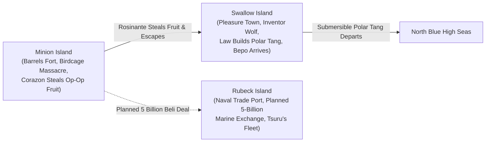
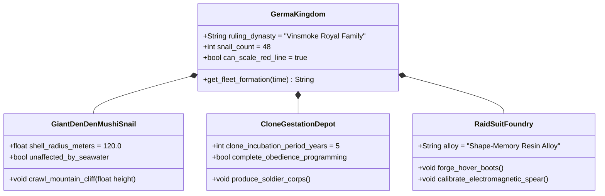

# One Piece Blue Planet: North Blue Wiki Atlas & Spatial Almanac

**Master Geographical Compendium, Settlement Registry, Faction Lore & Trade Directory**  
*Sector:* North Blue Quadrant ($\theta \in [+15.0^\circ, +75.0^\circ], \phi \in [-90.0^\circ, 0.0^\circ]$)  
*Planetary Baseline:* Seamless 3D Sphere, Radius $R = 16,000,000.0\text{ meters}$, Godot 4.3+ (`precision=double`)

---

## 1. Executive Summary & Planetary Geodesy

The **North Blue** is one of the Four Great Oceans (*Four Blues*) of the Blue Planet. In our 64-bit planetary coordinate framework, it occupies the north-western planetary quadrant:

* **Northern Polar Cap Boundary:** Extends up to $\theta = +75.0^\circ$ latitude, terminating in the permafrost fjords of Whiteland Kingdom and polar pack-ice.
* **Southern Boundary:** Bordered at $\theta \approx +15.0^\circ$ by the **North Calm Belt**—a 150-kilometer-wide band of absolute dead calm, devoid of atmospheric wind, infested by colossal, deep-sea Nesting Sea Kings ($500\text{m} - 2,000\text{m}$ length).
* **Eastern Boundary:** Blockaded by the colossal, sheer vertical red rock ramparts of the **Red Line** ($\phi \approx 0.0^\circ$, rising to $+10,000\text{ meters}$ above sea level), pierced only at the southwestern apex by the **Reverse Mountain North Blue Hydraulic Canal**.
* **Western Boundary:** Extends across open pelagic waters to $\phi = -90.0^\circ$.

```mermaid
flowchart TD
    subgraph NorthBlue["North Blue Sector (theta: +15° to +75°, phi: -90° to 0°)"]
        Whiteland["Whiteland Kingdom (Lat +68.4°, Polar Fjords)"]
        Kuen["Kuen Village (Lat +61.2°, Arid Mountains)"]
        Swallow["Swallow & Minion Islands (Lat +51° to +52°, Op-Op Incident)"]
        Rubeck["Rubeck Island (Lat +50.4°, Naval Trade Hub)"]
        Deul["Deul Kingdom (Lat +48.0°, Military Citadel)"]
        Flevance["Flevance Ruins (Lat +44.15°, Toxic White City)"]
        Micqueot["Micqueot (Lat +39.0°, Vineyards of Ithürzburger Stein)"]
        Notice["Notice (Lat +34.2°, Riviera of Bellamy & Sarquiss)"]
        Rakesh["Rakesh (Lat +32.5°, Fortified Sea-Gate)"]
        Lvneel["Lvneel Kingdom (Lat +28.5°, Noland's Homeland)"]
        Spider["Spider Miles (Lat +22.1°, Slag Basin & Donquixote Base)"]
        Downs["Downs (Lat +19.5°, Underworld Smuggler Grottoes)"]
        Germa["Germa Kingdom (Nomadic Snail Fleet Patrol)"]
        Canal["Reverse Mountain North Canal Mouth (Lat +2.25°, Lon -1.60°)"]
    end
    Germa -.->|Nomadic Patrol Circuit| Swallow
    Germa -.->|Climbs +10,000m Cliffs| RedLine["Red Line Summit"]
    Spider -->|Trade Routes| Canal
    Notice -->|Trade Routes| Canal
    Canal -->|Surges Up +5,000m| ReverseMountain["Reverse Mountain Summit Basin"]
```



Unlike the tranquil, starter-oriented waters of East Blue, North Blue is widely regarded as a harsh, cynical, and technologically ruthless ocean. It has given birth to legendary marine admirals (**Sakazuki**, **Borsalino**), fearsome pirates and supernovas (**Trafalgar D. Water Law**, **Basil Hawkins**, **X Drake**, **Benn Beckman**, **Avalo Pizarro**), notorious royal warmongers (**Vinsmoke Judge** and **Germa 66**), and the tragic, blood-stained histories of **Flevance** and **Mont Blanc Noland**.

---

## 2. Canonical Location Compendium

### 2.1. Lvneel Kingdom (ルブニール王国)
* **Planetary Coordinates:** $\theta = +28.50^\circ, \phi = -18.20^\circ, \text{Alt} = +12.0\text{m}$ (Surface Radius: $115\text{ km}$)
* **Biome & Climate:** Temperate Coastal Forests, rolling agricultural terraces, and royal glasshouses. Mild maritime climate with distinct floral springs.
* **Political Affiliation:** Sovereign Monarchy allied with the World Government; ruled by the House of Lvneel (successors of King Aruyutayan V).

#### Historical Lore & Background
Four hundred years ago (circa Sea Calendar 1120), Lvneel was the staging ground for one of the greatest maritime expeditions in human history. The royal explorer and master botanist **Mont Blanc Noland** set sail aboard the grand galleon *Northheim*. After defying the Calm Belt, Noland landed on the prehistoric island of **Jaya**, cured the native Shandia tribe of the fatal Tree Fever using Kona tree extract, and discovered the legendary **Golden City of Shandora**.

Upon returning to Lvneel, Noland reported his discovery to **King Aruyutayan V**. Blinded by imperial greed, the king marshaled a massive armada and forced Noland to lead him back to Jaya. However, one year prior to their arrival, the Knock Up Stream had blasted half of Jaya and the Golden City into the sky (creating Skypiea's Upper Yard). Finding only an empty jungle, King Aruyutayan V accused Noland of treasonous falsehoods. Noland was dragged back to Lvneel in irons and publicly beheaded on the central palace scaffold. To preserve royal prestige, the crown commissioned the infamous children's fable **"Noland the Liar"** (*Uso-tsuki Nōrando*), instilling generational shame upon the Mont Blanc bloodline and driving Noland's descendants (including **Mont Blanc Cricket**) into self-imposed exile.

#### Ports, Establishments & Marketplaces
* **Port Northheim (Grand Royal Harbor):** Deep-water stone wharves ($\text{depth} = 28\text{m}$) capable of berthing 50-gun royal galleons. Equipped with astronomical chart offices, drydocks, and naval customs inspection stations. Dock fee: $4,500\text{ ฿}$.
* **Lvneel Royal Botanical Exchange:** World-renowned botanical institute managed by Master Horticulturist Ross. Sells rare seed cultivars, disease treatments, and precision surveying instruments.
* **The Golden Bell Tavern & Archives:** A cozy waterfront inn operated by Old Cedric, housing prohibited historical logbooks and serving *Lvneel Spiced Amber Ale* ($450\text{ ฿}$).

#### Key NPCs
* **Cedric of the Northheim Archive:** Tavern keeper and underground historian. Offers the questline *The 400-Year-Old Logbook Fragment*, challenging players to recover Noland's missing astronomical charts.
* **Elena Ross:** Royal horticulturist and descendant of Noland's ship doctor. Sells *Lvneel Golden Pumpkin Seeds* ($25,000\text{ ฿}$) and *North Sea Brass Astrolabes* ($85,000\text{ ฿}$).

---

### 2.2. Flevance — The White City Ruins (フレバンス)
* **Planetary Coordinates:** $\theta = +44.15^\circ, \phi = -41.80^\circ, \text{Alt} = +45.0\text{m}$ (Surface Radius: $78\text{ km}$)
* **Biome & Climate:** Calcified mineral ruins, chalky limestone valleys, and toxic tailings dams. Chilly alpine mist heavily saturated with respirable Amber Lead dust.
* **Political Affiliation:** Extinct Kingdom / World Government Biohazard Exclusion Zone.

#### Historical Lore: The Amber Lead Tragedy
Flevance was once lauded as the most breathtaking fairytale nation in the Four Blues. Situated over vast subterranean seams of **Amber Lead** (*Kohaku Namari*), the kingdom's architecture, roads, trees, and soil glistened with an ethereal, alabaster white luster. Amber Lead was mined relentlessly to manufacture luxury consumer goods exported across the world: pristine white paints, porcelain tableware, cosmetics, sugar substitutes, textiles, and hardened rifle ammunition.

However, Amber Lead possessed a lethal secret: it was a bioaccumulative heavy toxin. Over a century prior to the current era, World Government geological surveyors discovered that continuous contact with Amber Lead micro-particles irreversibly poisoned human marrow and organs. Because the poison was transmitted across generations—causing each subsequent generation to be born with a drastically shorter lifespan—the World Government and the royal family of Flevance conspired to conceal the research data to reap colossal tax revenues and mineral profits.

Sixteen years ago, the accumulated toxicity reached its critical threshold. Entire generations fell ill simultaneously with **Amber Lead Syndrome**: excruciating bone pain, chalk-white dermal discoloration, hair loss, and respiratory collapse. Ignorant of the non-contagious nature of heavy-metal poisoning, neighboring kingdoms declared Flevance an infectious biohazard. When frantic citizens fled toward the borders seeking medical treatment, neighboring armies closed the borders with artillery, incinerated quarantine hospitals, and initiated a systematic purge. The royal family fled via World Government transport, leaving their subjects to die. A 10-year-old **Trafalgar D. Water Law** survived only by crawling beneath a wagon laden with the corpses of his family and neighbors.

#### Environmental Hazards & Exploration
* **Amber Lead Dust Inhalation:** Lingering in Flevance without an airtight *Military Charcoal Dust Mask* ($8,500\text{ ฿}$) inflicts severe toxicity, reducing player maximum HP by 2% per minute.
* **Automated Perimeter Sentry Batteries:** Abandoned World Government laser and autocannon emplacements still guard the harbor breakwater, requiring evasive piloting to land.

#### Establishments & Black Market
* **Hazmat Scavenger Den (Underground Crypt):** Run by the outlaw scavenger **Kroll the Masked**. Deals in smuggled *Raw Amber Lead Ore* ($45,000\text{ ฿}$ per chunk) and *Original Flevance Alabaster Lacquer* ($18,000\text{ ฿}$).
* **Ruins of Dr. Water's Clinic:** The shattered basement of Law's childhood home contains the *Water Family Medical Journal*, an essential blueprint for unlocking advanced toxic filtration in ship medical bays.

---

### 2.3. Spider Miles (スパイダーマイルズ)
* **Planetary Coordinates:** $\theta = +22.10^\circ, \phi = -53.90^\circ, \text{Alt} = +4.0\text{m}$ (Surface Radius: $62\text{ km}$)
* **Biome & Climate:** Industrial slag basin, scrap mountain labyrinths, iron forges, and oil-slicked canals. Hot, acrid smog with sulfurous fallout.
* **Political Affiliation:** Lawless Outlaw Port; former operational headquarters of the Donquixote Family.

#### Historical Lore & Background
A bleak industrial harbor dominated by colossal metal-waste incinerators and ship-dismantling yards. Sixteen years ago, following their escape from Mary Geoise and early wanderings, **Donquixote Doflamingo** and his top executives (**Trebol**, **Diamante**, **Pica**, **Vergo**, and **Corazon**) transformed Spider Miles into their sovereign criminal redoubt.

It was here that young Trafalgar Law, strapped with sticks of dynamite, approached Doflamingo demanding to join the crew, swearing vengeance upon the entire world. Here, Corazon tossed Law out of a second-story window, Senor Pink wore his dapper gentleman's suit before tragedy struck, and Baby 5 and Buffalo played amid mountains of twisted battleship plating.

#### Ports & Marketplaces
* **Spider Miles Slag Basin:** Heavy deep-draft industrial docks ($\text{depth} = 16\text{m}$). Dock fee: $1,500\text{ ฿}$. Features scrap salvage cranes, illegal foundry slips, and weapons exchanges.
* **Vulcan's Scrap & Heavy Ordinance:** Managed by **Iron-Jaw Briggs**. Sells *Scrapped Marine Hull Plating* ($75,000\text{ ฿}$, grants +15% ship armor defense), *Spider Miles Demolition Crates* ($32,000\text{ ฿}$), and *Lead-Lined Smuggling Lockers* ($48,000\text{ ฿}$).
* **The Flamingo's Perch Tavern:** A gritty saloon operated by Madam Roxie. Sells *Spider Miles 120-Proof Slag Moonshine* ($300\text{ ฿}$) and black-market *Old Donquixote Family Cache Maps* ($95,000\text{ ฿}$).

---

### 2.4. The Op-Op Fruit Incident Triangle
The frozen triangle of **Minion Island**, **Swallow Island**, and **Rubeck Island** is the crucible where the fate of Trafalgar Law, Donquixote Rosinante (Corazon), and X Drake was decided sixteen years ago.



#### A. Minion Island (ミニオン島)
* **Coordinates:** $\theta = +51.20^\circ, \phi = -60.50^\circ, \text{Alt} = +24.0\text{m}$ (Surface Radius: $45\text{ km}$)
* **Biome & Climate:** Subarctic pine taiga, blizzard-swept glacial ridges, and frozen fort ruins.
* **Lore:** The base where ex-Marine rear admiral **Diez Barrels** and his pirate crew guarded the **Ope Ope no Mi**, intending to sell it to the Marines for $5,000,000,000\text{ ฿}$. Corazon infiltrated the fort, took heavy fire, stole the fruit, and force-fed it to Law. Doflamingo arrived, deployed his catastrophic **Birdcage** (*Torikago*), executed Barrels, and shot his own brother Rosinante to death while Rosinante held his soundproofing barrier active until Law was safe. Young **Diez Drake** (X Drake) fled into the snow and was rescued by Vice Admiral Tsuru.
* **Exploration:** The clearing where Corazon hid Law in a munitions chest remains marked by a snow-covered wooden chest. Relic: *Severed Razor String Strand* ($55,000\text{ ฿}$).

#### B. Swallow Island (スワロー島)
* **Coordinates:** $\theta = +52.00^\circ, \phi = -62.10^\circ, \text{Alt} = +35.0\text{m}$ (Surface Radius: $58\text{ km}$)
* **Biome & Climate:** Alpine peaks arranged in the silhouette of a flying swallow, pine woods, and alpine geothermal streams.
* **Lore (*One Piece Novel: Law*):** After escaping Minion Island, Law collapsed on Swallow Island's shores. He was taken in by the eccentric genius inventor **Wolf** in **Pleasure Town**. Wolf had unearthed the legendary buried treasure of Swallow Island and used it to install streetlights, hot-water lines, and modern workshops. Law befriended **Bepo** (a young Mink who had washed ashore from Zou), as well as local bullies **Shachi** and **Penguin**. When Wolf's rogue pirate son **Artur Bacca** (user of the *Dero Dero no Mi*) attacked the town, Law defeated him using his newly awakened Op-Op powers. With Wolf's engineering genius, they constructed the yellow submersible **Polar Tang** and founded the **Heart Pirates**.
* **Key Establishments:** *Wolf's Geodesic Workshop & Submarine Drydock*. Sells *Polar Tang Pneumatic Ballast Blueprints* ($350,000\text{ ฿}$, allows ship diving to $-250\text{m}$) and *Rebreather Carbon Filter Units* ($42,000\text{ ฿}$).

#### C. Rubeck Island (ルベック島)
* **Coordinates:** $\theta = +50.40^\circ, \phi = -58.90^\circ, \text{Alt} = +15.0\text{m}$ (Surface Radius: $65\text{ km}$)
* **Biome & Climate:** Dense Victorian red-brick port city, fortified naval moles, and maritime insurance banks.
* **Lore:** The planned handover port where Barrels was meant to deliver the Ope Ope no Mi to Marine battleships under **Vice Admiral Tsuru**. Today it serves as the premier naval supply port in northern waters, hosting the *North Blue Bounty Hunter Guild*.
* **Marketplace:** Sells *Rubeck Long-Barrel Marksman Muskets* ($48,000\text{ ฿}$) and *Admiralty North Blue Ocean Chartbooks* ($25,000\text{ ฿}$).

---

### 2.5. Notice (ノーティス)
* **Planetary Coordinates:** $\theta = +34.20^\circ, \phi = -26.40^\circ, \text{Alt} = +8.0\text{m}$ (Surface Radius: $70\text{ km}$)
* **Biome & Climate:** Mediterranean palm promenades, marble promenades, and sheltered yacht marinas. Warm, sunny, and temperate.
* **Political Affiliation:** Wealthy Independent Mercantile Republic.

#### Historical Lore & Background
Notice is the most decadent and affluent metropolis in the southern waters of North Blue. It is the birthplace of **Bellamy "The Hyena"**, **Sarquiss "Big Knife"**, and the core crew of the Bellamy Pirates. Born into immense family wealth and pampered luxury, Bellamy and his companions grew thoroughly disgusted with the idle, consequence-free lives of bourgeois society.

Enamored by Donquixote Doflamingo's rising infamy, Bellamy embraced his idol's Darwinian "New Age" philosophy: that the era of romantic dreamers chasing the One Piece or the City of Gold was dead, and that true power lay only in cold material realism and brute violence. Bellamy took the Bellamy Pirates from Notice's marinas directly to Jaya to claim dominion over Mock Town.

#### Establishments & Shops
* **Notice Gold Coast Marina:** Luxury moorings with velvet-lined berths. Dock fee: $8,000\text{ ฿}$.
* **Bellamy & Sarquiss Tailoring Atelier:** Haute-couture boutique catering to swaggering pirate captains. Sells *Velvet Feathered Captain's Cloaks* ($85,000\text{ ฿}$) and *Gilded Sarquiss-Pattern Kukris* ($65,000\text{ ฿}$).
* **The Golden Maelstrom Casino:** High-roller roulette and dice parlors frequented by foreign nobility. Sells *Notice Grand Vintage 1515 Champagne* ($1,500\text{ ฿}$).

---

### 2.6. Germa Kingdom — The Mobile Snail-Ship Empire (ジェルマ王国)
* **Planetary Coordinates:** Nomadic Orbital Patrol across $\theta \in [+24.5^\circ, +53.0^\circ], \phi \in [-72.0^\circ, -22.0^\circ]$ (Cruising Speed: $18\text{ knots} \approx 9.26\text{ m/s}$)
* **Biome & Climate:** Cybernetic metal decks, electromagnetic induction towers, and giant bio-shell habitats.
* **Political Affiliation:** Sovereign Warmonger Empire ("The Kingdom of Science"), ruled by Supreme Commander **Vinsmoke Judge**.



#### Anatomical & Mechanical Architecture
Germa Kingdom is the only country in the world that possesses no fixed geological landmass. The nation's entire physical terrain is composed of **forty-eight monumental ocean-going snails** (a specialized colossal subspecies of *Den Den Mushi*), each bearing multi-story stone battlements, barracks, and research facilities on its shell:

1. **Modular Island Assembly:** When navigating in open waters, the snails can cruise in dispersed convoy divisions. Upon anchoring, the snails align side-by-side, deploying colossal hydraulic drawbridges and interlocking magnetic clamps to assemble into a contiguous floating city-island ($3.5\text{ km}$ across).
2. **Red Line Amphibious Scaling:** Unlike conventional ships that cannot traverse the continental barrier, Germa's giant snails possess muscular foot suction pads strong enough to scale the $10,000\text{-meter}$ vertical rock walls of the Red Line. This allows Germa 66 to invade any of the Four Blues without traversing Reverse Mountain or Mary Geoise.
3. **The Clone Army Infrastructure:** Beneath the main castle decks lie the classified bio-vats. Utilizing the **Bloodline Elements** (*Keitō no Inshi*) discovered by Judge and Vegapunk during their days in the illegal research syndicate **MADS**, Germa cultivates thousands of adult male soldiers from five-year embryo cycles. These clones are genetically stripped of fear, doubt, and self-preservation, programmed to act as biological human shields for the royal family upon the command *"Wall!"* (*Kabe!*).
4. **The Conquest of Four Nations:** Three hundred years ago, the Germa Empire ruled the entirety of North Blue for 66 days. To reclaim this legacy, Judge waged a blitzkrieg campaign known as the Conquest of Four Nations, beheading the kings of four North Blue states in a single afternoon. A colossal oil painting depicting the defeated monarchs hangs in the royal throne hall.

#### Onboard Establishments & Tech Sales
* **Germa 66 Science Directorate:** Sells *Germa Shape-Memory Resin Alloy* ($240,000\text{ ฿}$), *Germa Hover-Jet Float Soles* ($450,000\text{ ฿}$, grants mid-air hovering for 4s), and *Germa 66 Clone Nutrient Ampoules* ($12,000\text{ ฿}$, full stamina restore).

---

### 2.7. Micqueot — The Northern Land (ミッキュオ)
* **Planetary Coordinates:** $\theta = +39.00^\circ, \phi = -15.10^\circ, \text{Alt} = +20.0\text{m}$ (Surface Radius: $68\text{ km}$)
* **Biome & Climate:** Terraced hillside vineyards, chalk cellars, and stone press chateaus. Crisp highland air with intense sunlight.
* **Lore:** The proud homeland of **Ithürzburger Stein**, one of the most prestigious vintage white wines in the world. Fermented in limestone caverns and bottled in rounded stone flagons, it is exported directly to Celestial Dragon feasts in Mary Geoise. Sells *Ithürzburger Stein Grand Vintage* ($95,000\text{ ฿}$) and full oak casks ($180,000\text{ ฿}$).

---

### 2.8. Kuen Village (クエン村)
* **Planetary Coordinates:** $\theta = +61.20^\circ, \phi = -35.40^\circ, \text{Alt} = +65.0\text{m}$ (Surface Radius: $38\text{ km}$)
* **Biome & Climate:** Arid subpolar mountain steppes, dry boulder ravines, and biting winds. Severe chronic drought.
* **Lore:** The impoverished mountain hamlet where **Baby 5** was born. Starvation was so rampant that villagers abandoned 'non-essential' mouths to the cold. Baby 5's mother cruelly discarded her in the mountains, whispering that she was *"useless to the family"*, triggering her pathological need to be needed by anyone who asked for her aid. Exploration hook: *Relief for the Discarded Village* (deliver 50 crates of grain to earn village matriarch Grandmother Morna's blessing).

---

### 2.9. Rakesh, Downs, Deul Kingdom & Whiteland Kingdom
* **Rakesh ($\theta = +32.50^\circ, \phi = -38.20^\circ$):** Heavy granite-walled trading bastion. Resisted Donquixote syndicate extortions. Sells *Northern Dense Pine Timber* ($18,000\text{ ฿}$) and *Triple-Weave Heavy Storm Canvas* ($36,000\text{ ฿}$).
* **Downs ($\theta = +19.50^\circ, \phi = -72.00^\circ$):** Sunken grotto archipelago and underworld sanctuary where Doflamingo recruited his initial street syndicate. Sells *Forged Marine Transit Warrants* ($140,000\text{ ฿}$) and *Devil Fruit Compendium Excerpts* ($220,000\text{ ฿}$).
* **Deul Kingdom ($\theta = +48.00^\circ, \phi = -22.30^\circ$):** Militaristic World Government realm ruled by **King Chap**. Grand coastal artillery batteries. Sells *Deul Royal 36-Pounder Culverins* ($125,000\text{ ฿}$).
* **Whiteland Kingdom ($\theta = +68.40^\circ, \phi = -48.50^\circ$):** Subpolar glacial fjords ruled by **King Iwatobi** in heavy ceremonial ermine. Ships navigate with massive iron ice-breaker rams through iceberg channels. Sells *Fossilized Mammoth Tusk Ivory* ($135,000\text{ ฿}$) and *Steel Ice-Breaker Prow Rams* ($160,000\text{ ฿}$).

---

## 3. Reverse Mountain: North Blue Ascent Canal

At coordinate $(\theta = +2.25^\circ, \phi = -1.60^\circ)$, the North Blue converges against the sheer rock face of the Red Line. Here lies the **North Blue Hydraulic Ascent Canal**, one of four monumental mountain aqueducts feeding the summit basin of Reverse Mountain:

```
[North Blue Gathering Shoals] (Lat +6.50°, Lon -4.20°) - Ocean currents 4-6 knots
              │
              ▼
[Red Wall Funnel Zone] (Lat +4.10°, Lon -2.80°) - Current accelerates to 14 knots
              │
              ▼
[The Hydraulic Maw] (Lat +2.50°, Lon -1.80°) - Point of No Return (25+ knots)
              │
              ▼
[Canal Gate Stone] (Lat +2.25°, Lon -1.60°) - 400m-wide entrance into sheer Red Line rock
              │
              ▼
[Ascending Canal Aqueduct] (55 knots uphill flow rising from 0m to +5,000m)
              │
              ▼
[Reverse Mountain Summit Basin] (Lat 0.0°, Lon 0.0°, Alt +5,000m)
              │
              ▼
[Descending Paradise Canal] -> Plunges into Twin Cape / Crocus Lighthouse
```

### Navigational Directives for the Helmsman
1. **Douse Upper Topsails:** Entering the hydraulic funnel with full sail deployed causes excessive heel angle and catastrophic rudder cavitation, smashing the hull into the red basalt entrance gates.
2. **Centerline Keel Alignment:** The canal width is exactly $400\text{ meters}$, while incoming ocean swells generate lateral eddies of up to $8\text{ m/s}$. The ship must maintain rudder dead-center.
3. **Summit Convergence:** At $+5,000\text{ meters}$, the North Blue current merges with the East, West, and South Blue canals into a turbulent circular basin before plunging eastward down the Grand Line lock toward **Twin Cape** and **Laboon**.

---

## 4. Cultural & Societal Identity of North Blue

### 4.1. "Sora, Warrior of the Sea" (海の戦士ソラ)
The cultural consciousness of North Blue is deeply molded by the legendary graphic comic strip **"Sora, Warrior of the Sea"**, printed weekly in the *World Economy News* (*Sekai Keizai Shinbun*). 

* **Plot & Symbolism:** An overt propaganda project funded by the Marine Command, the comic follows **Sora**, a righteous Marine hero who can walk on water, accompanied by a transforming giant seagull robot and his aquatic sidekicks. 
* **The Villainous Germa 66:** The villains of the comic are the ruthless, black-hearted commanders of **Germa 66**—an artistic caricature of the real Vinsmoke Family. 
* **Cultural Impact:** Because every child in North Blue grew up reading Sora's adventures, Germa 66 is universally recognized across the sea as an embodiment of mythic villainy. Characters from North Blue (such as Law, Drake, or Hawkins) instantly identify Germa's Raid Suits and their color designations (*Stealth Black*, *Sparking Red*, *Poison Pink*), reacting with deep-seated childhood recognition.

### 4.2. Prominent Natives of the North Blue
| Character | Birthplace / Homeland | Historical Significance |
| :--- | :--- | :--- |
| **Sakazuki (Akainu)** | North Blue | Fleet Admiral of the Marines; user of the Magu Magu no Mi; ruthless advocate of *Thorough Justice*. |
| **Borsalino (Kizaru)** | North Blue | Marine Admiral; user of the Pika Pika no Mi; master of light-speed strikes. |
| **Trafalgar D. Water Law** | Flevance | Captain of the Heart Pirates; Warlord; user of the Ope Ope no Mi; sole survivor of the White City. |
| **Vinsmoke Sanji** | Germa Kingdom | Cook of the Straw Hat Pirates; prince of Germa; master of Black Leg martial arts. |
| **Basil Hawkins** | North Blue | Captain of the Hawkins Pirates; Worst Generation Supernova; master of tarot divination and straw magic. |
| **X Drake (Diez Drake)** | Minion / Swallow | Former Marine Rear Admiral, pirate captain of the Drake Pirates, and covert leader of Marine HQ Special Force **SWORD**. |
| **Benn Beckman** | North Blue | First Mate of the Red Hair Pirates; legendary marksman possessing the highest IQ in East/North Blue. |
| **Avalo Pizarro** | North Blue Kingdom | "The Corrupt King"; former despotic ruler of an overthrown North Blue nation; Titanic Captain in the Blackbeard Pirates. |
| **Bellamy & Sarquiss** | Notice | Leaders of the Bellamy Pirates; devotees of Doflamingo's New Age philosophy. |
| **Baby 5** | Kuen Village | Former Donquixote officer; Happo Navy Commander's wife; user of the Buki Buki no Mi. |
| **Mont Blanc Noland** | Lvneel Kingdom | Legendary botanist, explorer, and admiral executed 400 years ago; discovered Shandora. |

---

## 5. Master Commodity & Arbitrage Matrix

Trading across North Blue offers lucrative arbitrage opportunities for merchant vessels equipped with large cargo holds:

| Commodity Name | Category | Primary Origin | Base Cost | Prime Export Target | Export Value Multiplier | Notes |
| :--- | :--- | :--- | :--- | :--- | :--- | :--- |
| **Lvneel Golden Pumpkin Seeds** | Agricultural | Lvneel Kingdom | $25,000\text{ ฿}$ | Drum Island / Alabasta | $2.2\times\text{ to }2.5\times$ | Eliminates scurvy on long voyages. |
| **Original Flevance Alabaster Lacquer** | Luxury Pigment | Flevance Ruins | $18,000\text{ ฿}$ | Water 7 / Sabaody | $2.8\times\text{ to }3.5\times$ | Highly illegal due to Amber Lead toxicity. |
| **Raw Amber Lead Ore Chunk** | Contraband Ore | Flevance Ruins | $45,000\text{ ฿}$ | Underworld Brokers | $3.5\times\text{ to }4.0\times$ | Heavy armorers pay fortunes; requires lead boxes. |
| **Scrapped Marine Hull Plating** | Ship Armor | Spider Miles | $75,000\text{ ฿}$ | Pirate Strongholds | $1.6\times\text{ to }2.0\times$ | Bolsters ship hit points against cannon fire. |
| **Polar Tang Submersible Blueprint** | Ship Module | Swallow Island | $350,000\text{ ฿}$ | Water 7 Shipyards | $1.9\times\text{ to }2.2\times$ | Enables deep-diving hulls up to $-250\text{m}$. |
| **Ithürzburger Stein (Grand Vintage)** | Luxury Wine | Micqueot | $95,000\text{ ฿}$ | Mary Geoise / Sabaody | $2.4\times\text{ to }3.0\times$ | Preferred vintage of World Nobles. |
| **Germa Shape-Memory Alloy** | Cyber Metallurgy | Germa Kingdom | $240,000\text{ ฿}$ | Egghead / Franky Co. | $2.5\times\text{ to }3.2\times$ | Advanced morphing alloy for high-tier upgrades. |
| **Fossilized Mammoth Tusk Ivory** | Precious Mineral | Whiteland Kingdom | $135,000\text{ ฿}$ | Sabaody Grove 30s | $2.5\times\text{ to }2.8\times$ | Extravagant jewelry and cane carvings. |
| **Northern Dense Pine Planks** | Timber | Rakesh Port | $18,000\text{ ฿}$ | Reverse Mountain Base | $1.3\times\text{ to }1.5\times$ | Essential hull repair material before the rapids. |
| **Forged Marine Transit Warrant** | Contraband Paper | Downs Cove | $140,000\text{ ฿}$ | Grand Line Smugglers | $2.2\times\text{ to }2.5\times$ | Bypasses naval customs check-stops. |

---

## 6. Master Geodesic & Cartographic Reference Directory

| Island ID | Canonical Name | Latitude ($\theta$) | Longitude ($\phi$) | Surface Radius | Climate / Biome | Primary Faction / Ruler | Key NPCs |
| :--- | :--- | :--- | :--- | :--- | :--- | :--- | :--- |
| `lvneel_kingdom` | **Lvneel Kingdom** | $+28.50^\circ$ | $-18.20^\circ$ | $115\text{ km}$ | Temperate Botanical | House of Lvneel | Elena Ross, Old Cedric |
| `flevance_ruins` | **Flevance (The White City)** | $+44.15^\circ$ | $-41.80^\circ$ | $78\text{ km}$ | Toxic Lead Ruins | Abandoned / Hazmat | Kroll the Masked |
| `spider_miles` | **Spider Miles** | $+22.10^\circ$ | $-53.90^\circ$ | $62\text{ km}$ | Industrial Slag Basin | Scrapyard Syndicate | Iron-Jaw Briggs |
| `minion_island` | **Minion Island** | $+51.20^\circ$ | $-60.50^\circ$ | $45\text{ km}$ | Glacial Taiga Ruins | Uninhabited | Hatcher the Hermit |
| `swallow_island` | **Swallow Island** | $+52.00^\circ$ | $-62.10^\circ$ | $58\text{ km}$ | Alpine Swallow Wings | Pleasure Town Council | Master Inventor Wolf |
| `rubeck_island` | **Rubeck Island** | $+50.40^\circ$ | $-58.90^\circ$ | $65\text{ km}$ | Fortified Harbor Port | Merchant Directorate | Garrick the Ledger |
| `notice_town` | **Notice** | $+34.20^\circ$ | $-26.40^\circ$ | $70\text{ km}$ | Subtropical Riviera | Mercantile Senate | Claude the Couturier |
| `rakesh_port` | **Rakesh** | $+32.50^\circ$ | $-38.20^\circ$ | $55\text{ km}$ | Fortified Sea-Gate | Harbor Barons Guild | Hector Ward, Brand |
| `downs_cove` | **Downs** | $+19.50^\circ$ | $-72.00^\circ$ | $48\text{ km}$ | Sunken Sea Grottoes | Underworld Council | Blind Silas |
| `micqueot_land` | **Micqueot** | $+39.00^\circ$ | $-15.10^\circ$ | $68\text{ km}$ | Sunlit Terraces | Ducal House | Sommelier Jean-Luc |
| `kuen_village` | **Kuen Village** | $+61.20^\circ$ | $-35.40^\circ$ | $38\text{ km}$ | Arid Mountain Steppe | Village Elders | Grandmother Morna |
| `deul_kingdom` | **Deul Kingdom** | $+48.00^\circ$ | $-22.30^\circ$ | $82\text{ km}$ | Coastal Bastions | King Chap | King Chap, Artificer Kurt |
| `whiteland_kingdom` | **Whiteland Kingdom** | $+68.40^\circ$ | $-48.50^\circ$ | $95\text{ km}$ | Polar Glacial Fjords | King Iwatobi | King Iwatobi, Trapper Sven |
| `germa_kingdom_mobile` | **Germa Kingdom** | *Nomadic* | *Nomadic* | $45\text{ km}$ | Cybernetic Snail Decks| Vinsmoke Family | Judge, Clone Unit #04 |
| `canal_north_mouth` | **Reverse Mountain Canal** | $+2.25^\circ$ | $-1.60^\circ$ | $25\text{ km}$ | Hydraulic Funnel Maw | Red Line Gateway | Approach Pilots |

---

*Verified against Canonical One Piece Manga (Chapters 286–292, 761–768, 826–845), One Piece Novel: Law, and Databook Vivre Cards.*  
*Maintained by the Planetary Exploration Engineering Group for Godot 4.3+ (`precision=double`).*
