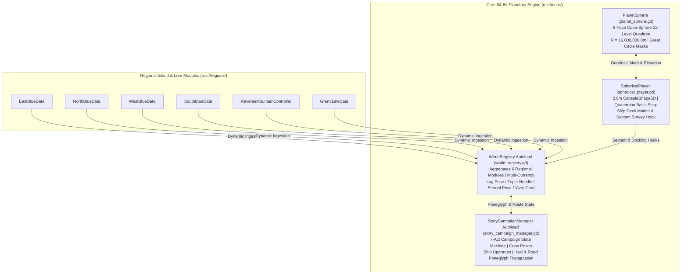
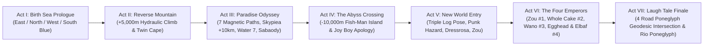

# Project "Blue Planet" — Overarching Plot, Void Century Lore & 64-Bit Planetary Engine Architecture

---

## 1. Executive Technical Verdict & 64-Bit Planetary Scale

> [!IMPORTANT]
> **Engine Standard:** Godot 4.3+ compiled with `precision=double` (`scons platform=macos precision=double`).
> All `Vector3`, `Transform3D`, and `JoltPhysics3D` calculations operate in **64-bit IEEE 754 Double Precision** (`53-bit significand`), delivering **$2\text{ nanometers}$ ($2 \times 10^{-9}\text{ m}$) of spatial accuracy** at the planet's surface ($16,000,000.0\text{ m}$ from `Vector3.ZERO`).

### 1.1. Planetary Geodesy Baseline
* **Unit Baseline:** $1.0\text{ engine unit} = 1.0\text{ meter}$.
* **Player Character (`SphericalPlayer`):** `CapsuleShape3D` height $= 2.0\text{ m}$, radius $= 0.4\text{ m}$, eye height $= +1.75\text{ m}$.
* **Sea-Level Radius ($R$):** $16,000,000.0\text{ m}$ ($16,000\text{ km}$, $\approx 2.51\times$ Earth's $6,371\text{ km}$ radius).
* **Equatorial Circumference ($C = 2\pi R$):** $100,530,964.91\text{ m}$ ($\approx 100,531\text{ km}$).
* **Total Surface Area ($A = 4\pi R^2$):** $3.217 \times 10^{15}\text{ m}^2$ ($3.217\text{ billion km}^2$, $\approx 6.3\times$ Earth's surface area).

### 1.2. Core Engine Architecture (`core/`)

* **[project.godot](file:///Users/lin/Downloads/OnePieceBluePlanet/project.godot):** Configures Godot 4.3 with `"Double Precision"`, `"Forward Plus"`, `JoltPhysics3D` at 60 Hz, 8192-px directional shadows, and autoloads `WorldRegistry` and `StoryCampaignManager`.
* **[planet_sphere.gd](file:///Users/lin/Downloads/OnePieceBluePlanet/core/planet_sphere.gd):**
  * **6-Face Cube-Sphere 22-Level Quadtree:** Subdivides each of the 6 cube faces (`POS_X`, `NEG_X`, `POS_Y`, `NEG_Y`, `POS_Z`, `NEG_Z`) using tangential warp `tan((uv * 2 - 1) * PI/4)` from **Level 0** ($\approx 16,000\text{ km}$ chord) down to **Level 22** ($\approx 3.81\text{ m}$ chunk edge, $\approx 0.12\text{ m}$ vertex spacing).
  * **Camera-Relative Shader Uniform Helper:** Because GPU vertex shaders run in 32-bit `float`, `PlanetSphere.apply_camera_relative_shader_uniforms()` subtracts `camera_origin_double` from `chunk_origin_double` on the CPU in 64-bit precision before uploading `u_chunk_camera_offset` to the GPU, eliminating all vertex jitter.
  * **Macro-Geographic Great Circle Masks:**
    * **Red Line:** Great Circle tilted $+45^\circ$ (`_red_line_normal = Vector3(0, cos(45°), -sin(45°))`), width $250\text{ km}$, sheer red cliff walls rising to $+10,000\text{ m}$.
    * **Grand Line:** Perpendicular Great Circle tilted $-45^\circ$ (`_grand_line_normal = Vector3(0, cos(-45°), -sin(-45°))`), width $600\text{ km}$, split into **Paradise** ($\phi \in [0^\circ, 180^\circ]$) and **New World** ($\phi \in [180^\circ, 360^\circ]$).
    * **Calm Belts:** Two flanking $150\text{ km}$-wide bands ($300\text{ km} \le d \le 450\text{ km}$ from the Grand Line centerline) with `0.0 m/s` wind and the `evaluate_calm_belt_hazard()` Sea King spawner ($500\text{ m}$–$2,000\text{ m}$ Sea Kings rising from $-2,000\text{ m}$ depth unless masked by Seastone keel plating).
    * **Node A $(\theta = 0^\circ, \phi = 0^\circ)$ — Reverse Mountain:** $+5,000\text{ m}$ summit cone carved by four $400\text{ m}$-wide ascending hydraulic canals from the Four Blues and one eastern descending canal into **Twin Cape**.
    * **Node B $(\theta = 0^\circ, \phi = 180^\circ)$ — Mary Geoise / Sabaody / Fish-Man Island:** Three-tier vertical stack spanning **Mary Geoise** ($+10,000\text{ m}$), **Sabaody Archipelago & New Marineford** ($0\text{ m}$), and **Fish-Man Island** ($-10,000\text{ m}$ submarine cavern).
* **[spherical_player.gd](file:///Users/lin/Downloads/OnePieceBluePlanet/core/spherical_player.gd):**
  * Updates `up_direction = global_position.normalized()` every physics tick and slerps `global_transform.basis` via minimal-arc `Quaternion(current_up, target_up)` so walking across the poles has zero gimbal lock.
  * Supports seamless walking on moving ships (`ABOARD_SHIP_DECK`), helm steering (`HELM_PILOTING`), Devil Fruit sea-water sinking vs. non-fruit swimming (`SWIMMING`), Jet Dial burst dashes, and the **Surveying Sextant** cartography hook ($d = \sqrt{2Rh + h^2}$).

---

## 2. Overarching Campaign Plot & 7-Act Narrative Design

Implemented in [story_campaign_manager.gd](file:///Users/lin/Downloads/OnePieceBluePlanet/plot/story_campaign_manager.gd) and [world_registry.gd](file:///Users/lin/Downloads/OnePieceBluePlanet/core/world_registry.gd), the player's voyage unfolds across **Seven Canonical Acts**:

### Act I — Romance Dawn: The Birth Sea Prologue
The player selects one of the **Four Blues** as their birth sea, where standard magnetic compasses point reliably toward the North Pole:
1. **East Blue Origin (Primary Story Route):**
   * **Dawn Island (*Foosha Village*, *Mt. Colubo*, *Gray Terminal*, *Goa Kingdom*):** Start at **Partys Bar** with **Makino** and **Mayor Woop Slap**, train in **Mt. Colubo** with **Curly Dadan**, and sail past the **Lord of the Coast**.
   * **Shells Town (*Marine Base 153*) & Shimotsuki Village:** Visit **Ririka & Rika's Food & Bar**, train at **Koushirou's Isshin Dojo**, and recruit a **First Mate Swordsman**.
   * **Orange Town & Island of Rare Animals:** Aid **Mayor Boodle** and **Chouchou** at the pet food shop and catalog exotic fauna with **Gaimon**.
   * **Syrup Village (*Gecko Islands*):** Protect **Kaya** and **Merry** to upgrade from a dinghy to a **Caravel (`Going Merry` class)** and recruit a **Sharpshooter / Artificer**.
   * **Baratie (*Sambas Region*):** Train under **Chef Zeff**, **Patty**, and **Carne** to unlock the **All-Blue Maritime Cooking System** and recruit a **Maritime Chef**.
   * **Conomi Islands (*Cocoyasi Village* & *Arlong Park*):** Liberate **Nojiko** and **Genzo's** village, plant **Bell-mère's Tangerine Trees** on deck (preventing scurvy), and recruit a **Master Navigator / Cartographer** (unlocking the **Surveying Sextant** world map system).
   * **Loguetown (*Town of Beginning and End*):** Test willpower for cursed/graded *Meito* blades at **Ipponmatsu's Arms Shop**, hear Gol D. Roger's Grand Line lore from **Raoul** at the **Gold Roger Bar**, and sail toward the guiding light of **Reverse Mountain**.
2. **Alternate Birth Sea Origins:**
   * **North Blue:** **Lvneel Kingdom** (Mont Blanc Noland's botanical logs) $\rightarrow$ **Flevance Ruins** (Amber Lead salvage) $\rightarrow$ **Spider Miles** $\rightarrow$ North-West Reverse Mountain Canal.
   * **West Blue:** **Ohara Ruins** (Tree of Knowledge cipher fragments) $\rightarrow$ **Kano Country** (Happo Navy vibration manuals) $\rightarrow$ **Ilusia / Toroa** $\rightarrow$ South-West Reverse Mountain Canal.
   * **South Blue:** **Sorbet Kingdom** (Kuma's church sanctuary) $\rightarrow$ **Torino Kingdom** (Giant Bird canopy medical library) $\rightarrow$ **Karate Island & Briss Drydock** $\rightarrow$ South-East Reverse Mountain Canal.

---

### Act II — The $+5,000\text{ m}$ Hydraulic Climb: Reverse Mountain & Twin Cape
* **Reverse Mountain (`lat=0°, lon=0°`):** Four $400\text{ m}$-wide diagonal hydraulic canals draw winter currents uphill from all Four Blues to the $+5,000\text{ m}$ summit basin before plunging down the eastern fifth canal into the Grand Line.
* **Twin Cape Lighthouse:** Encounter the island whale **Laboon** ramming the Red Line, explore his stomach canals and gastric acid chambers with lighthouse keeper **Crocus** (former doctor of the Roger Pirates), learn why normal compasses fail in the Grand Line, and receive your **Single-Needle Log Pose** to choose one of the **Seven Magnetic Paths** across Paradise.

---

### Act III — The Seven Magnetic Paths: Paradise & Sky Island Odyssey
* **Whisky Peak & Little Garden:** Survive the bounty hunter trap at the **Cactus Saloon**, then dock at prehistoric **Little Garden** where Elbaf giant captains **Dorry** and **Brogy** have dueled for 100 years. Because Little Garden's magnetic lock takes 1 full year to set, the crew secures an **Eternal Pose** to bypass the wait.
* **Drum Island (*Sakura Kingdom*):** Scale the vertical $5,000\text{ m}$ Drum Rockies to **Dr. Kureha's** castle, witness Hiriluk's cherry blossom snow, and recruit a **Ship Doctor**.
* **Alabasta Kingdom (*Sandy Island*):** Journey from **Nanohana** (**Spice Bean Restaurant**) and **Yuba** (**Toto**) through **Rainbase** (**Rain Dinners Casino**) to **Alubarna**. Defeat the Baroque Works conspiracy, descend into the **Tomb of the Kings** to rub the first **Historical Poneglyph** (revealing the location of **Ancient Weapon Pluton**), and recruit an **Ohara Archaeologist**.
* **Jaya (*Mock Town*) & Skypiea ($+10,000\text{ m}$ White-White Sea):** Reinforce the Caravel with **Mont Blanc Cricket**, **Masira**, and **Shoujou**, catch a **South Bird**, and ride the **Knock Up Stream** to the $+7,000\text{ m}$ **White Sea** and $+10,000\text{ m}$ **Skypiea**. Trade in **Extol** ($10,000\text{ Extol} = 1\text{ Beli}$) on **Lovely Street** for **Impact, Breath, Flame, Tone, Milky, and Jet Dials**, ring the **Shandorian Golden Belfry**, and read Gol D. Roger's Oden-engraved message beside the **Poseidon Poneglyph**.
* **Water 7 & Enies Lobby:** Exchange Skypiea gold at Water 7, weather the **Aqua Laguna** storm surge, ride the **Puffing Tom Sea Train**, and construct a flagship built from indestructible **Treasure Tree Adam** wood (`Thousand Sunny` class) featuring a **Cola-Powered Coup de Burst** ($1\text{ km}$ aerial jump) and the **Soldier Dock System**, recruiting a **Master Shipwright**.
* **Florian Triangle (*Thriller Bark*):** Navigate the sunless fog, receive a **New World Vivre Card** from **Lola**, and recruit a **Tone-Dial Musician** bound by a 50-year promise to **Laboon**.
* **Sabaody Archipelago (*Groves 1–79*) & Amazon Lily (*Calm Belt*):** Meet **Shakuyaku (Shakky)** at Grove 13 and **Silvers Rayleigh** ("The Dark King"). Train on **Rusukaina** and **Amazon Lily** (**Gor** currency) to awaken **Observation, Armament, and Conqueror's Haki**, while Rayleigh coats the ship in **Yarukiman Mangrove Resin** for deep-sea submersion.

---

### Act IV — $10,000\text{ Meters}$ Under the Red Line: Fish-Man Island
* **The Abyssal Plunge (`lat=0°, lon=180°, alt=-10,000m`):** Dive beneath the Red Line and **Mary Geoise** ($+10,000\text{ m}$) using buoyancy pedals through the **Downward Plume** and **Undersea Currents** into the double-layered bubble of **Fish-Man Island**.
* **The Sea Forest & Joy Boy's Apology:** Inside the **Sea Forest** coral graveyard beside the colossal **Ark Noah**, the Archaeologist deciphers the **Joy Boy Apology Poneglyph**—an 800-year-old letter from **Joy Boy** to the Void Century Mermaid Princess (**Ancient Weapon Poseidon**).
* **The New World Upgrade:** Recruit a **Master Fish-Man Helmsman** and receive the **Triple-Needle Log Pose** from **King Neptune** and the **Minister of the Left** to navigate the volatile magnetic fields of the New World.

---

### Act V — Into the New World: Punk Hazard, Dressrosa & Zunesha
* **Punk Hazard:** Following the highest-jitter needle of the **Triple Log Pose**, the crew lands on the half-magma, half-glacier restricted island of **Punk Hazard**, dismantling Caesar Clown's SAD production.
* **Dressrosa & Green Bit:** Infiltrate **Acacia**, the **Corrida Colosseum**, and the **Tontatta Kingdom** beneath Green Bit to topple the underground arms syndicate and forge an allied **Grand Fleet**.
* **Zou (*Mokomo Dukedom* atop *Zunesha*):** Because the $20\text{ km}$-tall millennial elephant **Zunesha** walks continuously across the New World ocean floor and emits no magnetic field, the crew uses a **Mink Vivre Card** to track Zunesha, ascend to **Claw City**, meet **Inuarashi** and **Nekomamushi**, and decipher **Road Poneglyph #1** inside the **Whale Tree**.

---

### Act VI — The Four Emperors & The Four Deep-Red Road Poneglyphs
To reach the end of the Grand Line, the crew must decipher all **Four Road Poneglyphs**:
1. **Road Poneglyph #1 — Zou (*Whale Tree Sanctuary*):** Guarded for 800 years by the Mink Tribe and Kozuki allies.
2. **Road Poneglyph #2 — Totto Land (*Whole Cake Island*):** Sail through Big Mom's 34 food islands (**Cacao Island**, **Komugi Island**, **Biscuits Island**), infiltrate the **Room of Treasure** in **Whole Cake Chateau** to take a rubbing of the second red stone, and awaken **Advanced Observation Haki (*Future Sight*)**.
3. **Road Poneglyph #3 — Wano Country (*Submerged Old Wano*):** Climb the waterfall into isolated **Wano Country** (**Silver, Gold, and Platinum Ryo** economy), train with **Hyogoro** in Udon to master **Advanced Ryuo (*Internal Destruction*)** and **Conqueror's Infusion**, craft **Seastone Keel Plating** at **Hitetsu's Amigasa Forge**, and descend with **Kozuki Sukiyaki** into drowned **Old Wano** beneath Mount Fuji to view the sealed chamber of **Pluton** and decipher the third red stone.
4. **Egghead Island, Warland Elbaf & Road Poneglyph #4:** Visit **Dr. Vegapunk's Labophase** on **Egghead** to obtain **DOM Anti-Gravity Boots** and learn how Ancient Weapons raised global sea levels by $200\text{ meters}$ during the Void Century. Then sail to **Warland Elbaf**, reunite with **Dorry**, **Brogy**, and **Jaguar D. Saul** at the **Owl's Library** (preserving Ohara's saved books), decipher **Road Poneglyph #4** (originally from Fish-Man Island's Sea Forest / guarded by the *Man Marked by Flame*), and verify the magnetic limit at **Lodestar Island**.

---

### Act VII — Laugh Tale Triangulation, The Rio Poneglyph & The Dawn of the World
* **Spherical Great-Circle Triangulation:** Once all four **Road Poneglyphs** (`road_poneglyph_1_zou`, `road_poneglyph_2_whole_cake`, `road_poneglyph_3_wano`, `road_poneglyph_4_elbaf`) are deciphered in `WorldRegistry.decipher_poneglyph()`, the engine calls `PlanetSphere.intersect_great_circle_arcs()` to compute the exact 64-bit spherical intersection of the two geodesic arcs on the $16,000,000.0\text{ m}$ globe.
* **The Rio Poneglyph & The One Piece:** Sailing into the newly materialized coordinates of **Laugh Tale** unites the **Nine Historical Poneglyphs** into the **Rio Poneglyph**—revealing the complete history of the **Void Century** ($900\text{–}800$ years ago), the **Great Kingdom**, **Joy Boy's** promise, the **Twenty Kingdoms**, and the **One Piece**, triggering the **Dawn of the World** endgame state.

---

## 3. Navigation, Multi-Currency & Ship Upgrade Reference Tables

### 3.1. Navigation Systems (`WorldRegistry.compute_navigation_reading`)
| Navigation Tool | Active Sea / Region | Mechanical Behavior on the $R = 16,000\text{ km}$ Sphere |
| :--- | :--- | :--- |
| **Standard Magnetic Compass** | North, East, West & South Blue | Points reliably along the geodesic meridian toward the North Pole (`lat=+90°`). Spins chaotically inside the Calm Belts and Grand Line. |
| **Single-Needle Log Pose** | Grand Line — Paradise (`lon 0°..180°`) | Locks onto the current island's magnetic field after `log_pose_lock_sec` elapses, then points along the geodesic arc to the next island on your chosen path (1 of 7 routes from Twin Cape to Sabaody). |
| **Triple-Needle Log Pose** | Grand Line — New World (`lon 180°..360°`) | Three needles point simultaneously to three candidate islands ahead. Each needle oscillates with `danger_jitter_deg` proportional to the destination's magnetic/environmental volatility. |
| **Eternal Pose** | Global (Any Sea) | Permanently locked onto one specific island's `(lat_deg, lon_deg)`, overriding sequential Log Pose timers (e.g., skipping Little Garden's 1-year wait). |
| **Vivre Card ("Paper of Life")** | Global (Dynamic Target) | Slides across the ship deck along the surface tangent vector pointing directly toward a moving entity (`Zunesha / Zou`, `Germa 66 Mobile Fleet`, or `Silvers Rayleigh`), while displaying the owner's `life_force_ratio`. |

### 3.2. Multi-Currency Exchange Rates (`WorldRegistry.convert_currency_amount`)
| Currency Code | Canonical Region | Exchange Rate to Beli (฿) | Exchange Rate to Extol (E) |
| :--- | :--- | :--- | :--- |
| **Beli (`Beli`)** | Global (Four Blues & Grand Line) | $1\text{ Beli} = 1\text{ Beli}$ | $1\text{ Beli} = 10,000\text{ Extol}$ |
| **Extol (`Extol`)** | Skypiea / White-White Sea ($+10,000\text{ m}$) | $10,000\text{ Extol} = 1\text{ Beli}$ | $1\text{ Extol} = 1\text{ Extol}$ |
| **Gor (`Gor`)** | Amazon Lily (Kuja Tribe, Calm Belt) | $1\text{ Gor} = 100\text{ Beli}$ | $1\text{ Gor} = 1,000,000\text{ Extol}$ |
| **Wano Silver Ryo (`WanoSilverRyo`)** | Wano Country (*Gin* — Everyday Trade) | $1\text{ Silver Ryo} = 500\text{ Beli}$ | $5,000,000\text{ Extol}$ |
| **Wano Gold Ryo (`WanoGoldRyo`)** | Wano Country (*Kin* — Merchant Bullion) | $1\text{ Gold Ryo} = 10,000\text{ Beli}$ | $100,000,000\text{ Extol}$ |
| **Wano Platinum Ryo (`WanoPlatinumRyo`)** | Wano Country (*Hakkin* — Estate Bullion) | $1\text{ Platinum Ryo} = 1,000,000\text{ Beli}$ | $10,000,000,000\text{ Extol}$ |
