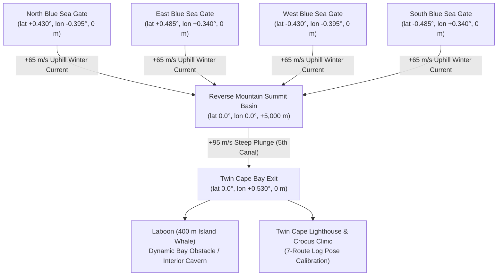

# Reverse Mountain & Twin Cape — Canonical Wiki & 64-Bit Engineering Atlas

> **Project "Blue Planet" — Antipodal Great Circle Intersection Node A (`θ = 0°`, `φ = 0°`)**  
> Implementation Module: [`regions/reverse_mountain_controller.gd`](file:///Users/lin/Downloads/OnePieceBluePlanet/regions/reverse_mountain_controller.gd)  
> Engine Baseline: Godot 4.3+ (`precision=double`), `1 unit = 1 meter`, Planet Radius $R = 16,000,000.0\text{ m}$ ($1^\circ \approx 279,252.68\text{ m}$).

---

## 1. Canonical Geography & Lore (One Piece Wiki Verified)

**Reverse Mountain** (*リヴァース・マウンテン, Rivāsu Maunten*) sits directly on the **Red Line** at one of its two antipodal intersections with the **Grand Line** (Chapters 101–105, Anime Episodes 61–63). It serves as the primary maritime gateway from the outer **Four Blues** into **Paradise** (the first half of the Grand Line), bypassing the lethal, windless **Calm Belts** swarming with Sea Kings.

### Why Water Flows Uphill ("Winter Island" Hydrodynamics)
* **Winter Island Classification:** In Grand Line climatology, Reverse Mountain is officially classified as a **Winter Island**.
* **Thermal & Current Convergence:** Because the mountain's extreme sub-zero microclimate is dramatically colder than the surrounding waters of the North, East, West, and South Blues, violent oceanic temperature gradients and colliding ocean currents force seawater **upward** along four carved stone canals toward the peak.
* **Ancient Stone Gateways:** Each canal entrance is flanked by massive stone pillars and arched gate structures etched with ancient tribal motifs (visually echoing the ruins of Shandora).
* **Guide Lights:** During storms and squalls—such as the gale the *Going Merry* braved leaving Loguetown—a **guide light** marks the safe mouth of the canal. Missing the gate means colliding catastrophically against the sheer red-stone cliffs of the Red Line.

### The Five Canals
1. **Four Ascending Canals:** Originating in **North Blue**, **East Blue**, **West Blue**, and **South Blue**, these ~`400 m` wide stone channels carry powerful uphill currents from sea level (`0 m`) to a **`+5,000 m` summit convergence basin**.
2. **The Fifth Descending Canal:** At the summit, all four currents merge into a single violent torrent that plunges eastward down the Paradise face of the Red Line straight into **Twin Cape** Bay.



---

## 2. Planetary Geodesy & 64-Bit Spline Physics

### Spherical Coordinate Mapping at Node A
* **Planet Center:** `Vector3(0.0, 0.0, 0.0)`
* **Sea-Level Radius:** `PLANET_RADIUS_M = 16,000,000.0` m
* **Circumference:** $2\pi R \approx 100,530,964.91\text{ m}$ (`~100,531 km`)
* **Arc Scale:** `METERS_PER_DEGREE = 279,252.6803 m/deg`
* **Red Line Footprint:** Width `250,000 m` (`±125,000 m` half-width), nominal plateau height `+10,000 m`.
* **Canal Width:** `400.0 m` (`±200.0 m` half-width) through the mountain gorge, flaring to `560.0 m` at the outer Blue Sea stone gates so approaching vessels can align safely before entering the narrow canyon.

### Canal Entry Coordinates (Four Blues -> Summit -> Twin Cape)

| Canal ID | Source / Destination | Entry Lat / Lon | Entry Arc Offset from `(0,0)` | Altitude Profile | Target Flow Speed |
| :--- | :--- | :--- | :--- | :--- | :--- |
| `north_blue_canal` | North Blue -> Summit | `+0.430°`, `-0.395°` | `163.1 km` NW | `0 m` $\rightarrow$ `+5,000 m` | `65 m/s` (+sail trim) |
| `east_blue_canal` | East Blue -> Summit | `+0.485°`, `+0.340°` | `165.4 km` NE | `0 m` $\rightarrow$ `+5,000 m` | `65 m/s` (+sail trim) |
| `west_blue_canal` | West Blue -> Summit | `-0.430°`, `-0.395°` | `163.1 km` SW | `0 m` $\rightarrow$ `+5,000 m` | `65 m/s` (+sail trim) |
| `south_blue_canal` | South Blue -> Summit | `-0.485°`, `+0.340°` | `165.4 km` SE | `0 m` $\rightarrow$ `+5,000 m` | `65 m/s` (+sail trim) |
| `paradise_exit_canal` | Summit -> Twin Cape | `0.000°`, `0.000°` $\rightarrow$ `+0.530°` | `0 km` $\rightarrow$ `148.0 km` E | `+5,000 m` $\rightarrow$ `0 m` | `95 m/s` (+sail trim) |

> [!IMPORTANT]
> **Why East & South Blue Gates sit at `lat ±0.485°, lon +0.340°`:**  
> Placing the NE and SE entry gates north and south of the Grand Line / Twin Cape exit corridor keeps incoming East Blue and South Blue vessels outside both the `250 km` Red Line cliff wall and the Paradise outflow plume until their canals curve cleanly into the `+5,000 m` summit basin.

### Hydraulic Current Math (`compute_hydraulic_step`)
Every canal centerline is evaluated as a 64-bit cubic Bezier spline in local tangent space `(east_m, north_m, alt_m)` and projected onto the curved planet sphere via:

$$\vec{p}_{\text{world}} = \left(\hat{n}_A \cos\left(\frac{s}{R}\right) + \hat{t} \sin\left(\frac{s}{R}\right)\right) (R + \text{alt}_m)$$

where $s = \sqrt{\text{east}_m^2 + \text{north}_m^2}$ is the surface arc length and $\hat{n}_A$ is the outward normal at Node A `(0°, 0°)`.

1. **Gravity Cancellation + Uphill Drive:**  
   Along the spline tangent $\hat{f}$, gravity pulls backward by $g (\hat{u} \cdot \hat{f})$. The hydraulic controller applies:
   $$a_{\text{along}} = (v_{\text{target}} - \vec{v} \cdot \hat{f}) \cdot k_{\text{gain}} + g (\hat{u} \cdot \hat{f})$$
2. **Rudder & Sail Trim Steering Assist:**  
   - **Sail Trim (`0.0..1.0`):** Adds up to `+14 m/s` forward surge speed inside the current.
   - **Rudder Input (`-1.0..+1.0`):** Applies lateral acceleration perpendicular to the flow (`right_dir`), scaled by `rudder_integrity`.
   - **Channel Centering Assist:** Applies a gentle restorative force proportional to `-lateral_offset / half_width`, helping attentive helmsmen stay centered between the 400m stone walls.
3. **Red Line Wall Scrape & Rudder Snap Hazard:**  
   If `abs(lateral_offset_m) > (half_width_m - ship_beam_m * 0.5)`, `canal_wall_impact` fires:
   - Inflicts `hull_damage` proportional to outward impact velocity.
   - If lateral impact velocity exceeds `rudder_break_threshold_mps` (`18.0 m/s`), inflicts **rudder damage** (homage to the *Going Merry* snapping its rudder at the East Blue gate in Chapter 101), reducing steering responsiveness until repaired at Twin Cape.

---

## 3. Twin Cape (`Futago Misaki`) & Twin Cape Lighthouse

Twin Cape sits at the eastern foot of Reverse Mountain (`lat ≈ 0.0°`, `lon ≈ +0.545°..+0.562°`, `alt = 0 m`), framed by two towering red-stone headlands flanking the Paradise outflow channel.

* **Twin Cape Lighthouse (`lat -0.012°, lon +0.558°, alt +48 m`):** Operated by **Crocus**, casting a `18,000 m` beacon across the turbulent entrance bay.
* **Sheltered Docking Zone:** Located just south-east of the outflow surge (`lat -0.008°, lon +0.562°`, docking radius `140 m`), where ships can anchor safely without being swept down-current.

### Log Pose Initialization & The Seven Paradise Routes
Standard magnetic compasses spin uselessly on the Grand Line due to high-iron mineral islands generating chaotic local magnetic fields. At Twin Cape, **Crocus** gifts the player their first **Single-Needle Log Pose** (`standard_log_pose`) and calibrates it onto one of **seven diverging magnetic routes** radiating from Twin Cape (all 7 routes eventually reconverge at Sabaody Archipelago / Fish-Man Island):

| Route # | Starting Island | Log Pose Lock Timer | Danger Tier | Canon Note |
| :--- | :--- | :--- | :--- | :--- |
| **1** | **Whisky Peak (Cactus Island)** | `10 min` | Tier 1 | Canonical Straw Hat Pirates route (leads to Little Garden $\rightarrow$ Drum $\rightarrow$ Alabasta) |
| **2** | **Nanimonai Island** | `25 min` | Tier 2 | Alternate northern Paradise chain |
| **3** | **Kyuka Island (Holiday Isle)** | `15 min` | Tier 1 | Resort & supply chain route |
| **4** | **Merveille Frontier Reef** | `40 min` | Tier 3 | Storm-heavy high-magnetism route |
| **5** | **Kuraigana Approach Current** | `35 min` | Tier 3 | Fog-shrouded northern reef route |
| **6** | **Bananawani Outer Atoll** | `30 min` | Tier 2 | Southern Paradise trade chain |
| **7** | **Karakuri / Winter Vanguard Isle** | `45 min` | Tier 4 | Severe winter squall route |

---

## 4. Crocus — Clinic, Lore & Marketplace Inventory

| Field | Canonical Wiki Detail |
| :--- | :--- |
| **Full Name** | **Crocus** (クロッカス, *Kurokkasu*) |
| **Epithet / Role** | Keeper of the Twin Cape Lighthouse; Former Ship's Doctor of the **Roger Pirates** |
| **Age** | `71` (Pre-Timeskip) / `73` (Post-Timeskip) |
| **Height** | `203 cm` (`6'8"`) |
| **Birthday** | **June 4** (Gemini) |
| **Equipment** | Precision throwing **Harpoons**, **Giant Whale Tranquilizer Launchers**, Medical Kit |
| **History** | Joined Gol D. Roger for the final 3-year voyage to Laugh Tale to keep Roger's terminal illness stabilized, while also searching for news of the Rumbar Pirates on Laboon's behalf. |

### Crocus's Lighthouse & Clinic Shop (`TWIN_CAPE_SETTLEMENT.marketplace_inventory`)

| Item ID | Name | Price (`Beli`) | Gameplay Effect |
| :--- | :--- | :--- | :--- |
| `standard_log_pose` | **Grand Line Log Pose** | `0` (Gift) / `150,000` | Essential spherical magnetic compass for Paradise navigation |
| `acid_resistant_hull_paint` | **Whale-Stomach Acid-Resistant Coating** | `12,000` | Prevents gastric acid hull DoT inside Laboon or corrosive sea mists |
| `crocus_sedative_kit` | **Crocus's Maritime Trauma Kit** | `4,500` | Restores 100% crew HP and clears stun/shock statuses |
| `twin_cape_harpoon_bundle` | **Heavy Lighthouse Harpoons (x10)** | `3,200` | Anti-beast ammunition effective against Giant Squid & Sea Kings |
| `giant_squid_fillet` | **Fresh Giant Squid Meat** | `900` | High-protein galley ration harvested at Twin Cape |
| `spare_caravel_rudder` | **Reinforced Oak Emergency Rudder** | `8,500` | Restores `rudder_integrity = 1.0` after Reverse Mountain wall impacts |

---

## 5. Laboon — The 400m Island Whale & Interior Cavern

**Laboon** (*ラブーン, Rabūn*) is a colossal **Island Whale** native to the **West Blue**, measuring **`400.0 meters` long** (`beam ~110 m`, `height ~120 m`). Fifty years ago, as a baby whale, Laboon followed the **Rumbar Pirates** across Reverse Mountain into Twin Cape. Fearing the Grand Line was too dangerous for a calf, the crew left him in Crocus's care, promising to return after circumnavigating the globe. Unaware that the crew perished, Laboon has spent half a century slamming his head against the Red Line in grief.

### Dynamic Bay States (`LaboonState`)
1. **`PATROLLING_BAY`:** Sweeps across the outflow channel (`~149.4 km` east of Node A). Colliding with Laboon's 400m ellipsoid hull inflicts impact damage (`hull_damage = impact_speed * 1.4`).
2. **`MOUTH_OPEN_SWALLOW`:** Laboon opens his `~52 m` radius mouth directly in front of the Canal 5 chute. Entering this zone triggers `laboon_swallowed_ship` and transitions the vessel into `LABOON_INTERIOR_ZONES`.
3. **`HEADBUTTING_RED_LINE`:** Laboon rams the Red Line cliff wall every `42 s`, emitting `laboon_headbutt_shockwave` across Twin Cape Bay.
4. **`CALMED_JOLLY_ROGER_PROMISE`:** Triggered via `fulfill_laboon_jolly_roger_promise()`—painting the crew's **Jolly Roger** across Laboon's massive forehead scars so he refuses to slam his head again until they reunite.
5. **`REUNITED_BINKS_SAKE`:** Unlocked in the late game via the Rumbar Pirates Tone Dial quest.

### Inside Laboon's Stomach (`LABOON_INTERIOR_ZONES`)
Crocus surgically reinforced and furnished Laboon's interior to treat his internal wounds and rescue swallowed ships:
* **`stomach_acid_sea` (Gastric Acid Basin):** `165 m` radius corrosive sea (`1.8 DPS` to unpainted wooden hulls).
* **`artificial_island` (Crocus's Floating Steel Platform & Cabin):** A metal island in the middle of the acid sea surrounded by walls painted as a **fake blue sky with clouds and ocean horizon**, complete with Crocus's cabin, tea table, and lawn chair.
* **`steel_exit_doors` (Riveted Iron Maintenance Hatches):** Heavy steel bulkhead doors installed in Laboon's flank/gut wall (`exit_laboon_via_steel_doors()`), allowing swallowed ships to sail safely out into Twin Cape Bay.
* **`giant_squid_lair`:** Pre-swallowed Giant Squid drifting in the stomach alongside **Mr. 9 & Miss Wednesday (Nefertari Vivi)**—who originally attempted to hunt Laboon for meat to feed Whisky Peak, introducing the **Baroque Works / Alabasta** storyline.

---

## 6. Rumbar Pirates & Brook Tone Dial Hook

* **The Backstory:** Captain **Yorki**, **Brook**, and the **Rumbar Pirates** promised Laboon they would return singing his favorite shanty, *"Binks' Sake"*. After Yorki fell ill and the crew was wiped out in the **Florian Triangle**, Brook survived via the *Yomi Yomi no Mi* and recorded the crew's dying final chorus onto a **Tone Dial** stored inside his skull.
* **Gameplay Hook (`trigger_rumbar_tone_dial_hook`):**  
  Once the player retrieves the **Binks' Sake Tone Dial** from the Florian Triangle / Thriller Bark region and returns to Twin Cape:
  - Playing the Tone Dial unlocks `LaboonState.REUNITED_BINKS_SAKE`,
  - Grants the title **"Oathkeeper of Twin Cape"**,
  - Awards **Island Whale Resonance** (reduces Calm Belt & Sea King aggro near Red Line crossings) and **Crocus's Roger Pirates Sea Chart Fragment**.

---

## 7. GDScript 4 Integration Reference

```gdscript
# Example ShipVessel physics step inside ReverseMountainController:
var rm_step: Dictionary = reverse_mountain_controller.compute_hydraulic_step(
	self,
	global_position,
	linear_velocity,
	rudder_input,
	sail_trim,
	ship_beam_m,
	rudder_integrity,
	delta
)
if rm_step["active"]:
	linear_velocity = rm_step["corrected_velocity"]
	if rm_step["wall_hit"]:
		apply_hull_damage(rm_step["hull_damage"])
		rudder_integrity = max(0.0, rudder_integrity - rm_step["rudder_damage"])

# Check Laboon Bay Obstacle / Swallow Cavern:
var whale_check: Dictionary = reverse_mountain_controller.evaluate_laboon_encounter(
	self, global_position, linear_velocity
)

# Check Twin Cape Lighthouse Docking & Log Pose Gift:
var dock_check: Dictionary = reverse_mountain_controller.check_lighthouse_docking(self, global_position)
if dock_check["in_dock_zone"] and Input.is_action_just_pressed("interact"):
	var crocus_res: Dictionary = reverse_mountain_controller.interact_with_crocus(player, 1)
```
