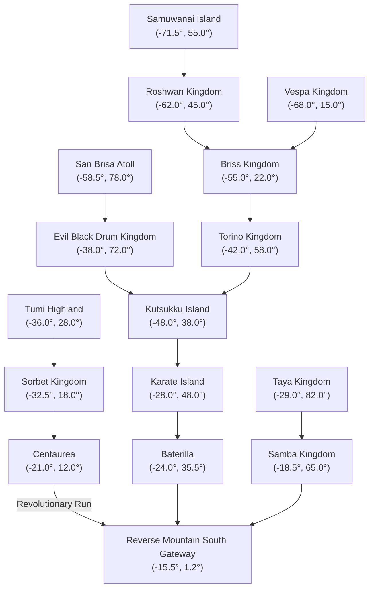
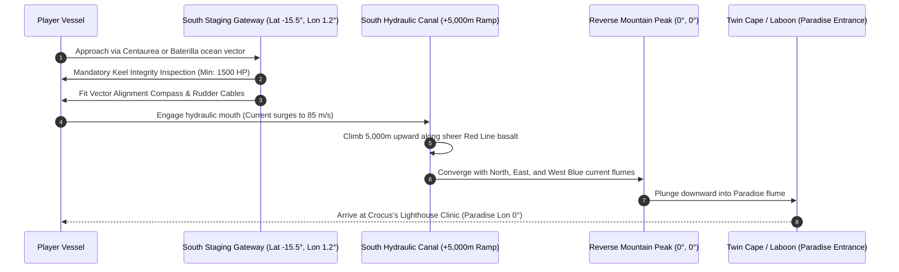

# South Blue Wiki Atlas & Regional Lore Compendium
**Project "Blue Planet" — Planetary-Scale Spherical Exploration RPG (Godot 4.3+ `precision=double`)**


---

## 1. Regional Overview & Planetary Geodesy

The **South Blue (南の海, *Sausu Burū*)** is one of the four great oceans of the Blue Planet. In our 64-bit planetary geodesy simulation ($R = 16,000,000.0\text{ m}$, Circumference $\approx 100,531\text{ km}$), the South Blue occupies the southeastern quadrant of the lower hemisphere:

$$\theta \in [-75.0^\circ, -15.0^\circ] \quad (\text{Latitude, Southern Hemisphere})$$
$$\phi \in [0.0^\circ, +90.0^\circ] \quad (\text{Longitude, East of Reverse Mountain Meridian})$$

```mermaid
flowchart TD
    subgraph PlanetaryGrid["South Blue Spherical Coordinate Bounds (R = 16,000,000 m)"]
        RL["Red Line Wall (+10,000m sheer basalt, Western Meridian at Lon 0°)"]
        SCB["South Calm Belt (Lat -15.0° Boundary: Zero wind, Sea King nests)"]
        RM["Reverse Mountain South Canal Mouth (Lat -15.5°, Lon 1.2°)"]
        GL["Grand Line / Paradise (Across Calm Belt / Past Reverse Mountain)"]
        
        SB_ISLANDS["South Blue Islands & Nations (Lat -75° to -15°, Lon 0° to 90°)"]
        
        RL -->|Blocks West Blue Transit| SB_ISLANDS
        SCB -->|Northern Barrier| SB_ISLANDS
        SB_ISLANDS -->|Ocean Currents Converge| RM
        RM -->|Hydraulic Ascent (+5,000m)| GL
    end
```

### Oceanographic & Geographic Characteristics
1. **The Western Rampart — The Red Line:** The western perimeter ($\phi \approx 0^\circ$) is bordered by the colossal sheer red basalt wall of the Red Line, rising abruptly $+10,000\text{ meters}$ above sea level. No natural sea routes exist into the West Blue along this meridian except via the hydraulic canals of Reverse Mountain at $(\theta = 0^\circ, \phi = 0^\circ)$.
2. **The Northern Horizon — The South Calm Belt:** At latitude $\theta = -15.0^\circ$, prevailing maritime trade winds abruptly drop to $0.0\text{ m/s}$. The Calm Belt forms a $150\text{ km}$-wide barrier between the South Blue and the Grand Line (Paradise). Vessels attempting to traverse the Calm Belt without Seastone keel lining or mechanical paddlewheel propulsion trigger colossal Sea King spawns (beasts ranging from $500\text{m}$ to $2,000\text{m}$ in length).
3. **The Southern Antarctic Convergence:** Below $\theta = -60.0^\circ$, ocean temperatures plummet. Sea lanes around the **Roshwan Kingdom**, **Vespa Kingdom**, and **Samuwanai Island** are choked with tabular ice floes, require reinforced icebreaker hulls, and feature intense thermal updrafts where sub-polar weather clashes with volcanic vents.
4. **Ecological & Cultural Identity:** Known historically as the ocean of **giant exotic fauna** (colossal avians like the Masked Goayu of Torino Kingdom, Super Sparrows, and Island-eaters), **martial supremacy** (Karate Island dojos and CP6 academies), **pioneering metallurgy & robotics** (Wapol Konzern's Wapometal), **revolutionary fervor** (the Sorbet Kingdom uprisings, Centaurea, Tumi), and **fateful bloodlines** (the birthplace of Portgas D. Ace, Gol D. Roger's secret haven, and the roots of Eustass Kid and Kuzan).

---

## 2. Complete Island Compendium (16 Locations)



---

### 2.1. Sorbet Kingdom (ソルベ王国)
* **Coordinates:** $\theta = -32.5^\circ\text{ S}, \phi = 18.0^\circ\text{ E}$ | **Altitude:** $350\text{ m}$ | **Radius:** $140\text{ km}$
* **Climate & Biome:** Temperate Maritime; coastal farmland, forests, popsicle-shaped stone spires, cobblestone quays.
* **Political Affiliation:** World Government affiliated (Historically); currently autonomous post-revolution under King Bulldog and Queen Dowager Conney.

#### Canon History & Lore
The Sorbet Kingdom is one of the most historically poignant nations in *One Piece*. It is the ancestral homeland of **Bartholomew Kuma**, his childhood love **Ginny**, and his adopted daughter **Jewelry Bonney**.
- **The Tyranny of King Bekori:** Decades ago, the corrupt King Bekori sought to reduce Sorbet's Heavenly Tribute obligations by legally dividing the country into two. The northern province, housing the aristocracy and the royal palace, was protected; the southern province, populated by the elderly, the sick, and the poor, was stripped of World Government protections and set ablaze to purge "worthless taxpayers" (mirroring the Gray Terminal incident in Goa Kingdom).
- **The Solo Revolution:** Bartholomew Kuma, unable to stand by while the elderly were slaughtered, led the legendary **Solo Revolution**. Facing Bekori's armies and royal guard alone, Kuma overthrew the king without shedding innocent blood. Reluctantly acclaimed as king by the grateful populace, Kuma governed from his humble parish church.
- **The "Tyrant" Smear & Cipher Pol Hostage:** Bekori returned with World Government naval backing, spreading black propaganda that Kuma was a murderous tyrant. To protect Sorbet, Kuma surrendered his freedom, becoming an official Warlord of the Sea and eventually Vegapunk's cybernetic prototype (Pacifista PX-0). Meanwhile, young Bonney—afflicted by the fatal **Sapphire Scales (青玉鱗, *Seigyokurin*)** disease—was kept under strict house arrest in Kuma's church by **Alpha**, an undercover agent of **CP8**.
- **Bonney's Escape:** Upon turning 10 years old, Bonney used her Age-Age Fruit powers to overwhelm Agent Alpha and escaped to sea alongside local fishermen (including Gyogyo), forming the **Bonney Pirates**. The rightful royal line was restored to King Bulldog (son of Queen Dowager Conney).

#### Districts, Ports & Architecture
1. **Northern Royal Citadel:** Massive popsicle-shaped marble towers overlooking grand boulevards. Home to King Bulldog's court.
2. **Southern Commoners District:** The resilient working-class province rebuilt by Kuma following Bekori's arson fires.
3. **The Church of Sorbet:** A modest wooden seaside church with high rafters where Kuma served as pastor. Contains the bell tower and the room where Kuma extracted the physical agony of the elderly each week using his Paw-Paw fruit.
4. **Gyogyo's Fishing Wharf:** Weathered cedar docks where local fishermen dock their smacks and trade deep-sea cod.

#### Key NPCs & Establishments
- **Queen Dowager Conney (コニー):** Former Queen Mother of Sorbet. Witty, fiercely brave, and identical in facial structure to an aged Bonney. Provides high-level diplomatic shelter and lore on Kuma's Buccaneer ancestry.
- **King Bulldog (ブルドッグ王):** Current benevolent sovereign. Dedicated to honoring Kuma's sacrifice and protecting the commoners from World Government retribution.
- **Gyogyo (ギョギョ):** Veteran fisherman who grew up with Kuma and Ginny. Harbor master and contact for the Bonney Pirates.
- **Bonney's Hearthside Bakery & Pizzeria:** Famed bakery serving loaded brick-oven pizzas and citrus glaze pastries ($480\text{ ฿}$ and $220\text{ ฿}$).
- **Church Alms Dispensary:** Community clinic dispensing *Sapphire Balm* ($1,200\text{ ฿}$) and *Illuminated Scripture Leaves* ($3,500\text{ ฿}$).

---

### 2.2. Baterilla (バテリラ)
* **Coordinates:** $\theta = -24.0^\circ\text{ S}, \phi = 35.5^\circ\text{ E}$ | **Altitude:** $180\text{ m}$ | **Radius:** $95\text{ km}$
* **Climate & Biome:** Tropical Haven; rolling turquoise coastal bays, blooming pink hibiscus groves, secluded coral grottos.
* **Political Affiliation:** Autonomous peaceful island; demilitarized.

#### Canon History & Lore
Baterilla holds a sacred place in maritime history as the birthplace of **Portgas D. Ace** and the resting place of **Portgas D. Rouge**, the first woman in history revealed to carry the **Will of D.**.
- **Gol D. Roger's Haven:** Prior to turning himself in to the Marines at Loguetown, the Pirate King Gol D. Roger spent his final quiet months here living as an ordinary family man with Rouge.
- **The 20-Month Pregnancy:** When intelligence reached the World Government that Roger might have fathered a child on Baterilla, Cipher Pol and Marine fleets descended upon the island. Every pregnant mother and newborn child across the island was investigated and ruthlessly seized. Through superhuman willpower and love, Rouge held Ace inside her womb for **20 full months**—defying human biology to protect him from execution.
- **Ace's Birth & Rouge's Sacrifice:** Immediately after giving birth to Ace, Rouge succumbed to extreme physical exhaustion and passed away with a smile, wearing her iconic pink hibiscus flower. Vice Admiral Monkey D. Garp secretly arrived to take infant Ace into custody, honoring Roger's final dying wish and spiriting him away to Mt. Colubo in East Blue.

#### Districts, Ports & Architecture
1. **Hibiscus Port Harbor:** Serene wooden pier lined with pastel-painted bungalows, flower stalls, and outdoor seaside taverns.
2. **Rouge's Memorial Grove & Cottage:** The secluded thatch-and-timber cottage on the ocean cliffs where Rouge lived, surrounded by fragrant pink hibiscus bushes.
3. **Marine Observation Post (Ruins):** Overgrown stone ramparts once occupied by Cipher Pol during the newborn sweep 22 years ago.
4. **Secret Coral Grotto:** Low-tide sea cavern where Roger moored his personal skiff.

#### Key NPCs & Establishments
- **Elder Nora:** Village matriarch who aided Rouge during her pregnancy. Shares lore regarding Roger's gentle demeanor in his final days.
- **Warrant Officer Garland (Retired):** An ex-Marine who resigned in disgust after witnessing the innocent mothers interrogated during the inquisition.
- **Baterilla Floral & Dye Exchange:** Sells authentic *South Blue Pink Hibiscus* ($500\text{ ฿}$, grants passive morale regeneration), *Scarlet Sail Dye* ($7,500\text{ ฿}$), and *Maternal Will Coral Amulets* ($12,000\text{ ฿}$).
- **The King's Rest Tavern & Inn:** Serves *Grilled Coral Snapper* ($320\text{ ฿}$) and *Spiced Coconut Rum* ($450\text{ ฿}$).

---

### 2.3. Torino Kingdom (トリノ王国 — "The Isle of Treasure")
* **Coordinates:** $\theta = -42.0^\circ\text{ S}, \phi = 58.0^\circ\text{ E}$ | **Altitude:** $1,250\text{ m}$ (Central Tree Summit) | **Radius:** $110\text{ km}$
* **Climate & Biome:** Subtropical Primeval Canopy; titanic ancient tree, high-altitude branch walkways, subterranean root caverns.
* **Political Affiliation:** Sovereign tribal territory; independent.

#### Canon History & Lore
Known erroneously to outsiders and treasure hunters as the "Isle of Treasure," Torino Kingdom contains no gold or gems—its true treasure is an extraordinary ecosystem of **advanced medicinal flora** and an **ancient library of pharmacology**.
- **The War of Birds and Men:** For centuries, a bitter territorial war raged between the short, rotund human tribesmen living on the ground and the colossal, intelligent **Masked Goayu (Tanagashima) birds** nesting in the gigantic central tree canopy. The humans viewed the birds as monstrous predators, while the birds attacked the humans to protect their eggs and rare flora.
- **Chopper's 3D2Y Training Grounds:** During the Sabaody Archipelago dispersion, Kuma swatted **Tony Tony Chopper** across the sea directly to the Torino Kingdom. After initially being hunted by the tribesmen for food, Chopper discovered that the birds were actually gentle creatures defending an injured hatchling. Chopper used his medical skills to heal the chick and brokered a historic peace treaty between humans and avians.
- **Botanical Advancement:** Reading Luffy's "3D2Y" tattoo message in the newspaper, Chopper spent the two-year timeskip on Torino Kingdom. Utilizing the vast stone library and the island's rare roots, Chopper mastered multiple new transformations (Kung Fu Point, Horn Point modifications) and developed the stabilized 3-minute Monster Point without losing his mind.

#### Districts, Ports & Architecture
1. **Great Tree of Life Canopy:** Sprawling timber-and-vine platforms suspended over $1,000\text{ meters}$ above the forest floor among the nests of the giant Goayu birds.
2. **Shanba Tribal Settlement:** Thatched stone huts arranged in a ring among the colossal surface roots.
3. **Torino Great Stone Library:** Colossal subterranean stone vaults housing centuries of scientific manuscripts, botanical classifications, and mechanical schematics.
4. **South Root Beach Cove:** Natural anchorage where ships tie off directly to mossy buttress roots wider than a galleon's hull.

#### Key NPCs & Establishments
- **Chief Shanba (シャンバ):** Rotund tribal chieftain and master scholar who wears a grass skirt and simple hair knot. A brilliant pharmacologist who guided Chopper through the ancient archives.
- **Matriarch Masked Goayu:** Colossal $15\text{m}$-tall bird with white plumage and dark mask-like eye feathers. Acts as aerial guardian of the island.
- **Shanba's Herbal & Botanical Dispensary:** Sells *Torino Golden Root Essence* ($8,500\text{ ฿}$, precursor to Rumble Balls), *Bioluminescent Spores* ($1,800\text{ ฿}$), and transcribed copies of the *Torino Botanical Compendium* ($25,000\text{ ฿}$).
- **Masked Goayu Sky-Saddle Outpost:** Crafts *Aerial Riding Saddles* ($45,000\text{ ฿}$) and *Goayu Down Cold-Coats* ($9,200\text{ ฿}$).

---

### 2.4. Karate Island (カラテの島)
* **Coordinates:** $\theta = -28.0^\circ\text{ S}, \phi = 48.0^\circ\text{ E}$ | **Altitude:** $480\text{ m}$ | **Radius:** $105\text{ km}$
* **Climate & Biome:** Rugged Temperate; granite cliffs, plunging waterfalls, sprawling stone dojos, boxing gyms.
* **Political Affiliation:** Martial Arts Confederacy; neutral.

#### Canon History & Lore
Karate Island is the undisputed martial arts capital of the South Blue. Disciples from all four seas travel here to master both traditional unarmed karate and western bare-knuckle boxing.
- **Homeland of Jerry (CP6):** Jerry, the comically tall Cipher Pol agent who served as the guardian of car #7 aboard the Sea Train *Puffing Tom*, was born and trained here. Jerry claimed the title of "South Blue Karate Boxing Champion," utilizing an unorthodox hybrid style of long-reach boxing and flying yoga kicks before being swiftly defeated by Sanji.
- **Waterfall Conditioning:** Warriors meditate beneath thundering $350\text{m}$ waterfalls, practicing breathing techniques that harden their muscle fibers into armor (forming the foundation for the Rokushiki technique *Tekkai*).

#### Districts, Ports & Architecture
1. **Central Martial Amphitheater:** A massive sunken arena surrounded by granite pillars where annual grand tournaments are held.
2. **South Blue Boxing Academy:** Jerry's former gym, equipped with leather heavy bags, rope rings, and high-altitude running tracks.
3. **Ten-Thousand Ton Waterfall Shrine:** Natural granite cataract where advanced martial artists condition their bodies against punishing hydraulic pressure.
4. **Black Belt Pier:** Harbor bustling with brawler sloops, training supply shops, and high-protein barbecue smokehouses.

#### Key NPCs & Establishments
- **Grandmaster Dohyo:** Master of the Hundred-Style Dojo. A living legend capable of splitting ironwood shields with a bare palm strike.
- **Max 'Thunder-Jab':** Jerry's former sparring partner and veteran boxing trainer.
- **Grandmaster's Martial Outfitters:** Sells *Iron-Thread Black Belt Hand Wraps* ($4,200\text{ ฿}$), *100-kg Lead-Lined Training Gi* ($6,800\text{ ฿}$), and *Jerry's Long-Stilt Boxing Boots* ($11,500\text{ ฿}$).
- **Giant Boar Roastery:** Smoked *Mammoth Boar Shanks* ($650\text{ ฿}$, +10 Attack Power).

---

### 2.5. Evil Black Drum Kingdom (悪ブラックドラム王国)
* **Coordinates:** $\theta = -38.0^\circ\text{ S}, \phi = 72.0^\circ\text{ E}$ | **Altitude:** $620\text{ m}$ | **Radius:** $130\text{ km}$
* **Climate & Biome:** Smoky Industrial Slag; soot-choked skies, mechanized factories, iron snare-drum towers, luxury boulevards.
* **Political Affiliation:** World Government affiliated sovereign state; corporate monarchy.

#### Canon History & Lore
The corporate-industrial realm established in South Blue by **King Wapol** following his humiliating defeat on Drum Island.
- **The Rise of Wapometal:** After being blasted off Drum Island by Luffy, Wapol was reduced to a penniless tramp living under bridges. By eating scrap iron, garbage, and toys using his *Baku Baku no Mi* (Munch-Munch Fruit), he accidentally fused materials to invent **Wapometal (ワポメタル)**—a revolutionary shape-memory alloy with unprecedented tensile strength and elastic recovery.
- **Wapol Konzern & Royal Restoration:** Wapol used Wapometal to launch the international toy manufacturing conglomerate **Wapol Konzern**. The toys became an international craze, generating astronomical wealth. Impressed by the economic power of Wapometal (which was quickly adopted by the Marines for battleship plating and by Franky for the *General Franky* mecha), the World Nobles granted Wapol a brand-new kingdom in South Blue.
- **The Sovereign Court:** Wapol married Miss Universe **Kinderella**, modified his guard dog into the cyborg hound **Hakowan**, and built the Black Drum Fortress—an iron fortress shaped like an inverted drum. At the recent Levely, Wapol attended as a recognized monarch, rekindling his feud with King Dalton of Sakura Kingdom.

#### Districts, Ports & Architecture
1. **Wapol's Black Drum Castle:** A towering, drum-shaped iron fortress equipped with rotating gun turrets and smokestacks.
2. **Wapol Konzern Mega-Foundry:** Smelting works running around the clock where scrap steel and chemicals are combined into Wapometal.
3. **Kinderella Golden Boulevard:** Glittering district filled with diamond boutiques, luxury salons, and carriage houses.
4. **Baku Baku Export Harbor:** Heavy industrial docks loaded with freight ships distributing toys and munitions globally.

#### Key NPCs & Establishments
- **King Wapol (ワポル):** Tyrant king and corporate tycoon. Greedy, ruthless, but technologically indispensable to the World Government.
- **Queen Kinderella (キンデレラ):** Former Miss Universe. Vain and obsessed with high society elegance.
- **Hakowan (ハコワン):** Wapol's cyborg dog with spring-loaded Wapometal jaws.
- **Wapol Konzern Metallurgical Bureau:** Sells *Pure Wapometal Ingots* ($48,000\text{ ฿}$), *Baku Baku Spring Cannons* ($85,000\text{ ฿}$), and *Wind-Up Soldiers* ($3,500\text{ ฿}$).
- **Queen Kinderella's Haute Couture:** Sells *Miss Universe Diamond-Laced Cloaks* ($32,000\text{ ฿}$) and *Gold-Plated Compacts* ($5,500\text{ ฿}$).

---

### 2.6. Briss Kingdom (ブリス王国)
* **Coordinates:** $\theta = -55.0^\circ\text{ S}, \phi = 22.0^\circ\text{ E}$ | **Altitude:** $220\text{ m}$ | **Radius:** $115\text{ km}$
* **Climate & Biome:** Cool Windswept Maritime; rocky headlands, granite drydocks, tall clocktowers, antiquarian museums.
* **Political Affiliation:** World Government affiliated.

#### Canon History & Lore
The Briss Kingdom is renowned across the seas as the origin of the legendary exploration vessel **St. Briss (セントブリス号)**.
- **The St. Briss Mystery:** Exactly 208 years ago, the galleon *St. Briss* departed the Briss Kingdom on a historic expedition into the Grand Line. The vessel encountered the geothermal anomaly south of Jaya and was catapulted into the sky via the **Knock Up Stream**, entering the White-White Sea of Skypiea at $+10,000\text{ meters}$.
- **The Falling Galleon:** In the modern era, during the Jaya Arc, the wreckage of the *St. Briss* famously plummeted directly from the clouds in front of the Straw Hat Pirates. Nico Robin's forensic analysis of the skeletal crew revealed cultural artifacts unique to the South Blue of two centuries past—including **tooth-blackening tar** (used to protect against scurvy) and surgical evidence of **trepanned skulls**.

#### Key Establishments & Goods
- **St. Briss Master Shipwright Guild:** Offers *Atmospheric Storm Rigging* ($55,000\text{ ฿}$), designed to withstand Knock Up Stream launches.
- **Antiquarian Quarter:** Sells *Traditional South Sea Enamel Tar* ($750\text{ ฿}$) and *Antique Trepanning Kits* ($8,500\text{ ฿}$).

---

### 2.7. Kutsukku Island (クツック島 — The Four Gangs Sector)
* **Coordinates:** $\theta = -48.0^\circ\text{ S}, \phi = 38.0^\circ\text{ E}$ | **Altitude:** $150\text{ m}$ | **Radius:** $120\text{ km}$
* **Climate & Biome:** Industrial Slum / Lawless Scrap Wastes; mountains of scrap steel, smoke-choked fire alleys, barbed-wire wharves.
* **Political Affiliation:** Unaffiliated lawless underworld territory.

#### Canon History & Lore
The grim, violent homeland of **Eustass Kid**, **Killer**, **Heat**, and **Wire**.
- **The Four Rival Gangs:** As youths, the island was partitioned into four rival gang territories led respectively by Kid, Killer, Heat, and Wire. Street brawls and turf warfare were daily occurrences.
- **Victoria Shiruton Doruyanaika:** A spirited girl who was the childhood friend and first crush of both Kid and Killer. During a childhood dinner of curry udon, Doruyanaika got sauce all over her face; when Kid and Killer burst out laughing, she beat them both half to death (causing both boys to hate curry udon for the rest of their lives).
- **The Uprising & Creation of the Kid Pirates:** When the island's ruling criminal syndicate brutally murdered Doruyanaika, Kid united the four rival gangs in grief and fury. Together, Kid, Killer, Heat, and Wire stormed the syndicate's headquarters, slaughtered every mob boss, and toppled the regime. Refusing to stay in a town choked with blood and sorrow, they built the **Victoria Punk (ヴィクトリアパンク号)**—christened in Doruyanaika's honor—and set out to sea as the Kid Pirates.

#### Key Establishments & Goods
- **Victoria Punk Custom Ironworks:** Sells *High-Attraction Magnetic Scrap Clusters* ($12,500\text{ ฿}$), *Punk Rock Skull Battering Rams* ($75,000\text{ ฿}$), and *Dual-Scythe Whetstones* ($4,500\text{ ฿}$).
- **Victoria's Memorial Lookout:** Clifftop grave marker honoring Doruyanaika overlooking the harbor.

---

### 2.8. Centaurea (センチュレア)
* **Coordinates:** $\theta = -21.0^\circ\text{ S}, \phi = 12.0^\circ\text{ E}$ | **Altitude:** $290\text{ m}$ | **Radius:** $125\text{ km}$
* **Climate & Biome:** Mediterranean Oceanic; olive orchards, limestone terraces, liberated agora squares.
* **Political Affiliation:** Revolutionary Army Liberated Nation; autonomous republic.

#### Canon History & Lore
Centaurea was a heavily fortified South Blue tributary state where the royal court brutalized the populace to meet exorbitant Heavenly Tribute demands.
- **The Revolutionary Liberation:** Years ago, a massive popular uprising erupted. Monkey D. Dragon sent Revolutionary Army commanders to intervene. In a swift, coordinated campaign, the royal garrison was disarmed, the king was tried by a people's tribunal, and Centaurea was declared free. Today, it serves as a covert operations hub and supply staging post for Revolutionary cells across the South Blue.

#### Key Establishments & Goods
- **Centaurea Cooperative Supply:** Sells *Revolutionary Wind-Proof Cloaks* ($4,800\text{ ฿}$), *Encrypted White Den Den Mushi Receivers* ($18,000\text{ ฿}$), and *Dragon's Manifesto Pamphlets* ($150\text{ ฿}$).

---

### 2.9. Tumi (ツミ)
* **Coordinates:** $\theta = -36.0^\circ\text{ S}, \phi = 28.0^\circ\text{ E}$ | **Altitude:** $720\text{ m}$ | **Radius:** $110\text{ km}$
* **Climate & Biome:** Highland Alpine; terraced valleys, mountain torrents, high stone bridges.
* **Political Affiliation:** Revolutionary friendly confederacy.

#### Canon History & Lore
An alpine nation that suffered under brutal mining quotas. When royal artillery moved to wipe out a rebellious miners' encampment, emergency requests brought **Bartholomew Kuma** and Revolutionary units. Kuma famously stood in the mountain pass and deflected an entire royal artillery barrage using his Paw-Paw pads, saving hundreds of families and earning the eternal devotion of the Tumi people.

#### Key Establishments & Goods
- **Tumi Highland Depot:** Sells *Alpine Mountain Wool Coats* ($4,200\text{ ฿}$), *Arnica Bruise Balm* ($850\text{ ฿}$), and *Commemorative Kuma Relief Medals* ($2,500\text{ ฿}$).

---

### 2.10. Roshwan Kingdom (ロシュワン王国)
* **Coordinates:** $\theta = -62.0^\circ\text{ S}, \phi = 45.0^\circ\text{ E}$ | **Altitude:** $310\text{ m}$ | **Radius:** $135\text{ km}$
* **Climate & Biome:** Sub-Antarctic Glacial; frozen canals, onion-domed stone fortresses, snow-swept tundra.
* **Political Affiliation:** World Government affiliated.

#### Canon History & Lore
A frigid sovereign state ruled by **King Beer VI (ビール6世)** and celebrated for the lovely **Matryo Princesses**.
- **Beer Tankard Heraldry:** Renowned for their ice-stout breweries and warm tavern hospitality. The royal flagship features distinctive sails painted with clinking frothy beer mugs. King Beer VI attended the recent Levely in Mary Geoise alongside his royal daughters.

#### Key Establishments & Goods
- **King Beer VI's Imperial Brewery:** Sells *Roshwan Frosted Imperial Stout* ($1,800\text{ ฿}$ per keg; cures hypothermia), *Carved Matryo Nesting Shield Dolls* ($7,200\text{ ฿}$), and *Clinking Tankard Sailcloth* ($12,000\text{ ฿}$).

---

### 2.11. Samba Kingdom (サンバ王国)
* **Coordinates:** $\theta = -18.5^\circ\text{ S}, \phi = 65.0^\circ\text{ E}$ | **Altitude:** $160\text{ m}$ | **Radius:** $110\text{ km}$
* **Climate & Biome:** Vibrant Equatorial; palm beaches, brass instrument workshops, carnival plazas.
* **Political Affiliation:** World Government affiliated.

#### Canon History & Lore
The most vibrant, musical nation in South Blue, ruled by **King Moqueca (モケカ王)**. Famous for year-round brass carnivals, capoeira rhythmic brawling, and spicy coconut seafood stews. Moqueca represented the musical kingdoms at the Levely.

#### Key Establishments & Goods
- **Moqueca's Brass & Spice Emporium:** Sells *Handcrafted Samba Brass Trumpets* ($8,500\text{ ฿}$, boosts ship speed through rhythmic cadence), *Coconut Palm Stew* ($550\text{ ฿}$), and *Macaw Feather Headdresses* ($3,200\text{ ฿}$).

---

### 2.12. Taya Kingdom (タヤ王国)
* **Coordinates:** $\theta = -29.0^\circ\text{ S}, \phi = 82.0^\circ\text{ E}$ | **Altitude:** $410\text{ m}$ | **Radius:** $115\text{ km}$
* **Climate & Biome:** Subtropical Bamboo Forest; dense iron-bamboo groves, secluded pagoda shrines, constabulary garrisons.
* **Political Affiliation:** World Government affiliated.

#### Canon History & Lore
Homeland and former jurisdiction of Marine Admiral **Aramaki (Ryokugyu / 緑牛)**.
- **Aramaki's Police Past:** Before becoming a Marine Admiral, Aramaki served here as a ruthless local police officer. Known for relentless, violent enforcement of order, he was eventually imprisoned in a deep fortress cell for defiance of royal commands. During his imprisonment, Aramaki fasted for three full years without food. When the World Military Draft was instituted during the timeskip, the Marines recognized his monstrous Wood-Wood Fruit power and conscripted him directly into the Admiralty.

#### Key Establishments & Goods
- **Taya Armory & Bamboo Works:** Sells *Iron-Bamboo Practice Bokken* ($3,800\text{ ฿}$), *Gendarme Brass Shield Badges* ($2,400\text{ ฿}$), and *Photosynthesis Chlorophyll Tonic* ($1,200\text{ ฿}$).

---

### 2.13. Vespa Kingdom (ヴェスパ王国)
* **Coordinates:** $\theta = -68.0^\circ\text{ S}, \phi = 15.0^\circ\text{ E}$ | **Altitude:** $260\text{ m}$ | **Radius:** $125\text{ km}$
* **Climate & Biome:** Polar Windswept Maritime; glacial fjords, ice-breaker drydocks, frozen seawalls.
* **Political Affiliation:** World Government affiliated.

#### Canon History & Lore
Homeland and birthplace of former Marine Admiral **Kuzan (Aokiji / 青雉)**.
- **The Blue Pheasant's Roots:** As a child, Kuzan lived in a quiet snowy fishing cove, often riding his bicycle along the frozen seawalls and watching migrating icebergs. His relaxed, contemplative worldview ("Lazy Justice") was shaped by the slow, unhurried rhythm of the Vespa winters.

#### Key Establishments & Goods
- **Vespa Polar Outfitters:** Sells *Kuzan's 'Lazy Justice' Sleep Masks* ($2,800\text{ ฿}$), *Amphibious Cruiser Bicycles* ($65,000\text{ ฿}$), and *Smoked Glacial Trout* ($350\text{ ฿}$).

---

### 2.14. Samuwanai Island (サムワナイ島 — "Never Cold Island")
* **Coordinates:** $\theta = -71.5^\circ\text{ S}, \phi = 55.0^\circ\text{ E}$ | **Altitude:** $380\text{ m}$ | **Radius:** $85\text{ km}$
* **Climate & Biome:** Geothermal Volcanic Oasis in Antarctic Waters; boiling sulfur geysers, steaming bathhouses.
* **Political Affiliation:** Independent thermal community; home of **Ida**.

#### Canon History & Lore
Surrounded by drifting icebergs in the freezing sub-polar sea, Samuwanai (meaning "Not Cold") is warmed by massive subterranean magma veins. It is a famous thermal sanitarium where sailors cure frostbite in volcanic mud.

#### Key Establishments & Goods
- **Ida's Mineral Springs & Mud Depot:** Sells *Never-Cold Bath Salts* ($650\text{ ฿}$; grants 24 hours cold immunity), *Sulfur-Steamed Black Eggs* ($180\text{ ฿}$), and *Healing Sulfur Mud* ($900\text{ ฿}$).

---

### 2.15. San Brisa Atoll (サン・ブリサ環礁)
* **Coordinates:** $\theta = -58.5^\circ\text{ S}, \phi = 78.0^\circ\text{ E}$ | **Altitude:** $85\text{ m}$ | **Radius:** $65\text{ km}$
* **Climate & Biome:** Wild Coral Ring; limestone bird cliffs, azure lagoons, nesting rookeries.
* **Political Affiliation:** Uninhabited wildlife sanctuary.

#### Canon History & Lore
A wild atoll harboring massive colonies of **Super Sparrows** (the breed of Chuchun, the 4-meter giant sparrow ridden by announcer Itomimizu during the Davy Back Fight arc). The surrounding deep waters are seasonal feeding grounds for juvenile **Island-eating fish**.

#### Key Establishments & Goods
- **Rogue Zoologist's Camp:** Dr. Barnaby trades *Super Sparrow Call Whistles* ($15,000\text{ ฿}$) and *Giant Raptor Talons* ($4,800\text{ ฿}$).

---

### 2.16. Reverse Mountain South Staging Gateway (リヴァース・マウンテン南運河入口)
* **Coordinates:** $\theta = -15.5^\circ\text{ S}, \phi = 1.2^\circ\text{ E}$ | **Altitude:** $45\text{ m}$ | **Radius:** $40\text{ km}$
* **Climate & Biome:** Violent Hydraulic Maelstrom; towering Red Line rock faces, convergent rapids.
* **Political Affiliation:** International Strategic Waterway / Marine Surveillance Outpost.

#### Canon History & Lore
The climactic departure gate of the South Blue. Here, the ocean current funnels into a $400\text{m}$-wide channel climbing $+5,000\text{ meters}$ straight up the sheer red stone of Reverse Mountain into the Grand Line.
- **The Hydraulic Climb:** Water accelerates to $85.0\text{ m/s}$ (~$306\text{ km/h}$). Vessels must align their keels precisely between the stone gates. At the $+5,000\text{m}$ summit, the South Blue canal collides with canals from the North, East, and West Blue before plunging into **Twin Cape** in Paradise.

#### Key Establishments & Goods
- **Upward Surge Shipwright & Tackle:** Sells *Heavy Keel Reinforcement Straps* ($35,000\text{ ฿}$), *Canal Vector Alignment Compasses* ($12,000\text{ ฿}$), and *Twin Cape Entry Waypoint Charts* ($5,000\text{ ฿}$).
- **Master Pilot Gordon:** Veteran canal navigator offering pilotage and warnings.

---

## 3. South Blue Native Hall of Fame & Global Impact

| Character | Homeland / Island | Canon Status & series Role | Major Lore Contribution |
| :--- | :--- | :--- | :--- |
| **Bartholomew Kuma** | Sorbet Kingdom | Former King, Revolutionary Founder, Warlord | Buccaneer bloodline; saved Straw Hats; sacrificed humanity for Bonney. |
| **Jewelry Bonney** | Sorbet Kingdom | Worst Generation Captain (Bonney Pirates) | Daughter of Ginny & Kuma; Toshi Toshi no Mi user; unlocked Nika form. |
| **Portgas D. Rouge** | Baterilla | Mother of Ace; Will of D. bearer | Sustained 20-month pregnancy through sheer maternal willpower. |
| **Portgas D. Ace** | Baterilla | Whitebeard 2nd Division Commander | Son of Roger & Rouge; raised on Dawn Island; fiery legacy. |
| **Eustass Kid** | Kutsukku Island | Worst Generation Captain (Kid Pirates) | Conquered 4 gangs; constructed Victoria Punk in Doruyanaika's honor. |
| **Killer** | Kutsukku Island | "Massacre Soldier" / Kid's 1st Mate | Co-founder of Kid Pirates; dual scythe combatant; survived SMILE curse. |
| **Victoria Doruyanaika** | Kutsukku Island | Childhood friend of Kid & Killer | Curry Udon incident; murder sparked Kid Pirates' birth. |
| **Kuzan (Aokiji)** | Vespa Kingdom | Former Marine Admiral / Blackbeard Titanic Captain | Ice-Ice Fruit master; bicycle traveler; philosopher of Lazy Justice. |
| **Aramaki (Ryokugyu)** | Taya Kingdom | Marine Admiral | Former Taya police officer; 3-year fasting record; Mori Mori no Mi. |
| **Sengoku the Buddha** | South Blue | Former Marine Fleet Admiral | Hito Hito no Mi: Model Daibutsu; Supreme Commander during Marineford. |
| **Franky (Cutty Flam)** | South Blue | Straw Hat Pirates Master Shipwright | Born to South Blue pirates who abandoned him; built Thousand Sunny. |
| **Lucky Roux** | South Blue | Red Hair Pirates Senior Officer | Master cook and lightning-fast gunman; fired first shot of the series. |
| **Inazuma** | South Blue | Revolutionary Army Deputy Commander | Choki Choki no Mi (Snip-Snip Fruit); Ivankov's trusted partner. |
| **Jaguar D. Saul** | South Blue | Giant Vice Admiral / Scholar of Elbaf | Saved Robin during Ohara Buster Call; rescued Ohara library books. |
| **Kumadori** | South Blue | CP9 / CP0 Assassin | Lion-haired Kabuki martial artist; Life Return (Seimei Kikan) master. |
| **Kumadori Yamanbako** | South Blue | Legendary Assassin / Kumadori's Mother | Renowned South Blue killer whom Kumadori erroneously mourns as dead. |
| **Jerry** | Karate Island | CP6 Sea Train Security Agent | South Blue Karate Boxing Champion; tall yoga brawler. |
| **Mr. 5 (Gem)** | South Blue | Baroque Works Officer Agent | Bomu Bomu no Mi (Bomb-Bomb Fruit) user from South Blue. |
| **Miss Goldenweek** | South Blue | Baroque Works Realist Painter | Colors of Trap psychological hypnosis artist from South Blue. |
| **Terry Gilteo** | South Blue | Revolutionary Army Intelligence Officer | Headquartered at Baltigo / Kamabakka; aided Tequila Wolf liberation. |

---

## 4. Master Economic & Equipment Matrix

```markdown
| Item ID | Item Name | Category | Primary Market | Price (Beli) | Gameplay Stats & Lore Effect |
| :--- | :--- | :--- | :--- | :--- | :--- |
| `wapometal_ingot` | Pure Wapometal Ingot | Crafting Metal | Evil Black Drum | 48,000 ฿ | Shape-memory superalloy; essential for Tier 5 Hull Armor & Franky Shogun upgrades. |
| `rumble_ball_precursor` | Torino Golden Root Essence | Alchemy/Medicine | Torino Kingdom | 8,500 ฿ | Boosts Devil Fruit transformation duration by +30% for 20 minutes. |
| `ancient_medical_codex` | Torino Botanical Compendium | Skill Manual | Torino Kingdom | 25,000 ฿ | Permanently boosts Ship Doctor proficiency by +15 points. |
| `high_altitude_rigging` | St. Briss Atmospheric Rigging | Ship Component | Briss Kingdom | 55,000 ฿ | Triple-braided staysails capable of enduring Knock Up Stream ascents. |
| `hydraulic_keel_reinforcement` | Reverse Mountain Heavy Keel | Ship Upgrade | Reverse Mountain | 35,000 ฿ | Doubles hull structural durability against 85 m/s hydraulic canal walls. |
| `amphibious_sea_bicycle` | Aokiji-Pattern Sea Bicycle | Vehicle/Mount | Vespa Kingdom | 65,000 ฿ | Pedal-powered amphibious cruiser for traveling across ice and calm water. |
| `sky_mount_saddle` | Masked Goayu Aerial Saddle | Mount Gear | Torino Kingdom | 45,000 ฿ | Allows mounting and steering colossal South Blue avians across high cloud layers. |
| `super_sparrow_whistle` | Super Sparrow Call Whistle | Tool / Summon | San Brisa Atoll | 15,000 ฿ | Tames or summons a wild 4-meter Super Sparrow mount. |
| `black_belt_grips` | Iron-Thread Black Belt Wraps | Unarmed Weapon | Karate Island | 4,200 ฿ | Increases unarmed strike damage by +18 and grants +10% armor pierce. |
| `jerry_spring_boots` | Jerry's Long-Stilt Boxing Boots | Boots / Gear | Karate Island | 11,500 ฿ | Adds +2.0m jump height and increases kick knockback. |
| `punk_rock_ram` | Punk Rock Dinosaur Battering Ram | Ship Weapon | Kutsukku Island | 75,000 ฿ | Jagged steel skull ram; deals triple damage on head-on ship collisions. |
| `magnetic_junk_shards` | Magnetic Scrap Cluster | Crafting / Ammo | Kutsukku Island | 12,500 ฿ | Conductive shrapnel used in magnetic abilities and heavy bombs. |
| `bonney_brick_pizza` | Sorbet Loaded Brick-Oven Pizza | Provisions | Sorbet Kingdom | 480 ฿ | Restores 350 HP; increases stamina regeneration by +20% for 15 minutes. |
| `south_blue_hibiscus` | South Blue Pink Hibiscus | Flora / Accessory | Baterilla | 500 ฿ | Worn in hair; grants +10 Charm and passive crew morale regeneration. |
| `rouge_will_amulet` | Maternal Will Coral Amulet | Talisman | Baterilla | 12,000 ฿ | Prevents lethal knockdown once per day (leaves player with 1 HP). |
| `roshwan_frosted_stout` | Roshwan Frosted Stout (Keg) | Beverage | Roshwan Kingdom | 1,800 ฿ | Removes Hypothermia debuffs; increases melee damage by +15% for 20 minutes. |
| `samuwanai_bath_salt` | Never-Cold Thermal Bath Salt | Consumable | Samuwanai Island | 650 ฿ | Grants complete immunity to environmental freezing status for 24 hours. |
| `rev_army_cloak` | Revolutionary Wind-Proof Cloak | Apparel | Centaurea | 4,800 ฿ | Hooded cloak that prevents identification by low-tier Marine patrols. |
| `encrypted_transponder_key` | White Den Den Mushi Receiver | Communications | Centaurea | 18,000 ฿ | Intercepts Marine cipher frequencies within a 50-mile radius. |
| `hardened_bamboo_bokken` | Iron-Bamboo Practice Bokken | Weapon | Taya Kingdom | 3,800 ฿ | Non-lethal training sword with high stun power; never splinters. |
| `brass_samba_trumpet` | Handcrafted Samba Brass Horn | Instrument | Samba Kingdom | 8,500 ฿ | Playing cadence songs on deck boosts ship navigation speed by +10%. |
```

---

## 5. Reverse Mountain Navigation & Hydraulic Ascent Protocol



### The Physics of the South Blue Hydraulic Ascent
1. **Canal Entry Gate:** Located at $(\theta = -15.5^\circ, \phi = 1.2^\circ)$. The continental shelf abruptly terminates, dropping into a deep sub-oceanic trench where convergent currents compress into a $400\text{m}$-wide flume.
2. **Current Surge:** Current velocity accelerates from standard cruising speed ($8\text{ knots}$) to $85.0\text{ m/s}$ ($165\text{ knots}$ / $306\text{ km/h}$). Ship sails must be furled immediately upon entering the funnel to prevent dismasting.
3. **Rudder Centering Mechanics:** The flume is bounded on both sides by the vertical red walls of the Red Line. Helm control requires active steering mini-games to maintain the vessel within the central $50\text{m}$ hydro-lane. Drifting more than $150\text{m}$ off-center triggers hull collision damage against the Red Line.
4. **Summit Convergence at $(0^\circ, 0^\circ)$:** At $+5,000\text{m}$ elevation, the four flumes from North, East, West, and South Blue collide in a colossal frothing reservoir before spilling eastward through the sole downward chute leading into the Grand Line.
5. **Twin Cape Descents:** Ships rocket down the eastern slope into the territorial waters of the giant island whale **Laboon** and **Crocus's Lighthouse**, where the Paradise Log Pose begins its first magnetic alignment.

---

## 6. Engine Integration Guide & GDScript API

The South Blue dataset is encapsulated within `/Users/lin/Downloads/OnePieceBluePlanet/regions/south_blue_data.gd` under the class `SouthBlueData`.

### Quick Code Example: Retrieving Regional Data

```gdscript
# Querying South Blue Island data from gameplay code:
var sorbet_data: Dictionary = SouthBlueData.get_island("sorbet_kingdom")
print("Island Name: ", sorbet_data.name)
print("Coordinates: ", sorbet_data.coordinates) # Vector2(-32.5, 18.0)

# Converting spherical coordinates to 64-bit 3D Cartesian coordinates:
var pos_3d: Vector3 = SouthBlueData.spherical_to_cartesian(
    sorbet_data.coordinates.x,
    sorbet_data.coordinates.y,
    sorbet_data.altitude_m
)
print("World Vector3 at R=16,000,000m: ", pos_3d)

# Calculating Great Circle sailing distance to Reverse Mountain:
var rm_entry = SouthBlueData.REVERSE_MOUNTAIN_CANAL_ENTRY["coordinates"]
var distance_meters: float = SouthBlueData.get_great_circle_distance(
    sorbet_data.coordinates.x, sorbet_data.coordinates.y,
    rm_entry.x, rm_entry.y
)
print("Distance to Reverse Mountain Canal: %.2f km" % (distance_meters / 1000.0))

# Finding all items under the "Crafting Metal" category:
var metals: Array[Dictionary] = SouthBlueData.find_items_by_category("Crafting Metal")
for metal in metals:
    print("Found Metal: ", metal.name, " for ", metal.price_beli, " Beli at ", metal.island_id)
```

### Autoload Compatibility
`SouthBlueData` is built to be seamlessly queried by the global `WorldRegistry` autoload, enabling:
- Global Log Pose needle tracking toward South Blue islands.
- Dynamic shop inventory generation based on player Beli and currency exchange.
- Seamless Quadtree streaming of island terrain meshes when the player approaches within $500\text{ km}$ of any coordinate node.
