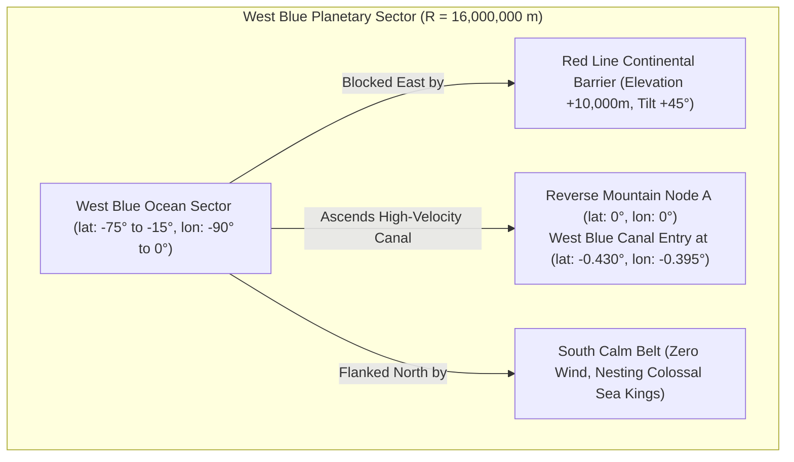
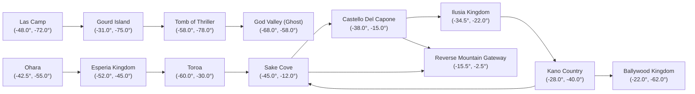
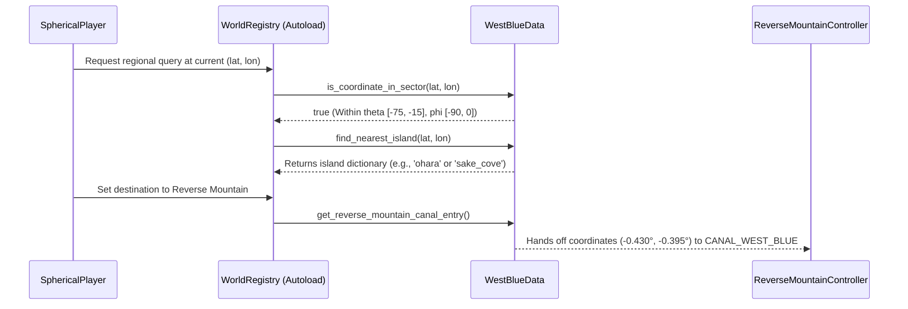

# West Blue Master Wiki Atlas: The Underworld, The Scholars & The Great Red Wall


> [!IMPORTANT]
> **Planetary Geodesic Coordinate Bounds:**
> * **Latitude Range ($\theta$):** $[-75.0^\circ, -15.0^\circ]$ (Southern Hemisphere, West of the Red Line)
> * **Longitude Range ($\phi$):** $[-90.0^\circ, 0.0^\circ]$ (Western Quadrant, converging east into Reverse Mountain Node A)
> * **Planetary Radius ($R$):** $16,000,000.0\text{ meters}$ ($16,000\text{ km}$, 64-bit IEEE 754 float precision)
> * **Equatorial Circumference ($2\pi R$):** $\approx 100,530,965\text{ meters}$ ($100,531\text{ km}$)
> * **Engine Coordinate Standards:** Godot 4.3+ compiled with `precision=double`. 1 unit = 1 meter. Player height = 2.0m.

---

## 1. Executive Summary & Ocean Geographic Architecture

The **West Blue** (西の海, *Nishi no Umi*) is one of the four regular cardinal oceans of the One Piece world. Geographically bounded by the massive 10,000-meter wall of the **Red Line** to the east and the perilous **South Calm Belt** to the north, the West Blue is celebrated across history for its stark contrasts: towering sovereign kingdoms, ancient archaeological sanctuaries, centuries of refined instrument making and fencing traditions, and a ruthless criminal underworld dominated by the notorious **Five Families of the West** (*Nishi no Godai Toubatsu*).



### Key Pillars of the West Blue
1. **The Underworld Hegemony (The Five Families of the West):** Unlike the scattered pirate crews of East Blue, the organized crime syndicates of West Blue operate like modern industrial mafias. Headed for years by **Capone "Gang" Bege** before his departure for the Grand Line, the Five Families run fortified iron strongholds, tommy-gun manufacturing, protection rackets, and black-market arms exchanges connecting directly to New World brokers.
2. **Archaeological Ruins & The Void Century (Ohara):** The homeland of Nico Robin and the martyred archaeologists of the **Tree of Knowledge**. Destroyed 22 years ago by a catastrophic World Government **Buster Call**, Ohara remains a tragic, forbidden exclusion zone where salvaged tomes and Poneglyph ciphers still linger beneath the waters of the sunken lake.
3. **Imperial Martial Nations (Kano Country & Happo Navy):** The sovereign empire of **Kano Country** (*Flower Country*), ruled by King Ramen, harbors the legendary **Happo Navy** led by **Don Chinjao** and **Don Sai**. Kano is famed for its mastery of **Hasshoken** (Eight Impacts Fist), vibrational shockwave martial arts that bypass conventional armor, and its armored dragon-prow ramming warships.
4. **Artisan Music & Fencing Convoys (Esperia & Toroa):** The birthplace of **Brook** (Esperia Kingdom) and **Byron** (Toroa). Renowned for producing the world's most resonant spruce violins, concealed cane-swords (*shikomizue*), and maritime acoustic flutes capable of pacifying oceanic megafauna.
5. **Historical Voids & Ghost Coordinates (God Valley & Thriller Bark Origin):** The erased atoll of **God Valley**, site of the cataclysmic conflict 38 years ago between Rocks D. Xebec, Gol D. Roger, Monkey D. Garp, and the Celestial Dragons; and the colossal ocean excavation caldera where **Gecko Moria** cut out the landmass of Thriller Bark to create the world's largest pirate ship.
6. **The Red Wall Threshold (Reverse Mountain Gateway):** The fast-flowing convergent currents where all West Blue shipping funnels into the 400-meter-wide **West Blue Ascending Canal** at `(lat: -0.430°, lon: -0.395°)`, shooting ships upward 5,000 meters to the summit basin of Reverse Mountain.

---

## 2. Exhaustive Island & Settlement Compendium



---

### 2.1. Ohara (オハラ) — The Fallen Tree of Knowledge

* **Spherical Coordinates:** $\theta = -42.500^\circ\text{ S}$, $\phi = -55.000^\circ\text{ W}$, Elevation $= 0.0\text{ m}$
* **Cartesian World Coordinates ($R = 16,000,000\text{ m}$):** $X \approx +6,765,491.5\text{ m}$, $Y \approx -10,809,380.2\text{ m}$, $Z \approx -9,662,154.8\text{ m}$
* **Climate & Biome:** Cool temperate maritime, perpetual coastal sea mists, scorched basalt crater, deep crater lagoon (Lake of Knowledge), ancient subalpine forest perimeter.
* **Danger Level:** **7 / 10** (World Government Absolute Quarantine; Cipher Pol surveillance snails & sniper patrols).
* **Governance / Affiliation:** Extinct Sovereign Academic Council; currently designated an uninhabitable World Government Exclusion Zone.

#### Overview & History
Ohara was once renowned as the world's preeminent center of archaeology, historical linguistics, and natural history. Its center was crowned by the majestic **Tree of Knowledge**, an ancient tree over 5,000 years old whose hollowed trunk housed the largest library on the planet. Twenty-two years ago, after Professor Clover and the scholars of Ohara succeeded in deciphering the Poneglyphs and deducing the existence of the Great Ancient Kingdom, the World Government dispatched CP9 Chief Spandine and authorized a catastrophic **Buster Call**. Ten Marine battleships pounded the island with high-explosive shells until the entire settlement was consumed in flames and the Tree of Knowledge collapsed.

During the bombardment, the scholars made a heroic final stand not with weapons, but by carrying armfuls of waterproof, wax-bound books and hurling them into the central lake to preserve human knowledge for future generations. Today, the charred 80-meter stump of the Tree of Knowledge still looms over the flooded circular crater. In secret, **Dr. Vegapunk** and **Monkey D. Dragon** visited this site shortly after the massacre, an emotional meeting that catalyzed Dragon's resolution to establish the Revolutionary Army.

#### Settlements, Ports & Establishments
* **The Great Tree Crater & Sunken Lake:** The 1.2-kilometer-wide blast crater filled with brackish sea water. The submerged root crevices still conceal ancient waterproof codices.
* **Smuggler's Research Encampment:** A camouflaged coastal bivouac tucked behind jagged sea stacks on the northern bluffs, operated by rogue archaeologists and salvage divers.
* **Ghost Bay Anchorage:** Submerged mooring rings located at `(lat: -42.485, lon: -54.980)`, depth 22m, sheltered from oceanic swells.
* **Smuggler's Research Camp (Shop):**
  * *Proprietor:* Aron the Ink-Stained (Antiquity Smuggler)
  * *Inventory:*
    * *Burned Library of Ohara Fragment* (85,000 ฿) — Charred leaf revealing ancient naval and architectural principles.
    * *Weathered Poneglyph Charcoal Rubbing* (250,000 ฿) — Authentic tracing of a historical stone cipher.
    * *Oharan Ancient Kingdom Linguistic Primer* (120,000 ฿) — Teaches ancient glyph comparative translation.
    * *Waterproof Antiquity Dive Lantern* (15,000 ฿) — Submersible whale-oil lantern burning down to 40 meters.
    * *Ohara Clover Leaf Tea* (1,200 ฿) — Restorative herbal infusion.
    * *Deep-Trench Dredging Hook* (24,000 ฿) — Triple-pronged claw with 100m high-tensile winch cable.
* **Cenotaph of Clover & The Martyrs:** A humble stone memorial hidden in the roots, raised in secret by Dragon and Vegapunk. Interacting with the memorial grants the player the **"Scholar's Tenacity"** buff (+25% translation speed for ancient tablets).

#### Key Canon & Archetype NPCs
* **Professor Clover (Legacy / Research Logs):** Chief Director of the Library of Ohara. His surviving encrypted field journals remain buried in the flooded root vaults.
* **Nico Olvia (Historical Testament):** Robin's mother and intrepid expedition leader who sacrificed her life to protect the Oharan archives.
* **Jaguar D. Saul (Giant Footprint & Ice Marker):** Former Marine Vice Admiral who befriended Nico Robin and defied World Government orders. Encased in Kuzan's "Ice Time Capsule", Saul survived and later organized Elbaf giants to salvage the books from the lake.
* **Aron the Ink-Stained (Archetype):** Clandestine antiquities diver willing to trade forbidden research fragments for cold Beli.
* **Watcher Kestrel (Cipher Pol Sentry Archetype):** Plainclothes marksman assigned to eliminate unauthorized visitors investigating the Void Century.

#### Exploration Hooks & Quests
* **Sunken Codices of the Lake of Knowledge:** Dive into the submerged root maze beneath the tree stump to recover an intact Void Century comparative grammar guide before Cipher Pol patrols detonate depth charges.
* **Cryogenic Traces of the Ice Time Capsule:** Survey the crystalline shoreline permafrost patch where Saul was frozen to uncover a preserved Giant Navy Log Fragment.

---

### 2.2. Kano Country (花ノ国 - Flower Country) — Empire of the Happo Navy

* **Spherical Coordinates:** $\theta = -28.000^\circ\text{ S}$, $\phi = -40.000^\circ\text{ W}$, Elevation $= 0.0\text{ m}$
* **Cartesian World Coordinates ($R = 16,000,000\text{ m}$):** $X \approx +10,816,589.4\text{ m}$, $Y \approx -7,511,634.3\text{ m}$, $Z \approx -9,076,013.9\text{ m}$
* **Climate & Biome:** Subtropical continental; winding jade rivers, terraced lotus plantations, karst limestone pinnacles, grand tiered vermilion pagodas.
* **Danger Level:** **6 / 10** (Heavy imperial naval patrols, Hasshoken martial masters).
* **Governance / Affiliation:** Imperial Monarchy (World Government Member Nation), ruled by King Ramen. Seat of the Chinjao Family.

#### Overview & History
Kano Country is a powerful and cultured empire modeled after imperial and feudal China. Known internationally for its stunning pagodas, exquisite lotus silks, and potent baijiu spirits, Kano also wields immense military might through its numbered naval fleets, most famously the **Happo Navy (8th Navy)** led by the Chinjao Family. 

Kano's warriors practice **Hasshoken** (八衝拳, *Eight Impacts Fist*), a martial art that generates internal vibrational shockwaves capable of bypassing solid armor and shattering steel structures from within. Historically, Don Chinjao amassed a legendary fortune of over 100 billion Beli, which he sealed beneath the eternal frozen sheet of the **Jewel Ice Sheet (Gyokuryu)** using his drill-shaped head. After Vice Admiral Garp flattened Chinjao's drill 30 years ago, Chinjao could no longer access his vault, fueling decades of bitter hatred until Monkey D. Luffy restored the drill during the Corrida Colosseum tournament. Under the current 13th leader, **Don Sai**, the Happo Navy severed ties with corrupt underground warlords, married Baby 5, and pledged allegiance as the 3rd Ship of the **Straw Hat Grand Fleet**.

#### Settlements, Ports & Establishments
* **Joya Imperial Harbor & Citadel:** A tiered metropolitan port built around lotus canals, protected by vermilion water-gates and stone battlements.
* **Chinjao Family Grand Dojo & Armory:** Mountain redoubt where hundreds of Happo Navy disciples punch iron slabs and split granite boulders to train their Hasshoken shockwaves.
* **Happo Navy Imperial Naval Basin:** Depth 35m, equipped with heavy drydocks, jade-bronze ram foundries, and military provision silos.
* **Chinjao Grand Martial Bazaar (Shop):**
  * *Proprietor:* Don Chinjao & Master Zhou
  * *Inventory:*
    * *Eight Impacts Fist Secret Vibration Scroll* (180,000 ฿) — Teaches vibrational strike techniques that bypass physical armor.
    * *Reinforced Bisen Heavy Naginata* (95,000 ฿) — Heavy polearm engineered to conduct Hasshoken vibration waves.
    * *Happo Dragon-Prow Heavy Ramming Keel* (450,000 ฿) — Massive cast-iron and jade ship ram; triples ramming impact damage.
    * *Jewel Jade Imperial Bullion (5 kg)* (75,000 ฿) — Translucent emerald-green trade ingot.
    * *Kano Lotus Blossom Baijiu* (4,500 ฿) — 60-proof spirit; boosts unarmed damage by 20% for 5 minutes.
    * *Kano Multi-Stage Firework Rockets* (12,000 ฿) — Multi-stage incendiary and signal rockets.
    * *Kano Embroidered Silk Brigandine* (35,000 ฿) — Traditional riveted steel plate and embroidered silk armor.
* **Imperial Lotus Teahouse:** Diplomatic lounge serving *Steamed Peony Dumplings* (1,500 ฿) and *Kano Imperial Jasmine Tea Bricks* (3,200 ฿).

#### Key Canon & Archetype NPCs
* **Don Chinjao (The Drill):** 12th Leader of Happo Navy; bounty 542,000,000 ฿ in his prime. Grand master of Hasshoken and Conqueror's Haki.
* **Don Sai:** 13th Leader of Happo Navy; bounty 210,000,000 ฿. Commander of the 3rd Ship of the Straw Hat Grand Fleet. Master of the *Kiryukiriko* shockwave kick.
* **Boo:** Vice Leader of Happo Navy; wields twin battle-axes reinforced by Hasshoken defense barriers.
* **Baby 5:** Former Donquixote Family officer; married to Sai. Eater of the Arms-Arms Fruit (*Buki Buki no Mi*); transforms into Gatling cannons, anti-ship missiles, and sickle blades.
* **King Ramen:** Monarch of Kano Country who attended the Levely. Has a distinctive tall shaved head with an imperial Chinese dragon tattoo and Fu Manchu mustache.
* **Master Artisan Lu (Archetype):** Master shipwright specializing in forging cast-iron dragon battering rams.

#### Exploration Hooks & Quests
* **Trial of the Shattered Monolith:** Prove martial prowess to Don Chinjao by shattering a 5-meter reinforced granite obelisk using vibrational shockwave strikes.
* **Intercepting Joker's Ghost Arsenal:** Intercept and board a disguised New World cargo vessel smuggling illegal weapons manufactured by Doflamingo to rogue warlords on Kano's borders.

---

### 2.3. Ilusia Kingdom (イロシア王国) — The Spired Cathedrals & Diplomatic Parley

* **Spherical Coordinates:** $\theta = -34.500^\circ\text{ S}$, $\phi = -22.000^\circ\text{ W}$, Elevation $= 0.0\text{ m}$
* **Cartesian World Coordinates ($R = 16,000,000\text{ m}$):** $X \approx +12,231,540.2\text{ m}$, $Y \approx -9,062,568.8\text{ m}$, $Z \approx -4,941,855.1\text{ m}$
* **Climate & Biome:** Cool crisp maritime temperate; granite sea cliffs, Gothic cathedral spires, marble clocktowers, orderly vineyard terraces.
* **Danger Level:** **4 / 10** (Disciplined royal guard, strict customs inspections).
* **Governance / Affiliation:** Constitutional Monarchy (World Government Member Nation). Formerly ruled by Thalassa Lucas; currently governed by King Seki.

#### Overview & History
Ilusia is an aristocratic European-style maritime kingdom distinguished by its soaring Gothic spires and prestigious naval horology guilds. Eight years ago, during the Levely council in Mary Geoise, Ilusia's former monarch, **King Thalassa Lucas**, delivered an ominous speech warning his fellow world leaders of the gathering storm posed by **Monkey D. Dragon** and the Revolutionary Army. 

In recent years, the throne passed to **King Seki**, a vain and extravagant ruler who raised harsh taxes on the peasant and merchant classes to pay for lavish Levely retinues and celestial tributes. This fiscal oppression caused severe social unrest, transforming Ilusia into an active breeding ground for the **Revolutionary Army's West Forces** commanded by Morley.

#### Settlements, Ports & Establishments
* **Port Thalassa & Royal Promenade:** Grand coastal city paved with granite cobblestones, featuring soaring clocktowers and diplomatic chancelleries.
* **The Grand Fleur Royal Docks:** Depth 28m, capable of berthing triple-deck Royal Escort vessels; provides precision drydocks and chronometer calibration towers.
* **Gaston's Maritime Horology & Navigation (Shop):**
  * *Proprietor:* Master Horologist Gaston
  * *Inventory:*
    * *Ilusian Precision Navigational Chronometer* (80,000 ฿) — Precision marine chronometer for celestial-independent navigation.
    * *Ilusian Brass-Inlaid Royal Musket* (42,000 ฿) — Accurate rifled flintlock with gilded engraving.
    * *Ilusian Royal Fleur Reserve Wine* (6,500 ฿) — Crisp royal white wine.
    * *Ilusian Royal Guard Gilded Cuirass* (65,000 ฿) — High defense breastplate; boosts diplomatic charisma.
    * *Forged Levely Diplomatic Sea Pass* (150,000 ฿) — Counterfeit royal passport waiving naval inspections.
    * *Ilusian Salted Voyager Provisions (30 Days)* (5,000 ฿) — Long-life voyage rations for a crew of four.
* **The Golden Fleur Inn & Diplomatic Lounge:** Refined tavern where diplomatic attachés, merchants, and disguised revolutionaries mingle.

#### Key Canon & Archetype NPCs
* **Thalassa Lucas:** Former King of Ilusia. Wise elder statesman who foresaw Dragon's global revolutionary uprising.
* **King Seki:** Current monarch. Pompous, lavish, and arrogant; obsessive regarding royal tributes.
* **Marie of the Cobblestones (Archetype):** Clandestine Revolutionary Army courier operating through the cathedral catacombs.
* **Captain Valerie (Archetype):** Chief of the Ilusian Royal Carabineers; torn between loyalty to the crown and sympathy for the taxed citizenry.

#### Exploration Hooks & Quests
* **Smuggling the Freedom Pamphlets:** Coordinate with Marie to transport a movable-type printing press and revolutionary leaflets through the cathedral catacombs past King Seki's carabineers.

---

### 2.4. Ballywood Kingdom (バリウッド王国) — Empire of Meatpacking & Stovepipe Splendor

* **Spherical Coordinates:** $\theta = -22.000^\circ\text{ S}$, $\phi = -62.000^\circ\text{ W}$, Elevation $= 0.0\text{ m}$
* **Cartesian World Coordinates ($R = 16,000,000\text{ m}$):** $X \approx +6,964,289.8\text{ m}$, $Y \approx -5,993,607.7\text{ m}$, $Z \approx -13,099,033.4\text{ m}$
* **Climate & Biome:** Warm humid temperate, industrious coal-smoke haze; wide neo-classical marble avenues, brick smokehouse districts, gaslit Broadway theaters.
* **Danger Level:** **3 / 10** (Commercial police, heavy industrial trade traffic).
* **Governance / Affiliation:** Electoral Senate & Monarchy (World Government Member Nation), ruled by King Ham Burger.

#### Overview & History
Ballywood Kingdom is an exuberant satirical reflection of 19th-century American culture and commerce. Governed by **King Ham Burger**, an eccentric ruler designed after Abraham Lincoln and Uncle Sam (complete with a star-patterned stovepipe hat and boisterous political rhetoric), Ballywood serves as the industrial and entertainment powerhouse of West Blue. 

The kingdom's economy thrives on two pillars: the **Great Star-Spangled Meatpacking District**, which supplies long-life smoked provisions to navies and merchant fleets across the globe, and **Broadway Liberty Avenue**, home to theatrical revues, brass bands, and traveling vaudeville troupes. King Ham Burger served as the distinguished chairman of the recent Levely summit in Mary Geoise.

#### Settlements, Ports & Establishments
* **Liberty City & Theater District:** Grand metropolis packed with marble courthouses, Broadway-style theater marquees, and steam paddlewheel terminals.
* **The Great Star-Spangled Wharf:** Depth 24m, equipped with steam-powered gantry cranes, refrigerated meat lockers, and high-capacity coal bunkers.
* **Uncle Ham's Grand Smokehouse & Grill (Shop):**
  * *Proprietor:* Pitmaster Bob "Smokestack" Miller
  * *Inventory:*
    * *Ballywood Hickory-Smoked Prime Shank* (3,800 ฿) — Restores 100% character stamina and prevents hunger for 3 days.
    * *Ballywood Star-Spangled Stovepipe Top Hat* (18,000 ฿) — 40cm-tall silk top hat; boosts trade charisma.
    * *Ballywood Industrial Steam Whistle Horn* (22,000 ฿) — Dual-chamber steam whistle audible over 15 nautical miles.
    * *Broadway Stage Acoustic Micro-Horn* (45,000 ฿) — Gilded directional megaphone for shipboard commands.
    * *Ballywood Movable Type Printing Stamp Set* (14,000 ฿) — Typography blocks for news sheets and permits.
    * *High-Pressure Boiler Iron Rivets (Keg of 100)* (8,500 ฿) — Heavy industrial rivets for steam boilers and hull repairs.

#### Key Canon & Archetype NPCs
* **King Ham Burger:** Sovereign of Ballywood and Levely Council Chairman. Passionate orator of constitutional commerce and champion of smoked meats.
* **Madame Clara (Archetype):** Director of the Ballywood Revue; scouts musical and acrobatic talent across the West Blue.
* **Pitmaster Bob (Archetype):** Veteran butcher who supplies prime cured provisions to Grand Line bound expeditionary fleets.

#### Exploration Hooks & Quests
* **The Grand Ballywood Revue:** Perform an authentic West Blue sea shanty on the main stage of the Grand Opera House to win the coveted Golden Stovepipe Trophy and patron purse.

---

### 2.5. Esperia Kingdom (エスペリア王国) — Sanctuary of Luthiers & Fencing Convoys

* **Spherical Coordinates:** $\theta = -52.000^\circ\text{ S}$, $\phi = -45.000^\circ\text{ W}$, Elevation $= 0.0\text{ m}$
* **Cartesian World Coordinates ($R = 16,000,000\text{ m}$):** $X \approx +6,964,289.8\text{ m}$, $Y \approx -12,608,172.9\text{ m}$, $Z \approx -6,964,289.8\text{ m}$
* **Climate & Biome:** Cool subalpine maritime, morning fjord mists; dense resonant spruce and maple forests, watermill sawmills, cobblestone canal hamlets.
* **Danger Level:** **5 / 10** (Disciplined royal fencing patrols, steep mountain terrain).
* **Governance / Affiliation:** Constitutional Monarchy with autonomous Battle Convoy guilds.

#### Overview & History
Esperia Kingdom is the canonical homeland of **Brook**, the musician and swordsman of the Straw Hat Pirates. Over 52 years ago, prior to joining Captain Yorki's Rumbar Pirates, Brook served as the leader of the **Esperia Royal Battle Convoy**, commanding elite cavalry guards and mastering the traditional Esperian fencing discipline. 

Esperia is universally recognized as the world's greatest source of musical instrument craftsmanship. The high-altitude spruce and maple trees growing along its steep fjords produce wood with exceptional acoustic resonance, prized by master luthiers for violins, cellos, and concert guitars. The kingdom also gave birth to the classical thrusting sword art (*Requiem la Banderole*, *Gavotte Bond en Avant*) that Brook would later combine with his Soul King music.

#### Settlements, Ports & Establishments
* **Port Allegro & The Violin Guild:** A picturesque fjord town built around waterwheel sawmills, violin workshops, and riverside cafés.
* **The Royal Convoy Barracks:** Martial academy where Brook once trained, preserving swift thrusting sword katas and cane-sword fencing forms.
* **Golden Clef Harbor:** Depth 26m, sheltered fjord slips with fresh mountain spring water chutes and luthier timber storage.
* **Stradivari Luthier Guild Atelier (Shop):**
  * *Proprietor:* Grand Luthier Vivaldi
  * *Inventory:*
    * *Masterwork Esperian Spruce Violin & Bow* (110,000 ฿) — Flawlessly carved violin with brilliant acoustic resonance.
    * *Concealed Cane-Sword (Shikomizue Rapier)* (88,000 ฿) — Ultra-light, razor-sharp fencing blade concealed within a gentleman's walking stick.
    * *Esperian Aged Resonant Tone-Wood Planks* (32,000 ฿) — Ship cabin paneling that amplifies musical buff durations by 50%.
    * *Original West Blue Sheet Music of 'Binks' Sake'* (15,000 ฿) — Authentic score containing Rumbar harmonies.
    * *Esperian Minstrel Velvet Frock Coat* (24,000 ฿) — Purple velvet coat with hidden instrument pockets.
    * *Esperian Fencing Rosin & Blade Polish* (4,200 ฿) — Conditions violin bows and rapier grips.
* **Binks' Rest Minstrel Hall:** Coastal tavern celebrating Rumbar history; grants a 15% Morale & Sailing Speed buff when bards perform.

#### Key Canon & Archetype NPCs
* **Brook (Historical Memory):** Revered former commander of the Royal Battle Convoy whose portrait hangs in the officers' mess.
* **Grand Luthier Vivaldi (Archetype):** Master instrument maker who selects aged spruce logs by tapping the wood and listening to its pitch.
* **Swordsman Lemaire (Archetype):** Chief fencing instructor preserving the fencing katas that Brook took to the Grand Line.

#### Exploration Hooks & Quests
* **Harvesting the Singing Spruce:** Ascend into the foggy subalpine peaks to locate and fell a 300-year-old resonant spruce without fracturing its acoustic grain.

---

### 2.6. Toroa (トロア) — Haven of Flute Dynasties & Coastal Melodies

* **Spherical Coordinates:** $\theta = -60.000^\circ\text{ S}$, $\phi = -30.000^\circ\text{ W}$, Elevation $= 0.0\text{ m}$
* **Cartesian World Coordinates ($R = 16,000,000\text{ m}$):** $X \approx +6,928,203.2\text{ m}$, $Y \approx -13,856,406.5\text{ m}$, $Z \approx -4,000,000.0\text{ m}$
* **Climate & Biome:** Cool maritime Mediterranean, breezy coastal limestone cliffs, reed lagoons, tiered open-air marble amphitheatres.
* **Danger Level:** **4 / 10** (Organized guild militia; threat of underground press-gang slavers).
* **Governance / Affiliation:** Civic Council of Musical Guildmasters (World Government affiliated).

#### Overview & History
Toroa is the canonical birthplace of **Byron**, the pirate musician and flautist captured by slavers and auctioned for 4,000,000 Beli at the Human Auctioning House on Sabaody (Chapter 501). Toroa's cultural identity is rooted in its natural acoustics: the wind whistling through its porous limestone sea caves produces haunting, harmonic tones that sailors have used for centuries as an acoustic lighthouse. 

Toroa's families have passed down the art of flute carving and woodwind performance across dozens of generations. Tragically, this musical renown attracted the greed of the Five Families and Sabaody trafficking rings, who frequently attempt to abduct Toroa prodigies to sell as luxury slaves to corrupt World Nobles.

#### Settlements, Ports & Establishments
* **Toroa Haven:** Tiered coastal township built into limestone bluffs, centered around natural acoustic amphitheatres.
* **Silverwind Harbor:** Depth 20m, sheltered harbor basin with soundproofing drydock slips.
* **Silverwind Woodwind Atelier (Shop):**
  * *Proprietor:* Master Flautist Corren (Byron's Uncle)
  * *Inventory:*
    * *Silverwind Concert Flute (Beast-Calming)* (65,000 ฿) — Sterling silver flute that emits frequencies pacifying agitated marine beasts.
    * *Mother-of-Pearl Inlaid Sea Harp* (78,000 ฿) — Handcrafted harp strung with treated whale-gut chords.
    * *Toroa Traditional Reed-Pipes* (8,500 ฿) — Folk wind instrument producing sweet piping melodies.
    * *Toroa Acoustic Soundproofing Felt* (18,000 ฿) — Dense natural felt for soundproofing ship cabins and medical bays.
    * *Toroa Bell-Metal Tuning Fork* (3,500 ฿) — Precision bronze fork for harmonic instrument tuning.

#### Key Canon & Archetype NPCs
* **Byron (Legacy / Sabaody Rescue Hook):** Gifted pirate musician whose capture galvanized Toroa's resistance against Grand Line slavers.
* **Master Flautist Corren (Archetype):** Byron's uncle and senior woodwind craftsman; teaches players acoustic frequencies for calming marine life.

#### Exploration Hooks & Quests
* **Echo of the Island Whales:** Perform an acoustic wind harmony inside Toroa's tidal caves at peak high tide to summon a pod of migrating young Island Whales.

---

### 2.7. Las Camp / Lascamp (ラスキャンプ) — The Frontier Badlands & Post-War Warzone

* **Spherical Coordinates:** $\theta = -48.000^\circ\text{ S}$, $\phi = -72.000^\circ\text{ W}$, Elevation $= 0.0\text{ m}$
* **Cartesian World Coordinates ($R = 16,000,000\text{ m}$):** $X \approx +3,308,822.4\text{ m}$, $Y \approx -11,890,323.8\text{ m}$, $Z \approx -10,183,490.4\text{ m}$
* **Climate & Biome:** Arid scrubland, scorching desert heat-waves; towering red canyon mesas, dusty frontier shanty towns, palisade saloons.
* **Danger Level:** **8 / 10** (Active post-Marineford warzone, rookie pirate raiding mobs, besieged Marine garrison).
* **Governance / Affiliation:** Contested Frontier; formal Marine presence crumbling under pirate uprisings.

#### Overview & History
Las Camp is an arid frontier territory featured in Chapter 582 immediately following the Summit War of Marineford. When the global broadcast announced the deaths of Edward Newgate (Whitebeard) and Portgas D. Ace, pirate crews across the world launched coordinated uprisings to seize territory. In Las Camp, rookie crews and local outlaws stormed towns and attacked islands, overwhelming the local Marine garrison. 

The island features a rugged Western frontier aesthetic with dusty saloons, red rock canyon hideouts, black-powder munitions trading, and fast-draw pistol duels under the scorching sun.

#### Settlements, Ports & Establishments
* **Red Rock Basin & Outlaw Haven:** A sprawling frontier port surrounded by wooden palisades and iron watchtowers.
* **Dusty Anchor Anchorage:** Depth 18m, protected by heavy timber barriers and sandbagged artillery batteries.
* **The Red Mesas Cantina & Duelling Saloon (Shop):**
  * *Proprietor:* Rosa the Quick-Draw
  * *Inventory:*
    * *Las Camp Heavy Caliber Fast-Draw Revolver* (38,000 ฿) — Rugged six-shot frontier sidearm with devastating stopping power.
    * *Las Camp Dust Goggles & Weathered Poncho* (6,000 ฿) — Complete immunity to sandstorm blindness and sunburn.
    * *Las Camp Nitroglycerin Dynamite Sticks (Crate of 12)* (25,000 ฿) — High-explosive mining charges.
    * *Las Camp Agave Firewater* (2,200 ฿) — Potent spirit; reduces incoming damage by 15% for 3 minutes.
    * *Las Camp Reinforced Iron Riding Saddle* (14,000 ฿) — Heavy saddle for navigating rocky scree slopes.
    * *West Blue Outlaw Bounty Roster* (5,000 ฿) — Registry of active wanted outlaws and bounties.

#### Key Canon & Archetype NPCs
* **Sheriff Vance (Archetype):** Battered Marine garrison captain struggling to maintain order with a depleted squad of loyal Marines.
* **Rosa the Quick-Draw (Archetype):** Cantina mistress and underworld informant who knows the location of every hidden cache in the canyons.

#### Exploration Hooks & Quests
* **Siege of the Red Palisade:** Rally with Sheriff Vance to defend the frontier settlement from a 3-wave assault by rogue pirate raiding galleys.

---

### 2.8. Castello Del Capone (カポネ城塞島) — Iron Fort of the Five Families

* **Spherical Coordinates:** $\theta = -38.000^\circ\text{ S}$, $\phi = -15.000^\circ\text{ W}$, Elevation $= 0.0\text{ m}$
* **Cartesian World Coordinates ($R = 16,000,000\text{ m}$):** $X \approx +12,179,887.6\text{ m}$, $Y \approx -9,850,560.1\text{ m}$, $Z \approx -3,263,594.1\text{ m}$
* **Climate & Biome:** Rainy industrial maritime, coal-smoke smog, wet cobblestone alleys, black granite sea walls, subterranean speakeasies.
* **Danger Level:** **7 / 10** (Ruthless mafia hit squads, concealed artillery bastions, corrupt Marine collaborators).
* **Governance / Affiliation:** Underworld Syndicate Hegemony (**The Five Families of the West**).

#### Overview & History
Castello Del Capone is the undisputed historical headquarters of **Capone "Gang" Bege** and his **Fire Tank Syndicate** before he set sail for the Grand Line as one of the Eleven Supernovas. As detailed by Jinbe in Chapter 857, the West Blue underworld was dominated by five major crime syndicates known as the **Five Families of the West**. Bege distinguished himself through unbridled brutality: he derived immense pleasure from beheading the bosses of rival families, sitting back, and watching their organizations self-destruct in internal turf wars. When vengeful underlings assaulted Bege, his Castle-Castle Fruit (*Shiro Shiro no Mi*) allowed him to bunker inside his own iron body and slaughter attackers with miniature cannons and infantry.

Even after Bege's departure, the island remains the center of West Blue organized crime. Black granite fortresses bristling with rapid-fire tommy guns protect speakeasies, cigar lounges, money laundering vaults, and submarine berths that ship contraband directly to Doflamingo's underworld brokers.

#### Settlements, Ports & Establishments
* **Fortezza Capone & Speakeasy Quarter:** An ironclad fortress metropolis featuring retractable bridges, iron gun-ports, and hidden basement tunnels.
* **Nostra Castello Submerged Mooring:** Depth 32m, capable of berthing armored amphibious ships and smuggling submersibles.
* **The Godfather's Speakeasy & Arsenal (Shop):**
  * *Proprietor:* Underboss Don Vincenzo
  * *Inventory:*
    * *Tommy-Gun Rapid-Fire Submachine Flintlock* (95,000 ฿) — 50-round drum magazine delivering rapid suppression volleys.
    * *Ballistic-Weave Pinstripe Mobster Suit* (75,000 ฿) — Tailored double-breasted suit woven with high-tensile steel fiber threads.
    * *West Blue Reserve Aged Cigar Box (25 Cigars)* (12,000 ฿) — Hand-rolled aged cigars favored by top syndicate underbosses.
    * *Concealed Wrist Dagger Sleeve* (28,000 ฿) — Spring-loaded forearm blade favored by mob assassins.
    * *Five Families Lead-Lined Contraband Sea Chest* (35,000 ฿) — Heavy lead chest concealing Devil Fruits and cargo from scans.
    * *Underworld Iron Fortress Blueprint Fragment* (180,000 ฿) — Schematics of Bege's fortress bulkheads and sluices.
    * *Forged Marine Transit Manifest* (50,000 ฿) — Counter-stamped customs pass bypassing boarding inspections.

#### Key Canon & Archetype NPCs
* **Capone "Gang" Bege (Legacy / Godfather of the West):** Former boss of the Five Families; captain of the Fire Tank Pirates (Bounty 350,000,000 ฿).
* **Vito "The Ghost Gun" (Legacy Echo):** Bege's eccentric hitman advisor obsessed with Germa 66.
* **Gotti (Legacy Echo):** Bege's machine-gun-armed cyborg demolitions enforcer.
* **Don Vincenzo (Archetype):** Regent commanding the Fire Tank holdings in West Blue; manages syndicate loans and arms sales.
* **Carmine Marchetti (Archetype):** Underboss of a rival family attempting to seize control of the Five Families council.

#### Exploration Hooks & Quests
* **Raid on the Marchetti Vault:** Infiltrate a rival mob family's fortified iron vault during a rainy midnight firefight to seize encrypted Devil Fruit research ledgers.

---

### 2.9. God Valley (ゴッドバレー) — Ghost Coordinates of the Erased Atoll

* **Spherical Coordinates:** $\theta = -68.000^\circ\text{ S}$, $\phi = -58.000^\circ\text{ W}$, Elevation $= 0.0\text{ m}$
* **Cartesian World Coordinates ($R = 16,000,000\text{ m}$):** $X \approx +3,176,146.4\text{ m}$, $Y \approx -14,834,942.2\text{ m}$, $Z \approx -5,082,903.9\text{ m}$
* **Climate & Biome:** Perpetual squall storms, boiling oceanic mists, razor-sharp submerged basalt spikes, deep circular oceanic abyss.
* **Danger Level:** **10 / 10** (Extreme magnetic voids, abyssal oceanic depths, supernatural echo apparitions).
* **Governance / Affiliation:** Erased from all official world maps; former sovereign territory wiped clean by the World Government.

#### Overview & History
God Valley is the most infamous historical location in West Blue. Thirty-eight years ago, the World Government annexed the island to serve as the venue for the World Nobles' triennial **Native Hunting Competition**, a barbaric tournament in which Celestial Dragons (including **Figarland Garling**) hunted native inhabitants and slaves for sport and Devil Fruit prize chests. 

The event exploded into legend when the **Rocks Pirates** (commanded by Rocks D. Xebec and featuring young Whitebeard, Big Mom, Kaido, and Shiki) attacked to claim the world's greatest treasures. In response, **Gol D. Roger** and Marine Vice Admiral **Monkey D. Garp** formed a historic alliance, clashing with Rocks in a cataclysmic battle that destroyed the Rocks Pirates. Following the incident, the entire island mysteriously vanished from the sea and was expunged from world cartography by the Five Elders. 

During the chaos, a young **Bartholomew Kuma**, Ginny, and Emporio Ivankov secured the Nikyu Nikyu no Mi and Uo Uo no Mi to escape, while Gol D. Roger found a one-year-old infant tucked inside a treasure chest: **Shanks**.

#### Settlements, Ports & Establishments
* **The Sunken Hunting Arena Reef:** Razor-sharp basalt spires piercing through stormy swells, marking the outer perimeter of the sunken island.
* **The Ghost Reef Mooring:** Depth 45m, natural tie-offs to submerged basalt needles with zero shore facilities.
* **Old Darrow's Reef Sanctuary (Shop):**
  * *Proprietor:* Hermit Darrow (Survivor of the Native Hunt)
  * *Inventory:*
    * *Carved Basalt Totem of God Valley* (500,000 ฿) — Priceless relic crafted by the vanished native people.
    * *Celestial Dragon Native Hunting Gold Medal* (300,000 ฿) — Solid gold medallion awarded during the 38-year-old hunt.
    * *Weathered Cutlass Blade of the Rocks Pirates* (150,000 ฿) — Corroded high-carbon steel cutlass etched with a flaming skull.
    * *Abyssal Atmospheric Diving Helmet* (85,000 ฿) — Pressurized bronze diving helmet rated for depths exceeding 100 meters.
    * *Corrupted God Valley Magnetic Pose* (60,000 ฿) — Magnetic pose whose needle points toward vanished planetary cores.

#### Key Canon & Archetype NPCs
* **Rocks D. Xebec (Abyssal Echo):** Legendary captain of the Rocks Pirates who sought to overthrow the World Nobles and claim the Throne of the World.
* **Shanks (Birth Location Hook):** Found as an infant in a treasure chest by Roger 38 years ago on these very coordinates.
* **Hermit Darrow (Archetype):** Sole surviving native witness living in a coral cave on the reef rim, possessing forbidden knowledge of the Celestial Dragons' prize vaults.

#### Exploration Hooks & Quests
* **Diving the Sunken Hunting Pavilion:** Don the abyssal atmospheric diving suit and descend 150 meters into the drowned ruins to retrieve a gold-sealed Celestial Dragon prize chest before volcanic thermal vents erupt.

---

### 2.10. The Tomb of Thriller (スリラーの墓所) — Excavation Caldera of Thriller Bark

* **Spherical Coordinates:** $\theta = -58.000^\circ\text{ S}$, $\phi = -78.000^\circ\text{ W}$, Elevation $= 0.0\text{ m}$
* **Cartesian World Coordinates ($R = 16,000,000\text{ m}$):** $X \approx +1,762,900.5\text{ m}$, $Y \approx -13,568,690.8\text{ m}$, $Z \approx -8,294,008.2\text{ m}$
* **Climate & Biome:** Chilly ocean mist, gloomy drizzle; circular deepwater caldera trench, jagged perimeter ring islands, gothic cemetery ruins.
* **Danger Level:** **6 / 10** (Ghostly fog, decaying crypts, plate-smashing specters).
* **Governance / Affiliation:** Deserted Ghost Territory; historical origin of Gecko Moria and Victoria Cindry.

#### Overview & History
The Tomb of Thriller is the monumental oceanic void left behind when **Gecko Moria** physically carved out an entire island in West Blue, fortified its bedrock with iron hull plating, and converted it into the world's largest pirate ship: **Thriller Bark**. 

The surviving perimeter ring of the island contains the abandoned seaside theater and grave of **Victoria Cindry**, the renowned West Blue stage actress who died tragically at age 24. Twelve years ago, **Dr. Hogback**, driven mad by grief and lust, raided Cindry's tomb, stole her corpse, and allied with Moria to reanimate her as a zombie servant implanted with the shadow of a woman who despised dinner plates. The island ring retains a spooky gothic atmosphere filled with weeping crypts, overgrown mausoleums, and abandoned laboratories.

#### Settlements, Ports & Establishments
* **Cindry's Shore & Theater Ruins:** Deserted seaside amphitheater where Cindry gave her final tragic performance before falling to her death.
* **Pale Fog Slip:** Depth 25m, creaking timber pier illuminated by spectral float-lanterns.
* **Pale Moon Mortuary & Apothecary (Shop):**
  * *Proprietor:* Igor the Undertaker
  * *Inventory:*
    * *Victoria Cindry Memorial Stage Poster (Vintage)* (25,000 ฿) — Rare original theatre poster.
    * *Dr. Hogback's Surgical Embalming Salve* (16,000 ฿) — Preservative unguent that halts biological decay.
    * *Ghost-Lantern of the Pale Sea* (45,000 ฿) — Chemical lantern that cuts through heavy sea fog and spectral mists.
    * *Victoria Cindry Ceramic Dinner Plate (Set of 10)* (500 ฿) — Ceramic plates that shatter into razor-sharp projectiles when thrown.
    * *Gothic Black Iron Candelabra* (4,800 ฿) — Wrought-iron relic salvaged from abandoned crypts.
    * *Thriller Bark Excavated Timber Splinter* (35,000 ฿) — Mineral-dense timber from the island ship's keel.

#### Key Canon & Archetype NPCs
* **Victoria Cindry (Legacy Echo):** Celebrated West Blue actress whose stolen corpse became Moria's zombie servant.
* **Gecko Moria (West Blue Origin Lore):** Former Warlord who sailed from this basin after excavating Thriller Bark.
* **Madame Beatrice (Archetype):** Cindry's former theater director who mourns her lost star.

#### Exploration Hooks & Quests
* **Secrets of the Desecrated Lab:** Explore flooded catacombs beneath the theater to retrieve Dr. Hogback's early surgical reanimation journals before tidal surges collapse the vaults.

---

### 2.11. Gourd Island (ヒョウタン島) — The Demon Sheriff's Bastion & Penitentiary

* **Spherical Coordinates:** $\theta = -31.000^\circ\text{ S}$, $\phi = -75.000^\circ\text{ W}$, Elevation $= 0.0\text{ m}$
* **Cartesian World Coordinates ($R = 16,000,000\text{ m}$):** $X \approx +3,549,425.4\text{ m}$, $Y \approx -8,240,635.4\text{ m}$, $Z \approx -13,246,750.8\text{ m}$
* **Climate & Biome:** Harsh salt-crusted gales, sheer granite sea-spurs; gourd-shaped double atolls linked by a fortified stone and iron causeway.
* **Danger Level:** **5 / 10** (Heavy Marine 88th Branch presence, maximum-security penal cell blocks).
* **Governance / Affiliation:** Military Penitentiary Zone (World Government Marine 88th Branch).

#### Overview & History
Gourd Island is a double-lobed island fortress shaped like a gourd, housing the World Government's primary regional penitentiary for West Blue. It is notoriously famous as the former jurisdiction of **Laffitte**, the "Demon Sheriff". Originally a peace officer entrusted with maintaining public order, Laffitte indulged in unspeakable violence, torture, and brutality against the civilian populace, prompting the World Government to strip his badge and exile him permanently from the West Blue. 

Following his expulsion, Laffitte joined Marshall D. Teach (Blackbeard), rising to become Chief of Staff and Captain of the Fifth Ship. Today, the fortress is commanded by Marine Commander Briggs, who enforces strict naval regulations while guarding hundreds of incarcerated Five Families gangsters.

#### Settlements, Ports & Establishments
* **Bastion 88 & Harbor Garrison:** Massive granite sea fortress spanning the narrow waist of the island.
* **Gourd Naval Quay:** Depth 22m, heavy iron naval gates with prisoner loading gantries.
* **Penal Colony Surplus Quartermaster (Shop):**
  * *Proprietor:* Quartermaster Briggs
  * *Inventory:*
    * *Demon Sheriff's Weighted Steel Cane* (55,000 ฿) — Heavy steel-reinforced walking stick balanced for rhythmic tap-dance parries.
    * *Marine Standard Seastone Handcuffs* (75,000 ฿) — Handcuffs tipped with Seastone alloy; nullifies Devil Fruit powers.
    * *Marine 88th Branch Police Baton* (8,000 ฿) — Solid hardwood baton with rubber-wrapped grip.
    * *Gourd Island Hardtack Biscuit Box* (800 ฿) — Weevil-impervious penal rations.
    * *Demon Sheriff's Hypnotic Pocket Watch* (32,000 ฿) — Silver watch with an eccentric spiral dial for hypnotic suggestion.

#### Key Canon & Archetype NPCs
* **Laffitte (Legacy of the Demon Sheriff):** Former West Blue peace officer turned Titanic Captain of the Blackbeard Pirates (Bounty 422,000,000 ฿).
* **Commander Briggs (Archetype):** Stern Marine warden determined to reform the 88th Branch and scrub away Laffitte's legacy of brutality.

#### Exploration Hooks & Quests
* **Subduing the Iron Block Riot:** Quell an armed riot organized by incarcerated Five Families capos attempting to breach the eastern seawall with smuggled dynamite.

---

### 2.12. Sake Cove & Cape Red-Hair (酒の入江 / 赤髪岬) — The Healing Brew

* **Spherical Coordinates:** $\theta = -45.000^\circ\text{ S}$, $\phi = -12.000^\circ\text{ W}$, Elevation $= 0.0\text{ m}$
* **Cartesian World Coordinates ($R = 16,000,000\text{ m}$):** $X \approx +11,066,359.4\text{ m}$, $Y \approx -11,313,708.5\text{ m}$, $Z \approx -2,352,246.3\text{ m}$
* **Climate & Biome:** Sunny mild Mediterranean maritime, gentle onshore sea breezes; sun-drenched terraced vineyards, white oak cooperages, golden sand coves.
* **Danger Level:** **2 / 10** (Peaceful cooperative haven, protected by the reputation of the Red-Hair Pirates).
* **Governance / Affiliation:** Free Brewer & Cooper Cooperative (Autonomous Haven).

#### Overview & History
Sake Cove is universally celebrated as the birthplace of the legendary **West Blue Sake** that Emperor **Shanks** brought as a peace offering to Edward Newgate (Whitebeard) aboard the Moby Dick in Chapter 434. Presenting a colossal red wooden calabash, Shanks smiled and declared: *"It's West Blue sake. Drink it. Healing water, so to speak."*

Nestled along sheltered golden sand coves beneath sunny sandstone hills, the island is blanketed with terraced grape and grain vineyards. Generations of master coopers and distillers age the liquor inside cavernous cellars carved into high sandstone cliffs. A single cup of authentic West Blue calabash sake cleanses fatigue, neutralizes maritime poisons, and elevates sailor morale to peak condition. Shanks personally left a signed Red-Hair pirate pennant in the highest cellar, ensuring no mob syndicate or corrupt Marine ever extorts the peaceful villagers.

#### Settlements, Ports & Establishments
* **Red Calabash Haven:** Picturesque harbor village surrounded by vineyards, cooperage slips, and outdoor tasting terraces.
* **Calabash Pier:** Depth 19m, fresh spring water chutes and oak barrel rolling ramps.
* **The Grand Calabash Brewery & Cooperage (Shop):**
  * *Proprietor:* Master Brewer Bacchus
  * *Inventory:*
    * *Grand Calabash of West Blue Sake ('Healing Water')* (12,500 ฿) — Cures all party status debuffs (poison, sickness, fatigue) and restores Morale to 100%.
    * *Vintage West Blue Red Wine (Oak-Aged 20 Years)* (8,000 ฿) — Full-bodied vintage wine; boosts health regeneration.
    * *Sake Cove Master Cooper Watertight Cask* (18,000 ฿) — Precision beeswax-lined barrel; keeps provisions fresh for 100 days.
    * *Red Felt Sailor's Bandana* (2,500 ฿) — Headscarf inspired by the Red-Hair Pirates.
    * *Terraced Vineyard Sweet Grape Cluster* (600 ฿) — Crisp sweet grapes for rapid hydration.

#### Key Canon & Archetype NPCs
* **Shanks (Echo of the Red-Hair Emperor):** Emperor of the Sea (Bounty 4,048,900,000 ฿) who named West Blue sake the finest "Healing Water" in the world.
* **Master Brewer Bacchus (Archetype):** Patriarch of the Calabash Cellars who oversees the aging of the sacred red calabashes.

#### Exploration Hooks & Quests
* **The Golden Harvest Vintage:** Climb high sandstone bluffs to gather pristine mineral water from mountain waterfalls to brew a special limited batch of "Healing Water" sake before tackling Reverse Mountain.

---

### 2.13. West Blue Reverse Mountain Gateway (リヴァース・マウンテン西海昇り口前哨)

* **Spherical Coordinates:** $\theta = -15.500^\circ\text{ S}$, $\phi = -2.500^\circ\text{ W}$, Elevation $= 0.0\text{ m}$
* **Cartesian World Coordinates ($R = 16,000,000\text{ m}$):** $X \approx +15,394,402.1\text{ m}$, $Y \approx -4,275,548.2\text{ m}$, $Z \approx -671,940.7\text{ m}$
* **Canal Entry Gate Target:** $\theta = -0.430^\circ\text{ S}$, $\phi = -0.395^\circ\text{ W}$ (Ascending into Reverse Mountain Summit Basin at $+5,000\text{ m}$)
* **Climate & Biome:** Violent storm squalls, towering sheer red cliffs of the Red Line (+10,000m), colossal granite beacon gate, high-velocity convergent rip-currents.
* **Danger Level:** **9 / 10** (Extreme current acceleration, fatal cliff collision risk).
* **Governance / Affiliation:** Free Maritime Staging Anchorage (Natural Great Circle Threshold).

#### Overview & History
The West Blue Gateway is the final maritime staging post in West Blue, located 163 km southwest of Reverse Mountain Node A. Here, the ocean undergoes a dramatic hydrographic transformation: four immense oceanic currents converge toward the Red Line, funneling into the 400-meter-wide **West Blue Ascending Canal**.

Aspiring crews moor their vessels to colossal iron chains bolted into the Red Line's outer basalt shelf. Shipwrights install reinforced rudder braces and double-linked steel steering chains, while experienced canal pilots instruct captains on how to align their ships with the twin stone beacon pillars. Ships that veer even three degrees off-center are pulverized against the sheer walls of the Red Line by currents that accelerate from 12 knots to over 65 knots in seconds.

#### Settlements, Ports & Establishments
* **The Last Hope Staging Mooring:** Floating cluster of iron repair barges moored directly to the Red Line shelf.
* **Staging Buoy Basin:** Depth 85m, equipped with mooring winches, lighthouse guidance beacons, and rudder alignment slips.
* **The Last Hope Hullwrights & Saloon (Shop):**
  * *Proprietor:* Shipwright Tsuru & Pilot Gregory
  * *Inventory:*
    * *Reverse Mountain High-Tensile Rudder Chains* (65,000 ฿) — Heavy forged chains bracing the rudder against 65-knot rapids.
    * *Reverse Mountain Hydrodynamic Current Chart* (35,000 ฿) — Bathymetric chart detailing rip-current alignment into the canal.
    * *High-Luminance Emergency Flare Gun* (12,000 ฿) — Fires magnesium flares for rescue during storm squalls.
    * *Heavy Forged Iron Mooring Harpoon* (22,000 ฿) — Harpoon and anchor cable for securing to sheer basalt cliffs.
    * *The 'Last Blue Pint' Farewell Ale* (800 ฿) — Dark ale served to sailors about to enter the Grand Line.

#### Key Archetype NPCs
* **Lighthouse Pilot Gregory (Archetype):** Veteran navigator who shouts final steering corrections through storm megaphones to ascending ships.
* **Master Carpenter Tsuru (Archetype):** Rudder specialist who reinforces ship tillers with double-linked steel braces.

#### Exploration Hooks & Quests
* **The 5,000-Meter Hydraulic Ascent:** Align your vessel between the stone beacon gates, trim canvas to match the surging West Blue current, and maintain absolute center rudder through the canyon rapids to reach Reverse Mountain's summit basin without breaking your steering gear.

---

## 3. Master Oceanic Navigation & Trade Routes

| Route ID & Name | Type | Key Waypoints & Stops | Total Distance | Hazard Rating | Prevailing Winds & Conditions |
| :--- | :--- | :--- | :--- | :--- | :--- |
| **`route_scholars_trail`**<br>The Scholar's & Minstrel's Trail | Cultural & Historical Voyage | Ohara $\rightarrow$ Esperia $\rightarrow$ Toroa $\rightarrow$ Sake Cove | $14,200\text{ km}$ | **Moderate** | SSW $15\text{–}20\text{ kts}$. Patrolled by Cipher Pol sentries and slaver cutters. |
| **`route_five_families_run`**<br>The Five Families Underworld Run | Crime Syndicate Highway | Castello Del Capone $\rightarrow$ Ilusia $\rightarrow$ Kano $\rightarrow$ Ballywood | $16,800\text{ km}$ | **High** | NNW $18\text{–}25\text{ kts}$. Contested by mob gunboats, turf wars, and naval customs. |
| **`route_outlaw_frontier`**<br>The Outlaw Frontier & Ghost Reef Run | Warzone & Deep Abyss Exploration | Las Camp $\rightarrow$ Gourd Island $\rightarrow$ Tomb of Thriller $\rightarrow$ God Valley | $18,500\text{ km}$ | **Extreme** | Unpredictable Storms $25\text{–}40\text{ kts}$. Pirate riots, penal garrisons, magnetic dead-zones. |
| **`route_martial_convoy`**<br>The Happo Martial Shipping Convoy | Heavy Naval Transport | Kano Country $\rightarrow$ Sake Cove $\rightarrow$ Castello Del Capone | $9,400\text{ km}$ | **Moderate-High** | Easterly Trades $20\text{ kts}$. Armored Happo convoys transporting jade and dragon rams. |
| **`route_reverse_mountain_ascent`**<br>The Grand Line Ascent Highway | Final Convergence Route | Sake Cove & Castello Del Capone $\rightarrow$ Reverse Mountain Gateway | $8,200\text{ km}$ | **Extreme** | Updraft Squalls $35\text{–}50\text{ kts}$. Convergent rip-currents pulling into the Red Line canal. |

---

## 4. Master Item, Weapon & Equipment Catalog

### 4.1. Consumables & Voyager Provisions
| Item ID | Item Name | Category | Price (฿) | Weight (kg) | In-Game Gameplay Effects |
| :--- | :--- | :--- | :--- | :--- | :--- |
| `west_blue_calabash_sake` | Grand Calabash of West Blue Sake | Consumable | 12,500 | 5.0 | Instantly cures all party debuffs (poison, sickness, fatigue); restores Morale to 100%. |
| `ballywood_smoked_shank` | Ballywood Smoked Prime Shank | Consumable | 3,800 | 4.5 | Restores 100% character stamina; grants 3 days hunger immunity. |
| `kano_lotus_baijiu` | Kano Lotus Blossom Baijiu | Consumable | 4,500 | 1.2 | Boosts unarmed strike damage by +20% for 5 minutes. |
| `ohara_clover_tea` | Ohara Clover Leaf Tea | Consumable | 1,200 | 0.3 | Herbal infusion; improves research focus and reading speed. |
| `las_camp_firewater` | Las Camp Agave Firewater | Consumable | 2,200 | 1.0 | Numbs pain; reduces incoming damage by 15% for 3 minutes. |
| `salted_provisions_30d` | Ilusian Salted Provisions (30 Days) | Consumable | 5,000 | 25.0 | Feeds a crew of four for an entire month at sea. |
| `terraced_sweet_grapes` | Terraced Sweet Grape Cluster | Consumable | 600 | 0.8 | Quick thirst replenishment and hydration boost. |
| `penal_hard_bread` | Gourd Island Hardtack Box | Consumable | 800 | 6.0 | Hard-baked biscuits impervious to weevils and sea water. |
| `last_blue_pint_ale` | The 'Last Blue Pint' Farewell Ale | Consumable | 800 | 0.7 | Heavy dark ale; bestows temporary courage buff. |
| `steamed_peony_dumplings` | Kano Steamed Peony Dumplings | Consumable | 1,500 | 0.8 | Dim sum dumplings; restores 35% stamina. |
| `imperial_jasmine_brick` | Kano Imperial Jasmine Tea Brick | Consumable | 3,200 | 1.0 | Yields 60 cups of restorative royal tea. |
| `vintage_west_wine` | Vintage West Blue Red Wine | Consumable | 8,000 | 1.6 | Oak-aged 20 years; boosts passive health regeneration. |
| `royal_fleur_wine` | Ilusian Royal Fleur Reserve Wine | Consumable | 6,500 | 1.4 | Crisp court white wine; favored by diplomats. |
| `embalming_salve` | Dr. Hogback's Embalming Salve | Consumable | 16,000 | 1.5 | Halts organic decay and mummifies organic specimens. |

### 4.2. Weapons & Martial Gear
| Item ID | Item Name | Category | Price (฿) | Weight (kg) | Combat & Tactical Characteristics |
| :--- | :--- | :--- | :--- | :--- | :--- |
| `tommy_gun_flintlock` | Tommy-Gun Submachine Flintlock | Weapon | 95,000 | 5.2 | 50-round drum magazine delivering rapid suppression volleys. |
| `reinforced_bisen_naginata` | Reinforced Bisen Heavy Naginata | Weapon | 95,000 | 7.5 | Heavy polearm; channels Hasshoken vibration shockwaves. |
| `concealed_cane_sword` | Concealed Cane-Sword (Shikomizue) | Weapon | 88,000 | 1.8 | Ultra-light rapier concealed in a walking cane; high critical rate. |
| `demon_sheriff_cane` | Demon Sheriff's Weighted Steel Cane | Weapon | 55,000 | 3.4 | Lead-weighted cane balanced for tap-dance parries and blunt impact. |
| `heavy_caliber_revolver` | Las Camp Fast-Draw Revolver | Weapon | 38,000 | 1.9 | Rugged six-shot frontier sidearm; heavy close-range stopping power. |
| `ilusia_brass_flintlock` | Ilusian Brass-Inlaid Royal Musket | Weapon | 42,000 | 4.1 | Accurate rifled flintlock with gilded engraving. |
| `police_baton` | Marine 88th Branch Police Baton | Weapon | 8,000 | 1.4 | Hardwood baton for non-lethal prisoner compliance. |
| `porcelain_dinner_plate` | Victoria Cindry Ceramic Dinner Plate | Weapon | 500 | 2.0 | Ceramic plates that shatter into razor-sharp shrapnel when thrown. |
| `nitroglycerin_dynamite` | Las Camp Dynamite Sticks (12) | Weapon | 25,000 | 8.0 | High-explosive mining charges; breaches stone ramparts and reefs. |
| `wrist_dagger_sleeve` | Concealed Wrist Dagger Sleeve | Weapon | 28,000 | 0.9 | Spring-loaded poisoned stiletto blade for sneak attacks. |
| `explosive_firework_rockets`| Kano Multi-Stage Firework Rockets | Weapon | 12,000 | 14.0 | Pyrotechnic rockets for incendiary bombardment of enemy rigging. |

### 4.3. Armor, Apparel & Ship Upgrades
| Item ID | Item Name | Category | Price (฿) | Weight (kg) | Utility & Defensive Functions |
| :--- | :--- | :--- | :--- | :--- | :--- |
| `pinstripe_ballistic_suit` | Ballistic-Weave Pinstripe Suit | Armor | 75,000 | 3.8 | Double-breasted mob suit woven with steel fiber threads; bullet resistant. |
| `padded_silk_brigandine` | Kano Embroidered Silk Brigandine | Armor | 35,000 | 6.2 | Overlapping steel plates riveted between heavy embroidered green silk. |
| `gilded_breastplate` | Ilusian Royal Guard Gilded Cuirass | Armor | 65,000 | 9.5 | High physical defense; increases diplomatic charisma. |
| `stovepipe_top_hat` | Ballywood Star-Spangled Top Hat | Apparel | 18,000 | 0.6 | 40cm-tall silk top hat; boosts trade barter pricing. |
| `minstrel_frock_coat` | Esperian Minstrel Velvet Frock Coat | Apparel | 24,000 | 2.1 | Expands inventory carrying capacity with hidden pockets. |
| `canyon_sand_goggles` | Las Camp Dust Goggles & Poncho | Apparel | 6,000 | 1.2 | Grants total immunity to sandstorm blindness and sunburn. |
| `red_felt_bandana` | Red Felt Sailor's Bandana | Apparel | 2,500 | 0.2 | Red-Hair Pirate tribute headscarf. |
| `happo_dragon_prow_keel` | Happo Navy Heavy Dragon-Prow | ShipUpgrade | 450,000 | 2,400.0 | Cast-iron and jade ram; triples ship collision damage. |
| `rudder_reinforcement_chains`| Reverse Mountain Rudder Chains | ShipUpgrade | 65,000 | 350.0 | Forged steel chains preventing rudder snap in canal rapids. |
| `watertight_cooper_cask` | Sake Cove Watertight Oak Cask | ShipUpgrade | 18,000 | 40.0 | Beeswax-lined barrel; prevents cargo spoiling for 100 days. |
| `resonant_tone_wood` | Esperian Resonant Tone-Wood Planks | ShipMaterial | 32,000 | 80.0 | Cabin paneling; amplifies musical buff durations by +50%. |
| `lead_lined_contraband_chest`| Five Families Lead-Lined Sea Chest | ShipStorage | 35,000 | 95.0 | Conceals Devil Fruits and cargo from Marine visual and Den Den scans. |
| `boiler_iron_rivets` | High-Pressure Boiler Iron Rivets | ShipMaterial | 8,500 | 35.0 | Heavy rivets for steam engine boilers and armored hull repair. |
| `thriller_timber_splinter` | Thriller Bark Timber Splinter | ShipMaterial | 35,000 | 5.0 | Ancient mineral-dense timber excavated from the caldera void. |

### 4.4. Antiquities, Instruments & Relics
| Item ID | Item Name | Category | Price (฿) | Weight (kg) | Lore Significance & Historical Effect |
| :--- | :--- | :--- | :--- | :--- | :--- |
| `burned_library_fragment` | Burned Library of Ohara Parchment | Antiquity | 85,000 | 0.4 | Rescued from the Tree of Knowledge flames; reveals ancient schematics. |
| `weathered_poneglyph_rubbing`| Weathered Poneglyph Rubbing | Antiquity | 250,000 | 0.5 | Charcoal tracing of a historical stone studied by Clover's guild. |
| `ancient_kingdom_lexicon` | Oharan Ancient Linguistic Primer | Book | 120,000 | 2.2 | Comparative grammar guide teaching ancient glyph translation. |
| `hasshoken_vibration_scroll` | Eight Impacts Fist Vibration Scroll | Book | 180,000 | 1.1 | Hand-annotated by Don Chinjao; teaches internal shockwave mechanics. |
| `binks_sake_sheet_music` | Original West Blue 'Binks' Sake' | SheetMusic | 15,000 | 0.2 | Authentic West Blue score with Rumbar Pirates' arrangements. |
| `ancient_native_totem` | Carved Basalt Totem of God Valley | Relic | 500,000 | 8.0 | Basalt artifact crafted by the vanished native people of God Valley. |
| `celestial_gold_medal` | Celestial Dragon Native Hunting Medal | Relic | 300,000 | 1.5 | Solid gold medallion awarded during the 38-year-old massacre. |
| `rocks_cutlass_fragment` | Rocks Pirates Weathered Cutlass | Relic | 150,000 | 2.8 | Steel saber blade dredged from God Valley with a flaming skull emblem. |
| `esperian_violin` | Masterwork Esperian Spruce Violin | Instrument | 110,000 | 1.2 | Flawlessly carved acoustic violin from aged Esperian spruce. |
| `silverwind_concert_flute` | Silverwind Concert Flute | Instrument | 65,000 | 0.8 | Tames and pacifies aggressive marine beasts and Island Whales. |
| `sea_harp` | Mother-of-Pearl Inlaid Sea Harp | Instrument | 78,000 | 6.5 | Coastal harp strung with treated whale gut; produces oceanic chords. |
| `toroa_reed_pipes` | Toroa Traditional Reed-Pipes | Instrument | 8,500 | 0.7 | Folk wind pipes producing sweet ocean wind melodies. |
| `corrupted_magnetic_pose` | Corrupted God Valley Magnetic Pose | Relic | 60,000 | 0.4 | Compass needle spins erratically toward severed planetary cores. |
| `seastone_handcuffs` | Marine Standard Seastone Handcuffs | Tool | 75,000 | 2.5 | Drains stamina and nullifies powers of Devil Fruit users. |
| `hypnotic_pocket_watch` | Demon Sheriff's Hypnotic Watch | Tool | 32,000 | 0.3 | Silver pocket watch with spiral face used by Laffitte for hypnosis. |
| `precision_chronometer` | Ilusian Precision Chronometer | NavigationalTool | 80,000 | 1.5 | High-accuracy spring-driven chronometer for longitude reckoning. |
| `reverse_mountain_current_chart`| Reverse Mountain Current Chart | NavigationalChart | 35,000 | 0.6 | Hydrodynamic survey chart detailing West Blue canal rip-currents. |

---

## 5. Engine Architecture & Integration Spec (`WestBlueData`)

The companion production data module `/Users/lin/Downloads/OnePieceBluePlanet/regions/west_blue_data.gd` provides native GDScript 4 data structures and 64-bit geodesic math routines for runtime instantiation.



### 5.1. Geodesic Conversion Accuracy at $R = 16,000,000\text{ m}$
Both `WestBlueData` and `ReverseMountainController` share identical coordinate mapping conventions:
```gdscript
static func spherical_to_world(lat_deg: float, lon_deg: float, alt_m: float = 0.0) -> Vector3:
	var lat_rad: float = deg_to_rad(lat_deg)
	var lon_rad: float = deg_to_rad(lon_deg)
	var cos_lat: float = cos(lat_rad)
	var dir: Vector3 = Vector3(
		cos_lat * cos(lon_rad),
		sin(lat_rad),
		cos_lat * sin(lon_rad)
	).normalized()
	return dir * (PLANET_RADIUS_M + alt_m)
```
* At $16,000\text{ km}$ distance from the origin $(0, 0, 0)$, Godot 4.3 double precision maintains sub-millimeter ($< 2\text{ nanometers}$) positioning stability.
* Great Circle surface distances are computed using the spherical Law of Haversines across the 16,000 km planetary radius.

### 5.2. Integration with Reverse Mountain Node A
* The West Blue approach current terminates at `west_blue_reverse_mountain_gateway` (`lat: -15.500`, `lon: -2.500`).
* At this waypoint, the player's navigation hud transitions to the **Reverse Mountain Up-Current Canal** target at `lat: -0.430, lon: -0.395`, matching `CANAL_WEST_BLUE` in `ReverseMountainController`.
* The `rudder_reinforcement_chains` purchased at the gateway reduce rudder impact damage by 80% when passing through the high-velocity winter rapids of Reverse Mountain.
